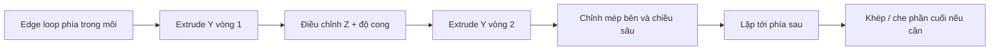

# Bài 02 — Dựng khoang miệng bằng Extrude và tách đối tượng để thao tác

**Mốc video:** 01:57–06:08  
**Sản phẩm:** Một mesh khoang miệng nối từ vòng cạnh môi vào sâu bên trong, có tên riêng trong Outliner.

## Mục tiêu

- Chọn chính xác vòng cạnh phía trong môi.
- Extrude từng lớp theo trục Y và hiệu chỉnh theo Z để tạo thể tích khoang miệng.
- Cô lập, tách, đổi tên và ẩn/hiện mesh để chuẩn bị dựng răng.

## 1. Chọn đúng vòng cạnh

1. Chọn `Head` và vào **Edit Mode** (`Tab`).
2. Chuyển **Edge Select** (`2` theo mặc định khi đang ở Edit Mode; không dùng Numpad 2).
3. Thử **Alt + nhấp** lên cạnh thuộc viền trong miệng để chọn edge loop.
4. Kiểm tra toàn bộ đường được chọn. Nếu Blender chọn một loop chạy vòng qua khuôn mặt thay vì đúng mép trong miệng, hãy bỏ chọn và tự chọn lại các đoạn cần thiết.
5. Chuyển qua góc chính diện/bên để kiểm tra cả đỉnh trước và đỉnh bị che.

> **Điểm quan trọng:** Các lệnh chọn loop phụ thuộc topology. Không áp dụng một cách máy móc khi vòng cạnh đã bị ngắt ở khóe môi hoặc có poles.

## 2. Extrude theo từng vòng

Với vòng cạnh phía trong môi đang chọn:

1. Nhấn `E` để **Extrude Region** rồi `Y` để khóa hướng dọc Y; kéo một đoạn ngắn vào phía trong (chiều âm/dương phụ thuộc hệ trục model).
2. Sử dụng `G Z` để điều chỉnh cao độ các vertex mới, hoặc `S Z` để **co/giãn biên độ trên-dưới**.
3. Ở góc nhìn bên, chỉnh từng nhóm vertex sao cho trần miệng cong lên, sàn miệng cong xuống.
4. Lặp lại các vòng extrude về phía trong, mỗi lần chỉnh độ rộng/chiều cao và độ cong.
5. Ở phía sau, thu hẹp dần hoặc khép/cap khoang miệng để **không để hở lỗ nhìn xuyên**.

**Vì sao cần chỉnh cạnh ở mỗi vòng?** Một vòng extrude thẳng dễ tạo khoang ống gấp khúc, gây các mặt dài và đường cong không tự nhiên. Nguồn video nhấn mạnh làm tròn và chỉnh vị trí thường xuyên để tránh sửa lỗi khó về sau.

## 3. Khi bị mesh đầu che khuất

- Chọn các mặt gây cản trở trong **Edit Mode** rồi nhấn `H` để ẩn tạm thời phần đang chọn.
- Cần phân biệt `H` trong Edit Mode (ẩn vertices/faces) và Object Mode (ẩn object).
- Dùng `Alt+H` trong đúng mode để đưa phần tử bị ẩn trở lại.
- Nên bật X-ray (`Alt+Z` theo keymap mặc định) khi cần chọn các vertex ở phía sau, sau đó tắt khi kiểm tra mặt ngoài.

## 4. Tách khoang miệng thành object độc lập

Sau khi hoàn thành các mặt cavity:

1. Trong Edit Mode, chọn một mặt thuộc cavity.
2. Chọn toàn bộ phần lưới cavity đang **liên thông** bằng `Ctrl+L` (Select Linked với một thành phần đã chọn) hoặc trỏ chuột lên phần cần chọn và nhấn `L`.
3. Kiểm tra vùng chọn: nếu cavity vẫn nối trực tiếp với môi thì `Select Linked` có thể chọn **cả đầu**. Khi đó phải giới hạn bằng cách ẩn các mặt khác hoặc chọn thủ công đúng vùng.
4. Nhấn `P` → **Selection** để tách thành đối tượng mới.
5. Trở về Object Mode, đổi tên đối tượng thành `Mouth_Cavity`.
6. Để tiện thao tác các bài sau, có thể ẩn đầu và chỉ để cavity hoặc các phần riêng lẻ.

> **Chú ý:** Đây là thao tác tách tạm để thuận tiện dựng hình. Khi nối lại bằng `Ctrl+J`, Blender chỉ hợp nhất **các object thành một object**, chưa tự động hàn các đỉnh trùng nhau. Bước hàn phải được kiểm tra sau.

## 5. Checklist chất lượng

- [ ] Vòng cạnh nối khởi đầu đúng viền trong môi.
- [ ] Các mặt cavity cong liên tục, không tự giao rõ rệt.
- [ ] Không nhìn xuyên qua đầu khi nhìn từ khoảng mở miệng.
- [ ] Đối tượng được đặt tên rõ ràng, có thể ẩn/hiện độc lập.
- [ ] Đã lưu `mouth_02_cavity.blend`.

## Lỗi thường gặp

| Triệu chứng | Nguyên nhân thường gặp | Cách xử lý |
|---|---|---|
| Loop lan ra cả đầu | Topology không tạo loop kín đúng ý | Chọn thủ công và kiểm tra góc nhìn khác |
| Extrude ngược ra trước | Chiều Y của model ngược giả định | Dùng dấu âm/dương phù hợp khi `E Y` |
| Vòm miệng thành ống thẳng | Không chỉnh `G Z`, `S Z` sau mỗi extrude | Thêm các vòng và hiệu chỉnh mặt cắt |
| Thấy xuyên qua phía sau | Cuối cavity còn hở | Khép geometry hoặc dùng mặt chắn phù hợp |
| `Ctrl+L` chọn cả đầu | Cavity vẫn liên thông với môi | Dùng lựa chọn giới hạn/ẩn tạm hoặc chọn thủ công |

**Chuyển bài:** [Bài 03 — Tạo nướu](03-tao-nuou-voi-torus-mirror-subdivision.md).
