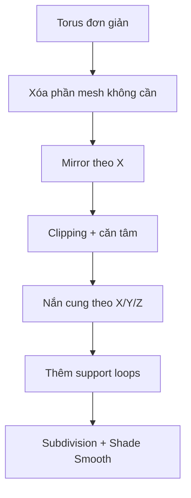

# Bài 03 — Tạo cung nướu với Torus, Mirror và Subdivision Surface

**Mốc video:** 06:08–09:25  
**Sản phẩm:** Cung nướu có độ cong, đối xứng theo trục X, đủ không gian để gắn răng.

## Mục tiêu

- Tận dụng torus làm hình học khởi đầu cho cung nướu.
- Hiểu quan hệ giữa **Mirror (X)**, **Clipping** và **Subdivision Surface**.
- Dùng support loops để giữ hình dáng khi làm mượt.

## 1. Khởi tạo từ torus

1. Tạm ẩn các bộ phận không cần thiết.
2. Trong **Object Mode**, dùng `Shift+A` → **Mesh → Torus**.
3. Trong bảng **Adjust Last Operation** (xuất hiện ngay sau khi thêm), đặt số phân đoạn phù hợp. Nguồn video dùng giá trị khoảng **12 segments** để thao tác gọn hơn; đây không phải thông số bắt buộc cho mọi model.
4. `Tab` vào Edit Mode, bật X-ray nếu phải chọn xuyên qua hình.
5. Xóa phần **phía sau**, một **nửa theo trục X**, rồi loại bớt **nửa dưới** của biên dạng, sao cho còn dải mesh cong cần thiết (hình dạng gần một phần tư torus theo cách cắt trong video).

**Tại sao làm như vậy?** Cung cong của torus giúp tiết kiệm việc tạo nhiều cạnh từ đầu. Chỉ giữ phần cần thiết để biến thành nướu, rồi dùng đối xứng tạo phần còn lại.

## 2. Thiết lập modifier

- Thêm **Mirror** trên trục `X` để có hai nửa cung nướu.
- Bật **Clipping** khi các vertex **tại đường giữa** phải khớp nhau; kết hợp **Merge** nếu muốn hàn biên đối xứng.
- Thêm **Subdivision Surface** để hiển thị mềm hơn.
- Thứ tự thông dụng trong giai đoạn này: `Mirror` trước, `Subdivision Surface` sau.

```text
Nửa mesh đang chỉnh sửa ── Mirror (X) ──> Cung nướu đối xứng
                     └── Subdivision ──> Bề mặt mềm, liên tục
```

## 3. Tạo dáng cung nướu

1. Chọn cạnh/cụm cạnh phía sau của dải, `G Y` để kéo dài về phía hàm sau.
2. `G X` để điều chỉnh độ mở ngang của cung (cung răng thường mở rộng dần về phía sau).
3. Dùng `Ctrl+R` thêm **loop cut** nhằm giữ các mép cần tương đối sắc khi Subdivision tác động.
4. Tại biên giữa, chọn cạnh cuối và sử dụng `E X` đưa mép về tâm X; dùng snapping/giá trị tọa độ để căn đúng `X = 0` khi cần.
5. Kiểm tra độ cao (`G Z`) sao cho nướu có tiết diện đủ dày để răng chìm phần chân vào, nhưng không tràn ra ngoài môi.
6. Bật/tắt tạm Subdivision để kiểm tra **cage mesh** và dạng hiển thị, sau đó **Shade Smooth**.

## 4. Thao tác và logic đối xứng

**Tránh nhầm lẫn:** Bật Clipping không có nghĩa mọi vertex sẽ bị khóa. Nó chủ yếu hạn chế các vertex ở vùng mặt phẳng mirror đi xuyên/tách khỏi mặt phẳng khi thao tác, đặc biệt khi đã khép vào đường giữa. Khi cần di chuyển các phần răng hoặc dải không nằm ở tâm, có thể phải tắt Clipping như hướng dẫn gốc — nhưng nhớ kiểm tra seam sau đó.



## 5. Bài tập

- [ ] Cung nướu bên trái và bên phải cân xứng.
- [ ] Ở chính giữa không có khe hở rõ rệt.
- [ ] Phía sau cung nướu mở rộng tự nhiên.
- [ ] Sau khi làm mượt, nướu vẫn giữ thể tích đủ để chứa chân răng.
- [ ] Đặt tên `Gum_Lower`; lưu `mouth_03_gum.blend`.

**Bổ sung:** Nhân vật stylized có thể dùng một dải nướu đơn giản và chủ động giảm polygon. Không nên đẩy số subdivision cao trong lúc dựng nếu chưa cần.

**Chuyển bài:** [Bài 04 — Răng hàm và răng tiền hàm](04-tao-rang-ham-va-rang-tien-ham.md).
