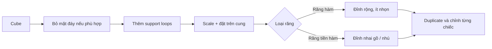

# Bài 04 — Dựng răng hàm và răng tiền hàm

**Mốc video:** 09:25–13:45  
**Sản phẩm:** Các nhóm răng phía sau được đặt lên cung nướu.

## Mục tiêu

- Phân biệt bốn nhóm răng bằng hình thể tương đối.
- Biến **cube** thành một răng low-poly, tăng độ mềm bằng subdivide/loop cuts.
- Nhân bản và điều chỉnh răng bằng `Shift+D`.

## 1. Hình thể răng cần nhớ

| Nhóm | Vị trí | Hình dạng đơn giản để dựng model |
|---|---|---|
| Răng cửa (*incisors*) | Phía trước | Bản rộng, mép cắn mỏng hoặc phẳng |
| Răng nanh (*canines*) | Sau răng cửa | Thân thuôn và có đỉnh nhọn nổi bật |
| Răng tiền hàm (*premolars*) | Giữa nanh và hàm | Khối tương đối dày, đỉnh nhai có gờ/nhú, chuyển tiếp từ nanh sang hàm |
| Răng hàm (*molars*) | Phía sau | Tán rộng và thân tương đối vuông, mặt nhai nhiều múi nếu cần chi tiết |

> Video chỉ mô hình hóa ở mức stylized đơn giản. Mô tả răng thật được rút gọn để giữ lượng hình học vừa phải.

## 2. Quy trình mẫu: dựng một răng hàm

1. `Shift+A` → **Mesh → Cube** (trong Edit Mode của nhóm răng hoặc một object riêng, tùy cách quản lý).
2. Xóa **mặt đáy** nếu phần chân răng bị nướu che và không có nhu cầu nhìn từ bên dưới. Đây là lựa chọn theo workflow gốc; không áp dụng khi cần mesh kín hoàn toàn.
3. Dùng `Ctrl+R` tạo **support loop** sát phần cần giữ dáng vuông.
4. Chọn toàn mesh, `S` thu nhỏ cho vừa cung nướu; `G X/Y/Z` đưa về vị trí răng hàm phía sau.
5. `R Z` xoay nhẹ để răng bám theo tiếp tuyến cung hàm.
6. Sử dụng **Subdivide** khi cần thêm geometry, điều chỉnh bốn mặt/cạnh để răng không quá tròn hoặc quá vuông.
7. `Shift+D` để nhân bản thành các răng hàm kế tiếp, **không đặt chồng vào nhau**; thay đổi nhẹ chiều rộng/chiều cao/rotation cho hợp lý.
8. Chỉnh nướu bao quanh phần chân răng để không nhìn thấy khe hở lớn.

> **Lưu ý:** Trong video mẫu, tác giả lắp **ba răng hàm** theo cách nhân bản. Con số này không phải quy định mô hình hóa bắt buộc cho mọi thiết kế nhân vật.

## 3. Dựng răng tiền hàm

1. Thêm cube mới và xóa mặt đáy theo kỹ thuật tương tự.
2. Thu nhỏ và đặt vào vị trí nằm giữa răng nanh (sẽ tạo ở bài sau) và răng hàm.
3. Chỉnh một cạnh/nhóm vertex ở mặt nhai lên cao để tạo cảm giác **nhú nhọn hơn răng hàm**.
4. Thêm một vòng cạnh gần vùng nhú để giữ chuyển tiếp không bị bo tròn quá mức khi dùng Subdivision.
5. Dùng **Subdivide** nếu cần, sau đó `Shift+D` tạo chiếc tiếp theo.
6. Kiểm tra khoảng cách; để lại không gian cho răng nanh và cửa ở phía trước.

## 4. Nguyên tắc đặt răng trên cung

- Chỉnh vị trí **từ nhìn trên xuống** để răng bám cung nướu, sau đó nhìn chính diện để chỉnh độ cao.
- Hướng thân răng nên **theo tiếp tuyến của cung** chứ không nhất thiết đều song song với trục Y.
- Các răng có thể hơi khác kích thước; tránh lặp máy móc nếu muốn tự nhiên.
- Răng nên chìm chân vừa đủ vào nướu, nhưng không để phần nướu bọc kín mặt nhai.
- Khi làm răng cho game, độ chi tiết mặt nhai phía sau cần phụ thuộc góc camera và khoảng cách nhìn.

## 5. Checklist và lỗi

- [ ] Có ít nhất một răng hàm và một răng tiền hàm nhận ra được hình thể.
- [ ] Không có răng lơ lửng phía trên nướu.
- [ ] Không có cặp răng chồng xuyên nghiêm trọng.
- [ ] Có thể quan sát đường cung răng hợp lý khi nhìn từ trên.
- [ ] Lưu `mouth_04_back_teeth.blend`.

| Lỗi | Gợi ý xử lý |
|---|---|
| Răng trở thành cục tròn | Thêm support loops, giảm subdivision lúc tạo dáng |
| Răng vuông sắc bất thường | Điều chỉnh loop support và làm mềm nhẹ các cạnh |
| Các răng bị dính khi bật Mirror Clipping | Kiểm tra chúng có đang bị ép vào seam X=0 không; tắt Clipping khi cần rồi bật lại |
| Không còn chỗ cho răng phía trước | Sắp xếp lại khoảng cách của molars/premolars trước khi tiếp tục |

**Chuyển bài:** [Bài 05 — Răng nanh, răng cửa và hàm trên](05-rang-nanh-rang-cua-va-ham-tren.md).
