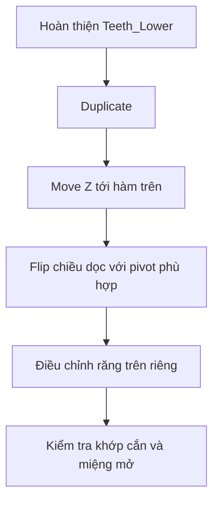

# Bài 05 — Tạo răng nanh, răng cửa và nhân bản cung răng trên

**Mốc video:** 13:45–18:04  
**Lưu ý nguồn:** Phần răng nanh và răng cửa ở video chủ yếu là **time-lapse**, nên các bước tạo dáng bên dưới được **bổ sung theo kỹ thuật nhất quán với các phần trước**, không phải bản chép nguyên văn.

## Mục tiêu

- Tạo khác biệt rõ giữa răng nanh và răng cửa.
- Hoàn thiện thứ tự nhóm răng từ trước ra sau.
- Tạo hàm trên từ một bản sao, đảo chiều dọc và tinh chỉnh riêng.

## 1. Dựng răng nanh (bổ sung thực hành)

1. Nhân bản một răng tiền hàm hoặc thêm cube mới.
2. Thu hẹp chiều rộng theo X, kéo dài tương đối theo Z để thân răng gọn hơn răng hàm.
3. Tạo đỉnh nhô tại mép cắn bằng cách chỉnh một hoặc một vài vertex, hoặc extrude vùng nhỏ phía trên.
4. Bổ sung các support loop cần thiết trước khi làm mượt để giữ đầu nanh.
5. Đặt ở vị trí chuyển tiếp sau răng cửa, trước răng tiền hàm.

> Không nên tạo “gai” quá dài và sắc ở nhân vật phong cách đời thường, trừ khi thiết kế yêu cầu.

## 2. Dựng răng cửa (bổ sung thực hành)

1. Thêm cube hoặc nhân bản một chiếc răng đã dựng rồi chỉnh lại.
2. Tạo thân răng có dạng **bản dẹt**, rộng theo chiều ngang cung răng hơn so với bề dày trước–sau.
3. Mép cắn tương đối phẳng hoặc bo rất nhẹ; **khác với đỉnh nhọn của nanh**.
4. Xếp các răng cửa ở vùng giữa cung hàm, đối xứng trái–phải qua mặt phẳng X=0.
5. Chỉnh khoảng hở giữa các răng theo phong cách nhân vật; không để seam giữa mặt bị dính ngoài ý muốn.

## 3. Hoàn thiện hàm dưới

- Khi nhìn chính diện, đường cắn nên tương đối nhất quán theo cung thiết kế.
- Khi nhìn từ trên, thứ tự khái quát:

```text
Trái: Hàm ← Tiền hàm ← Nanh ← Cửa  |  Cửa → Nanh → Tiền hàm → Hàm :Phải
                                   (đường giữa X=0)
```

- Tác giả nhấn mạnh không nên dành vô hạn thời gian cho phần răng hàm bị che khuất; ưu tiên tính hợp lý và mức chi tiết đủ cho cảnh quay.

## 4. Tạo cung răng trên từ cung răng dưới

**Thao tác thể hiện trong nguồn:**

1. Chọn cụm răng hàm dưới phù hợp; `Shift+D` để **Duplicate**.
2. `G Z` đưa bản sao lên vùng hàm trên.
3. Đảo chiều theo trục Z bằng `S Z -1` (áp dụng trong bối cảnh transform phù hợp để bản sao lật trên–dưới quanh pivot đang dùng).
4. Chỉnh lại độ rộng, vị trí, cao độ từng răng — không giữ hai hàm giống hệt nhau.
5. Đặc biệt, nguồn lưu ý **răng cửa trên thường rộng hơn răng cửa dưới** và vùng nanh cần khoảng cách khác.

**Bổ sung kỹ thuật:** Nếu scale âm trên Object Mode, hãy cân nhắc `Ctrl+A → Scale` và kiểm tra normals; nếu normals bị ngược, vào Edit Mode chọn tất cả rồi `Shift+N` để tính lại hướng pháp tuyến. Không áp dụng các bước “fix” này máy móc với mesh đang có rig hoặc modifier cần giữ transform.

## 5. Kiểm tra hình học khi lắp hai hàm



- Răng trên và dưới không được giao nhau ở tư thế nghỉ/mở dự kiến.
- Tư thế trung tính không cần mô phỏng nhai chính xác nếu chỉ dùng biểu cảm, nhưng cần tránh răng xuyên môi.
- **Bổ sung:** Trong rig facial, có thể đặt răng trên theo chuyển động đầu; răng dưới theo jaw bone để mở miệng hợp lý.

## Bài tập

- [ ] Nhìn hình thể có thể phân biệt nanh và cửa.
- [ ] Các nhóm răng được bố trí theo cung nướu.
- [ ] Đã có hai cung `Teeth_Upper` và `Teeth_Lower`.
- [ ] Có kiểm tra miệng mở và nhìn chính diện/bên/trên.
- [ ] Lưu `mouth_05_full_teeth.blend`.

**Chuyển bài:** [Bài 06 — Dựng lưỡi](06-dung-luoi-va-diem-xoay.md).
