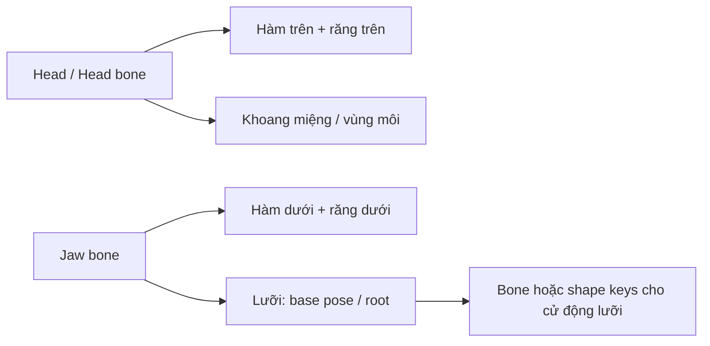

# Bài 07 — Lắp ráp khoang miệng, kiểm tra topology và chuẩn bị rig

**Mốc video:** 20:20–23:13  
**Sản phẩm:** Miệng có cavity, nướu/răng trên-dưới và lưỡi được sắp đúng tỷ lệ; phần cavity gắn lại với đầu.

## Mục tiêu

- Đưa các chi tiết vào đúng vị trí trong miệng nhân vật.
- Hiểu rõ giới hạn của `Ctrl+J` và **Merge by Distance**.
- Kiểm tra lỗi trước khi thêm material, rig và animation.

## 1. Ghép thử khi vẫn giữ các object độc lập

1. Hiện lại `Mouth_Cavity`, `Gum_Upper`, `Gum_Lower`, `Teeth_Upper`, `Teeth_Lower`, `Tongue`.
2. Nếu có transform thử nghiệm, dùng `Alt+R` trên object được chọn để xóa rotation **chỉ khi bạn thực sự muốn trả về rotation gốc**.
3. Chọn nhóm nướu, răng, lưỡi và điều chỉnh scale/vị trí sao cho vừa **phía trong** cavity.
4. Kiểm tra ba góc: chính diện, bên, trên; mở miệng thử nếu model có điều khiển hàm.
5. Hiện lại `Head` để xem các chi tiết thực tế qua khe miệng. Răng không bị môi che hoàn toàn và không xuyên qua da.

> **Quan trọng:** Nguồn có đoạn thu nhỏ cả cụm để đặt vào cavity. Nếu model được dựng ở kích thước thật ngay từ đầu, chỉ điều chỉnh vừa đủ; không phải lúc nào cũng cần scale lớn/nhỏ như trong video.

## 2. Nối lại cavity với head

Trong video, tác giả đưa phần mesh đã ẩn trở lại (`Alt+H` theo mode phù hợp), chọn cavity và đầu, rồi dùng `Ctrl+J` để kết hợp thành **một object**. Tiếp theo vào Edit Mode và dùng **Merge by Distance** dọc viền nối.

**Phân biệt ba thao tác:**

| Thao tác | Tác dụng | Điều không tự thực hiện |
|---|---|---|
| `Ctrl+J` (Join) | Gom nhiều mesh objects vào một object | Không tự hàn vertex trùng và không sửa seam |
| Merge by Distance | Gộp các vertex nằm trong khoảng ngưỡng | Không tự giải quyết lỗ hổng lớn hay loop không tương ứng |
| `Shift+N` (Recalculate Outside) | Tính lại normals theo topology | Không sửa các mặt tự giao/tô-pô sai |

**Cách thực hiện an toàn:**

1. Chỉ `Ctrl+J` khi đã kiểm tra phần cavity và đầu nằm đúng vị trí, đúng tỷ lệ.
2. Trong Edit Mode, **chọn riêng các vertex ở vùng nối** đầu–khoang miệng, không nhất thiết chọn toàn mesh.
3. Dùng **Mesh → Clean Up → Merge by Distance**, chọn ngưỡng nhỏ; kiểm tra số vertex thực sự được gộp.
4. Không dùng số đỉnh bị xóa trong video làm mục tiêu cố định. Nguồn có trường hợp xóa **13 vertex**; con số này phụ thuộc topology cụ thể.
5. Xem lại seam và normals. Nếu còn lỗ hở, cần bridge/điều chỉnh loop trước khi gộp.

## 3. Sơ đồ phụ thuộc để rig

> **Bổ sung:** Sơ đồ là khuyến nghị rig phổ biến, **không phải bộ rig được tạo trong video**. Để cho mở miệng thật, phải đảm bảo skinning phần da môi và má có trọng số hợp lý.

## 4. Danh sách kiểm tra trước khi chuyển pipeline

- [ ] Răng trên/dưới đặt đúng cung; mép cắn không xuyên môi.
- [ ] Cavity nối được với đầu hoặc ít nhất không thấy đường hở.
- [ ] Không nhìn xuyên đầu từ các góc camera thực tế.
- [ ] Không bị z-fighting ở vùng môi/cavity hay nướu/răng.
- [ ] Normals thống nhất, shading không bị mảng đen dị thường.
- [ ] Đã đặt tên object dễ hiểu và lưu phiên bản có thể sửa tiếp.
- [ ] Xác định phần nào sẽ theo head bone, jaw bone và tongue rig.

## 5. Bước tiếp theo (ngoài phạm vi video)

- Tạo **vật liệu**: trong miệng tối hơn mô bên ngoài; nướu hồng, lưỡi hồng đỏ, răng trắng ngà thay vì trắng tinh.
- Chuẩn bị UV/texture với mức độ chi tiết phù hợp cự ly quan sát.
- Đặt bones/weight cho hàm và mặt; thử các pose **mouth closed**, **mouth open**, **smile**, **talk**.
- Kiểm tra hiệu năng polycount, material slots và baking nếu nhân vật dùng trong game engine.

**Bài kết nối:** [Bài 08 — Dự án cuối khóa](08-bai-tap-du-an-kiem-tra-va-khac-phuc-loi.md).
