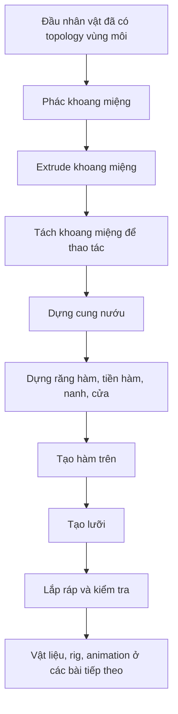

# KHÓA HỌC BLENDER: DỰNG KHOANG MIỆNG, NƯỚU, RĂNG VÀ LƯỠI CHO NHÂN VẬT 3D

> **Ngôn ngữ:** Tiếng Việt  
> **Nguồn biên soạn:** Bản chép lời hướng dẫn Blender dài khoảng **23 phút 13 giây**, do người học cung cấp.  
> **Đối tượng:** Người đã có mesh đầu nhân vật, miệng có vòng cạnh (edge loop) phù hợp để tiếp tục mô hình hóa.  
> **Kết quả:** Khoang miệng có chiều sâu, hai cung nướu/răng, lưỡi, bố cục tổ chức hợp lý để có thể tiếp tục làm vật liệu và rig.

## 1. Mục tiêu

Học xong, bạn có thể:

- Tạo **mouth cavity / mouth bag** bằng cách extrude vòng cạnh bên trong miệng.
- Thiết lập 2 góc nhìn giúp kiểm tra hình học từ chính diện và bên hông.
- Tạo cung **nướu** bắt đầu từ torus (hình xuyến), ứng dụng Mirror, Clipping và Subdivision Surface.
- Dựng hình răng **hàm, tiền hàm, nanh, cửa** bằng mô hình low-poly cơ bản, sau đó làm mượt.
- Nhân bản và điều chỉnh cung răng trên, mô hình hóa **lưỡi** từ plane + Solidify.
- Lắp ráp, đặt điểm xoay, dọn topology và kiểm tra mô hình với miệng mở.

## 2. Lộ trình học

| Bài | Nội dung | Vị trí trong video gốc | Sản phẩm |
|---|---|---|---|
| [01](01-chuan-bi-giai-phau-va-bo-cuc-khoang-mieng.md) | Chuẩn bị đầu nhân vật và phác khoang miệng | 00:00–01:56 | Đường phác trần/sàn khoang miệng |
| [02](02-tao-khoang-mieng-va-tach-object.md) | Extrude thành khoang miệng; tách object | 01:57–06:08 | `Mouth_Cavity` |
| [03](03-tao-nuou-voi-torus-mirror-subdivision.md) | Tạo nướu với torus, Mirror và Subdivision | 06:08–09:25 | Cung nướu đối xứng |
| [04](04-tao-rang-ham-va-rang-tien-ham.md) | Phân biệt hình thể răng, tạo răng hàm và tiền hàm | 09:25–13:45 | Nhóm răng phía sau |
| [05](05-rang-nanh-rang-cua-va-ham-tren.md) | Tạo răng nanh, răng cửa và nhân bản hàm trên | 13:45–18:04 | Hai cung răng |
| [06](06-dung-luoi-va-diem-xoay.md) | Dựng lưỡi với Solidify, tạo origin | 18:04–20:20 | Lưỡi có độ dày và pivot |
| [07](07-lap-rap-kiem-tra-topology-va-rig.md) | Đặt các bộ phận vào miệng, nối và kiểm tra | 20:20–23:13 | Mô hình miệng hoàn chỉnh |
| [08](08-bai-tap-du-an-kiem-tra-va-khac-phuc-loi.md) | Bài tập, rubric, mẹo tránh lỗi | Bổ sung sư phạm | Bài nộp cuối khóa |



## 3. Kiến thức và công cụ cần có

- **Blender** có chế độ Object Mode, Edit Mode, Vertex/Edge/Face Select; các modifier **Mirror**, **Subdivision Surface**, **Solidify**.
- Có sẵn một đầu nhân vật với vùng môi đã được dựng lưới; có thể chọn được **vòng cạnh mặt trong của miệng**. Nếu miệng chỉ là một đường vẽ trên texture thì cần tạo lại topology trước khi theo bài.
- Thao tác cơ bản: `Tab`, `E`, `G`, `S`, `R`, `Shift+A`, `Shift+D`, `Ctrl+R`, `P`, `Ctrl+J`.
- Nên lưu các mốc `mouth_01.blend`, `mouth_02.blend`... trước các bước xóa/ghép lưới.

## 4. Sơ đồ tổ chức đối tượng tham khảo

```text
Character
├── Head
│   └── (sau khi nối lại: Head + Mouth_Cavity)
└── Oral_Assembly
    ├── Gum_Lower
    ├── Teeth_Lower
    │   ├── Incisors / răng cửa
    │   ├── Canines / răng nanh
    │   ├── Premolars / răng tiền hàm
    │   └── Molars / răng hàm
    ├── Gum_Upper
    ├── Teeth_Upper
    └── Tongue
```

*Đây là cấu trúc khuyến nghị để quản lý model; video gốc có các bước đổi tên và gộp object, nhưng không mô tả chính xác toàn bộ cây Outliner này.*

## 5. Nguyên tắc dùng giáo trình

1. Mở bài theo thứ tự; thực hành trên **bản sao** của model đầu đang có.
2. Mỗi bài gồm mục tiêu, lý thuyết cốt lõi, thao tác chi tiết, kiểm tra, lỗi thường gặp và bài tập.
3. Thời gian trích từ video chỉ là **mốc tham chiếu**; thời lượng thực hành tùy trình độ.
4. Những chỗ có nhãn **“Bổ sung”** là giải thích/khuyến nghị biên tập, không khẳng định video đã hướng dẫn.
5. Shortcut được trình bày theo keymap Blender mặc định; nếu bản Blender hoặc keymap tùy biến khác, tìm lệnh tương đương trong menu/search.

## 6. Định hướng đầu ra game-ready (bổ sung)

- Cavity che được phần rỗng phía sau, không xuyên mesh môi, không tạo mặt tự giao rõ rệt.
- Nướu và răng được bố trí có tính đối xứng nhưng vẫn có thể chỉnh từng chiếc; mức độ chi tiết cần tương xứng cự ly camera.
- Hàm dưới có hướng xoay hợp lý; lưỡi còn khả năng biến dạng mà không đâm xuyên răng.
- Kiểm tra ở **rest pose** và **mouth-open test**, rồi mới chuyển sang UV, materials, rig, weights, shape keys.

## 7. Tài liệu nguồn và giới hạn

- **Nguồn chính:** `Pasted markdown(20261029-123511).md` (bản chép lời được cung cấp; bài dựng khoang miệng, răng, lưỡi của Sir Pinkbeard theo lời tự giới thiệu trong video).
- Bản chép lời tiếng Việt là kết quả nhận dạng/dịch lời nói, có lỗi như “túi ngậm” (mouth bag), “khuyên môi”, “kẹo cao su” (gums/nướu), “kim ngưu” (torus), “dây” (rigging). Thuật ngữ chuyên môn đã được chuẩn hóa theo ngữ cảnh và thao tác.
- Transcript **không có hình video** và một đoạn làm răng cửa/răng nanh diễn ra chủ yếu dưới dạng tua nhanh. Các bước chi tiết được cung cấp cho đoạn này là **hướng dẫn thực hành bổ sung**, không phải tường thuật nguyên văn.
- Không có dữ liệu để khẳng định file `.blend` cụ thể, hình tham chiếu hay thông số kích thước tuyệt đối; hãy điều chỉnh theo model của bạn.
