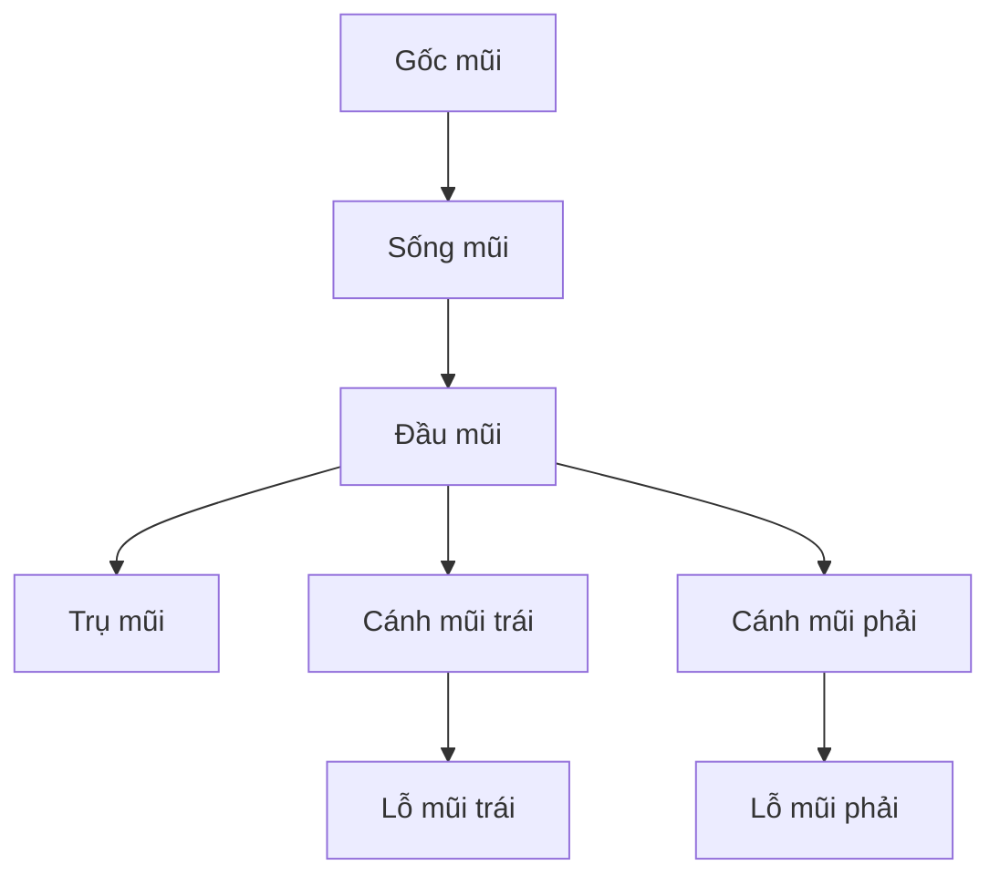

# Bài 01 — Chuẩn bị vùng điêu khắc và đọc hình khối mũi

**Thời lượng gợi ý:** 20–25 phút • **Mốc video:** 00:00–01:22 • **Mức độ:** Cơ bản

## 1. Mục tiêu

- Hiểu khác nhau giữa kéo **khối cơ sở** và tinh chỉnh **chi tiết**.
- Bảo vệ phần mắt đã tạo bằng Mask.
- Nhận diện các phần chính của mũi và ba góc kiểm tra bắt buộc.

## 2. Mũi không chỉ là một khối hình nón

Hãy bắt đầu từ các **khối hình học đơn giản**, sau đó hòa chúng vào khuôn mặt:

| Thành phần | Cách hiểu khi sculpt | Dấu hiệu quan sát |
|---|---|---|
| Gốc mũi (*radix*) | Nối vùng trán/gian mày với sống mũi | Chuyển khối mềm, không có đường cắt cứng |
| Sống mũi (*nasal bridge/dorsum*) | Khối chính kéo từ vùng giữa mắt xuống đầu mũi | Nhìn nghiêng thấy độ nhô; chính diện thấy các mặt phẳng sáng tối |
| Đầu mũi (*tip*) | Khối tròn/đa diện nhẹ ở phần cuối | Đọc rõ trong góc nghiêng và nhìn từ dưới |
| Cánh mũi (*alae*) | Hai khối hai bên đầu mũi | Tạo đường bao phía ngoài lỗ mũi |
| Trụ mũi (*columella*) | Mô ở giữa hai lỗ mũi | Quan sát tốt nhất ở góc nhìn từ dưới |
| Lỗ mũi (*nostrils/nares*) | Vùng lõm tối nằm dưới cánh và đầu mũi | Hai bên có thể hơi khác nhau một cách tự nhiên |

> **Chỉnh kiến thức:** Trong lời thoại có nhắc tới “cơ ở đầu mũi”. Khi điêu khắc bề mặt, nên hiểu đó là **khối mô mềm và sụn tạo hình đầu mũi**, không phải vẽ các bó cơ nổi như cơ tay hay cơ chân.

### Sơ đồ quan hệ các khối (mang tính khái niệm)

## 3. Chuẩn bị trong Blender

1. **Lưu bản sao** file chứa đầu đã dựng mắt trước khi chỉnh sửa vùng mũi.
2. Chọn đối tượng đầu → chuyển sang **Sculpt Mode**.
3. Kiểm tra mật độ mesh: nếu quá thưa, nét nhỏ không hiện được; nếu quá dày, Grab khó kiểm soát và Blender có thể chậm.
4. Trong video, người hướng dẫn đã dùng **Snake Hook** để kéo phần mũi ra từ mặt; đây là **bước dựng khối ban đầu**, không phải thao tác cần thực hiện lại nếu mũi đã nhô đúng tỷ lệ.
5. Khi cần thêm hình học cục bộ, cân nhắc **Dyntopo (Dynamic Topology)**; khi chỉ chỉnh khối trên mesh hiện có, có thể không cần Dyntopo.

### Dyntopo: dùng thế nào cho đúng?

- Khi bật Dyntopo, thao tác sculpt có thể **thay đổi topology**, giúp tạo chi tiết từ lưới còn thưa.
- Dyntopo không phải một loại shading; câu “Dino Turbo” trong bản chép lời là nhận dạng sai của **Dyntopo**.
- **[Bổ sung]** Kiểm tra chế độ làm việc, modifier và dữ liệu mesh trước khi bật Dyntopo; tránh bật một cách tùy tiện trên lưới nhân vật đã retopology/rig.
- Trong video có thao tác tắt hiển thị bề mặt mượt để nhìn sự thay đổi của hình học rõ hơn; không đồng nhất điều này với **Smooth Brush**.

## 4. Mask để bảo vệ vùng mắt

**Mốc video: 00:49–01:22**

1. Chọn **Mask Brush** khi đang ở Sculpt Mode.
2. Tô lên **mí mắt, khóe mắt và vùng lân cận** không muốn chỉnh sửa.
3. Kiểm tra rìa Mask ở vùng giữa mắt và gốc mũi: nếu che quá sát, gốc mũi sẽ bị “đóng băng”; nếu che quá ít, thao tác chỉnh mũi có thể tác động vào mắt.
4. Thử một nét Grab hoặc Clay nhẹ ở vùng được phép chỉnh, xác nhận mắt không biến dạng.
5. Chỉ xóa Mask **sau khi** đã hoàn thành khối chính và kiểm tra lại mắt.

Trong Blender 2.80 và 3.x, **`Alt+M`** được ghi trong tài liệu cho **Clear Mask**. Ở các bản mới, bạn vẫn có thể tìm **Mask → Clear Mask**. Dùng menu sẽ an toàn hơn khi keymap thay đổi.

## 5. Ba góc nhìn phải kiểm tra

| Góc nhìn | Cần kiểm tra |
|---|---|
| **Chính diện** (*Front*) | Bề rộng sống mũi, hai cánh mũi, độ cân xứng |
| **Nghiêng** (*Side*) | Độ nhô đầu mũi, chuyển tiếp từ trán, độ dốc sống mũi |
| **Từ dưới** (*Bottom/Underside*) | Hình dạng hai lỗ mũi, trụ mũi, độ dày viền cánh |

**[Bổ sung]** Có thể bật đối xứng X ở giai đoạn blockout nếu đầu đặt đúng trục; tắt đối xứng khi cần bất đối xứng nhỏ cho hiện thực. Không buộc mọi chiếc mũi phải cân xứng tuyệt đối.

## 6. Thực hành tại lớp

- Tạo một bản sao của đầu và tô Mask bảo vệ hai hốc mắt.
- Dùng Grab rất nhẹ đẩy sống mũi và đầu mũi; quay ba góc xem có ảnh hưởng đến mắt không.
- Lưu thành `nose_00_start.blend`.

### Câu hỏi kiểm tra

1. Vì sao cần Mask mắt trước khi điêu khắc mũi?  
   **Đáp án:** Để tránh chỉnh hình ngoài ý muốn lên vùng mắt đã hoàn thiện.
2. Dyntopo là công cụ làm bóng bề mặt hay thay đổi topology?  
   **Đáp án:** Thay đổi topology trong quá trình điêu khắc.
3. Góc nào dễ phát hiện lỗ mũi thiếu độ sâu?  
   **Đáp án:** Góc nhìn từ dưới, kết hợp góc nghiêng.
