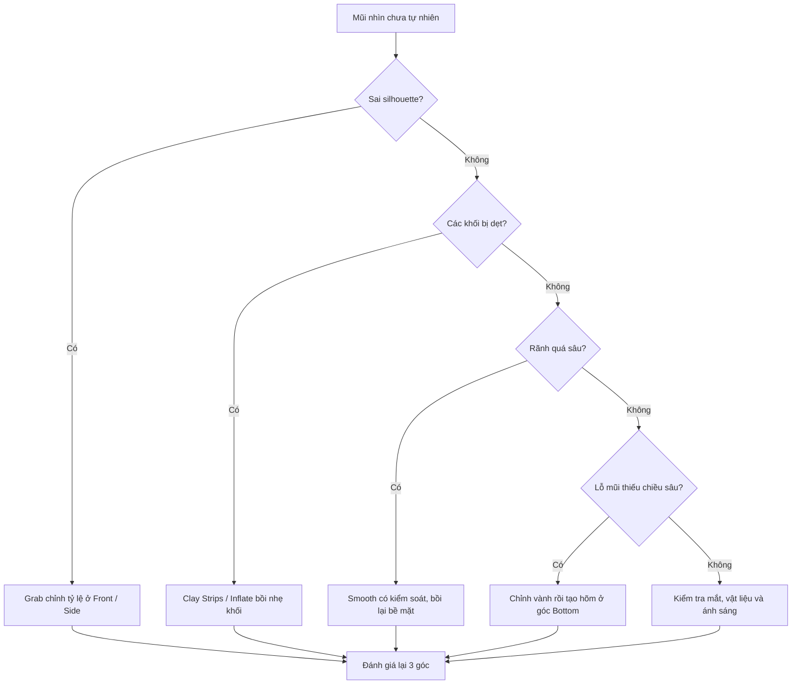

# Bài 05 — Bài tập tổng hợp, rubric và khắc phục lỗi

**Thời lượng gợi ý:** 35–60 phút • **Nội dung bổ sung ngoài video gốc**

## 1. Đề bài cuối khóa

Từ một mesh đầu có mắt đã hoàn thiện nhưng mũi còn cơ bản, hãy sculpt mũi theo **một** hình tham chiếu phù hợp. Mục tiêu là tạo 3 góc nhìn chính xác hơn, không chạy theo độ chi tiết tối đa.

### Sản phẩm cần nộp

1. File Blender cuối: `nose_03_final.blend`.
2. Ảnh trước/sau: cùng góc Front và Side.
3. Ba ảnh cuối: `nose_front.png`, `nose_side.png`, `nose_bottom.png`.
4. Ghi chú ngắn 100–150 chữ: công cụ đã dùng và hai khó khăn gặp phải.

## 2. Quy trình tự thực hành 30 phút

| Thời gian | Việc làm | Kiểm tra |
|---|---|---|
| 0–5 phút | Chuẩn bị model, tham chiếu, Mask mắt | Mắt được bảo vệ |
| 5–12 phút | Grab và Clay Strips dựng sống/đầu mũi | Silhouette ổn ở Front/Side |
| 12–20 phút | Blob/Inflate dựng cánh, tạo hõm lỗ mũi | 3 khối ở mặt dưới rõ |
| 20–25 phút | Grab chỉnh tỷ lệ, Crease nhẹ, Smooth | Không còn rãnh/cục thừa |
| 25–30 phút | Gỡ Mask, kiểm tra 3 góc, lưu | Ảnh chụp và file đúng |

## 3. Rubric đánh giá (100 điểm)

| Tiêu chí | Điểm tối đa | Dấu hiệu đạt điểm cao |
|---|---:|---|
| Silhouette & tỷ lệ | 30 | Tự nhiên ở góc nghiêng, chính diện không lệch |
| Khối đầu/cánh/trụ | 25 | Các khối có thể tích, nối vào má và môi trên hợp lý |
| Lỗ mũi | 20 | Vành có độ dày, hõm có chiều sâu, không thành chấm trang trí |
| Bề mặt | 15 | Không méo/gồ/vệt cọ, vẫn giữ mặt phẳng thiết yếu |
| Quy trình & lưu bài | 10 | Bảo vệ mắt, kiểm tra ba góc và có file/ảnh |

**Mức gợi ý:** 90–100 xuất sắc; 75–89 đạt tốt; 60–74 cần sửa; dưới 60 nên làm lại khối lớn trước khi tiếp tục chi tiết.

## 4. Sơ đồ xử lý lỗi



## 5. Trắc nghiệm tự đánh giá

**Câu 1.** Tại sao không nên bắt đầu từ lỗ mũi?  
**Đáp án:** Vì khối lớn (sống, đầu, cánh) quyết định vị trí và hình dạng hợp lý của lỗ mũi.

**Câu 2.** Cọ Blob chủ yếu có tác dụng gì?  
**Đáp án:** Làm khối phồng lên khi vẽ; không phải công cụ mặc định tạo lỗ xuyên qua bề mặt.

**Câu 3.** Khi mũi bị dẹt do Smooth quá tay, bước đầu cần làm gì?  
**Đáp án:** Khôi phục thể tích/silhouette bằng Grab hoặc Clay Strips rồi chỉ làm mịn vừa đủ.

**Câu 4.** Vì sao có thể chưa dùng Dyntopo ở giai đoạn cuối trên một model game-ready?  
**Đáp án:** Vì Dyntopo thay đổi topology; trong quy trình rig/retopology/UV đã có cấu trúc kiểm soát, cần cân nhắc kỹ trước khi chỉnh.

**Câu 5.** Khác biệt giữa hõm giả lập và lỗ mũi mở thật?  
**Đáp án:** Hõm chỉ là lõm trên bề mặt; lỗ mở thật có hình học cửa lỗ và mặt trong.

## 6. Tự đánh giá và ghi chép

```text
Model: ___________________________
Phong cách: bán hiện thực / stylized
Các cọ đã dùng: __________________
Điểm rubric: ______ / 100
Điểm chưa ổn khi nhìn từ dưới: ___________
Thay đổi sẽ thử ở lần sculpt tiếp: ________
```
