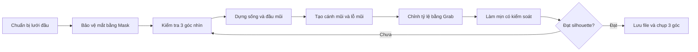

# Khóa học ngắn: Điêu khắc mũi chân thực trong Blender

> **Chủ đề:** Blender Sculpt Mode — xây dựng hình khối mũi, cánh mũi, lỗ mũi và hoàn thiện bề mặt.  
> **Ngôn ngữ:** Tiếng Việt; giữ tên công cụ tiếng Anh để dễ tìm trong Blender.  
> **Nguồn bài học:** Bản chép lời video khoảng 11 phút do người học cung cấp, hướng dẫn trên **Blender 2.8**.  
> **Mức độ:** Cơ bản → trung cấp đầu.  
> **Thời lượng học gợi ý:** 2–3 giờ, bao gồm luyện tập và so sánh góc nhìn.

## Bạn sẽ làm được gì?

Sau khóa học, bạn có thể:

1. Phân tích mũi thành **sống mũi, đầu mũi, cánh mũi, rãnh chuyển tiếp và lỗ mũi** thay vì khắc các chi tiết rời rạc.
2. Bảo vệ vùng mắt bằng **Mask** trong quá trình chỉnh mũi.
3. Dùng **Snake Hook, Grab, Clay Strips, Crease, Blob/Inflate và Smooth** theo đúng mục đích.
4. Kiểm tra hình thể từ **chính diện, nghiêng và nhìn từ dưới**, tránh một chiếc mũi chỉ đẹp ở một góc.
5. Biến đổi giữa phong cách **bán hiện thực** và **stylized**, không phá vỡ cấu trúc chung.

## Lộ trình học

| Thứ tự | Tệp bài học | Nội dung | Mốc video |
|---|---|---|---|
| 1 | [01-chuan-bi-va-giai-phau-hinh-khoi.md](01-chuan-bi-va-giai-phau-hinh-khoi.md) | Chuẩn bị lưới, Dyntopo, Mask, hiểu khối mũi | 00:00–01:22 |
| 2 | [02-dung-song-mui-va-dau-mui.md](02-dung-song-mui-va-dau-mui.md) | Dựng sống mũi, mặt phẳng và khối đầu mũi | 01:23–03:45 |
| 3 | [03-canh-mui-va-lo-mui.md](03-canh-mui-va-lo-mui.md) | Tạo cánh mũi, vành mũi và độ sâu lỗ mũi | 03:47–05:50 |
| 4 | [04-tinh-chinh-va-phong-cach.md](04-tinh-chinh-va-phong-cach.md) | Điều chỉnh mặt nghiêng, độ phồng, hòa chuyển khối | 06:00–10:58 |
| 5 | [05-thuc-hanh-kiem-tra-danh-gia.md](05-thuc-hanh-kiem-tra-danh-gia.md) | Bài tập tự luyện, kiểm tra kết quả, khắc phục lỗi | Thực hành mở rộng |
| 6 | [06-thuat-ngu-tai-lieu-tham-khao.md](06-thuat-ngu-tai-lieu-tham-khao.md) | Từ vựng song ngữ, đối chiếu thuật ngữ và tài liệu | Tham khảo |

## Sơ đồ quy trình

Nếu trình đọc Markdown không hỗ trợ Mermaid, hãy xem sơ đồ như một chuỗi bước theo mũi tên.

## Chuẩn bị

- Blender 2.8 để bám sát thao tác trong video; hoặc Blender 4.x/5.x để làm theo **tên công cụ** trong giao diện hiện tại (tên/phím tắt có thể khác).
- Mesh đầu người/nhân vật với vùng mũi còn đủ hình học để điêu khắc; có thể dùng một bản sao của file đầu đã làm mắt.
- Chuột 3 nút hoặc bảng vẽ; hình tham khảo mũi ở góc trước, nghiêng và dưới.
- Một file `.blend` lưu theo mốc: `nose_00_start.blend`, `nose_01_blockout.blend`, `nose_02_nostrils.blend`, `nose_03_final.blend`.

## Cách học hiệu quả

- Học **khối lớn trước chi tiết nhỏ**: silhouette → cấu trúc → bề mặt.
- Sau mỗi 3–5 nét cọ, xoay góc quan sát và đánh giá lại.
- Mọi trị số Radius/Strength chỉ là gợi ý thử nghiệm, phụ thuộc kích thước mesh và độ phân giải.
- **Không coi phím tắt trong lời thoại là chuẩn cho mọi phiên bản.** Khi không chắc, chọn công cụ theo tên trong Sculpt Mode hoặc tìm bằng `F3`.

## Ghi chú nguồn và phạm vi

Khóa học là bản **biên soạn lại, hiệu đính và mở rộng kiến thức** từ bản chép lời được cung cấp, không phải bản chép nguyên văn; video gốc chưa được cung cấp đường dẫn nên chỉ ghi mốc thời gian theo lời thoại. Những hướng dẫn mở rộng được đánh dấu là **[Bổ sung]**. Thuật ngữ và chức năng cọ được đối chiếu với [Blender Manual 4.5 LTS](https://docs.blender.org/manual/en/4.5/sculpt_paint/sculpting/introduction/brush.html) và [Blender Manual 2.80](https://docs.blender.org/manual/en/2.80/sculpt_paint/sculpting/hide_mask.html).
