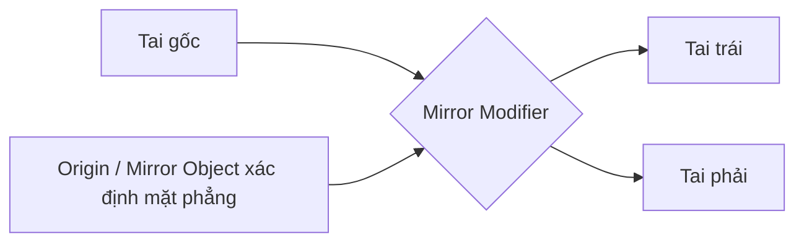

# Bài 03 — Dựng tai từ khối cơ bản và Mirror Modifier

**Mốc video:** 03:10–04:48 · **Thời lượng học gợi ý:** 30–40 phút

## Mục tiêu

- Tạo tai có khối tích, không phải một mặt phẳng.
- Điều chỉnh tỷ lệ, độ nghiêng, góc nhìn của tai.
- Tạo cặp tai cân đối bằng Mirror Modifier.

## Các bước thực hành

1. Về **Object Mode**, thêm một khối mesh mới (có thể dùng `Cube`) bằng `Shift + A > Mesh > Cube`.
2. Dùng `S` để thu nhỏ tổng thể; dùng `S`, tiếp đến phím trục (`X`, `Y` hoặc `Z`) để dẹt theo chiều sâu và chỉnh thành **khối tai bầu**. Trục thực tế tùy hướng nhân vật.
3. Dùng `G` để đưa tai ra vùng hai bên đầu, `R` để hơi nghiêng và tạo dáng tự nhiên. Kiểm tra cả mặt trước và góc 3/4.
4. Thêm **Subdivision Surface** với mức chia hợp lý. Nếu kết quả bo tròn quá mạnh hoặc mất hình, điều chỉnh hình nền trong Edit Mode hoặc thêm support loop trước khi tăng subdivision.
5. Vào **Object > Shade Smooth** (hoặc tùy phiên bản **Shade Auto Smooth / Shade Smooth by Angle**) để làm mượt pháp tuyến hiển thị. Chú ý: shade smooth **không tạo thêm polygon**.
6. Thêm **Mirror Modifier** cho tai. Có thể dùng `Mirror Object` là vật thể đầu **nếu origin và trục cục bộ của đầu nằm đúng mặt phẳng đối xứng**; nếu không, chỉnh origin/transform hoặc dùng empty làm mốc.
7. Quan sát hai tai. Thay đổi một tai, xem bên còn lại có cập nhật đúng không.

## Sơ đồ giải thích Mirror

## Ghi nhớ

- **Sculpt Symmetry:** sao chép **nét cọ** trên cùng mesh ở Sculpt Mode.
- **Mirror Modifier:** tạo bản phản chiếu của **hình học** theo mặt phẳng dựa trên origin/hệ trục.
- Mirror chỉ đúng khi trục đối xứng được đặt đúng; chọn ngẫu nhiên một `Mirror Object` có thể gây tai lệch hoặc biến mất khỏi vị trí mong muốn.

## Tự kiểm tra

- [ ] Tai có độ dày rõ khi nhìn ngang.
- [ ] Hai tai cân nhau qua trục đầu.
- [ ] Cùng chỉnh một tai thì phía còn lại thay đổi hợp lý.

**Bài tập:** tạo hai phong cách tai: tai nhỏ sát đầu, tai tròn lớn kiểu hoạt hình. Ghi lại kích thước và góc xoay tương đối.
