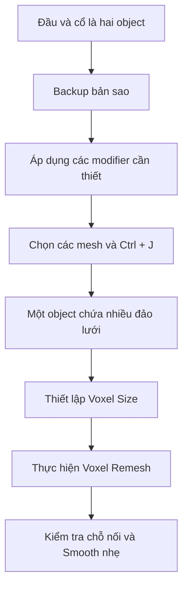

# Bài 04 — Tạo cổ, kết hợp các khối và Voxel Remesh

**Mốc video:** 04:49–10:01 · **Thời lượng học gợi ý:** 40–50 phút

## Mục tiêu

Tạo cổ bằng mesh đơn giản, hiểu **Join không đồng nghĩa hàn bề mặt**, biết quản lý bản sao lưu và sử dụng Voxel Remesh với mật độ phù hợp.

## Thực hành: tạo cổ

1. Đưa khối đầu lên cao để có không gian đặt cổ.
2. Thêm `Cube` hoặc một khối tương tự; dùng `S`, `G` và có thể `R` để chỉnh chiều rộng, chiều sâu và độ nghiêng.
3. Vào **Edit Mode** (`Tab`), thêm các vòng cạnh bằng `Ctrl + R` để kiểm soát phần trên–dưới của cổ.
4. Chỉnh các đỉnh hoặc mặt để đầu cổ hơi rộng/gắn khớp dưới hộp sọ; phía chân cổ tạo vùng nối về thân theo ý đồ thiết kế.
5. Trở về Object Mode và nhìn từ trước–ngang; sửa phần giao nhau với đầu.

## Sao lưu trước khi hàn lưới

Trong **Object Mode**, chọn các phần cần dự phòng → `Shift + D` để nhân bản → `M > New Collection` đặt tên `BACKUP_HEAD_PARTS`. Ẩn collection này trong Viewport. Có thể lưu thêm tệp `_before_remesh.blend`.

## Join và Remesh khác gì nhau?

| Thao tác | Kết quả | Điểm cần nhớ |
|---|---|---|
| `Ctrl + J` (Join) | Gộp nhiều object mesh thành **một object** | Các đảo lưới vẫn có thể rời nhau bên trong |
| Voxel Remesh | Tạo lại bề mặt/lưới theo một thể tích voxel | Có thể hàn vùng khối giao nhau, đồng thời thay topology |
| Smooth brush | Làm mềm hình dạng khu vực sculpt | Không tự hàn hai đảo lưới độc lập |
| Apply modifier | Ghi hiệu ứng modifier vào hình học | Là thay đổi khó hoàn nguyên sau khi lưu |

## Cách Voxel Remesh an toàn

1. Lưu file. Chỉ đưa vào object những mesh **thật sự định hàn** (ở đây là đầu và cổ; tai có thể để riêng để sculpt chi tiết).
2. Áp dụng modifier ảnh hưởng hình học nếu quy trình đòi hỏi. Lưu ý remesh có thể bỏ qua hình học chỉ tồn tại ở modifier chưa Apply.
3. `Ctrl + J` để Join, chọn object nhận tên cuối là `Head_Neck`.
4. Vào Sculpt Mode, tìm phần **Remesh** trong Tool Settings hoặc Properties theo phiên bản Blender.
5. Thử giá trị **Voxel Size tương đối lớn trước**, giảm từng bước và theo dõi số lượng mặt. Ví dụ `0.02` trong lời giảng là **tham số tham khảo phụ thuộc kích thước mô hình**, không phải chuẩn áp dụng cho tất cả file.
6. Remesh → kiểm tra vùng cổ, cằm và đường viền; dùng Smooth (`Shift` khi sculpt với brush hỗ trợ, hoặc Smooth brush riêng) vừa đủ.
7. Nếu Blender lag hoặc bề mặt vỡ: Undo, tăng Voxel Size, kiểm tra mô hình khép kín, xem lại scale.

## Cảnh báo hiệu suất

**Voxel Size càng nhỏ → thường càng nhiều polygon và tốn RAM/VRAM.** Không thể suy ra số polygon cố định chỉ từ `0.02` nếu không biết kích thước và hình dạng mesh. Thông số hàng triệu mặt trong lời giảng minh họa tính đánh đổi giữa độ mịn và hiệu suất, không phải mục tiêu bắt buộc.

## Tự kiểm tra

- [ ] Đầu và cổ nối êm, không thấy khe xuyên.
- [ ] Có backup trước remesh.
- [ ] Đã quan sát poly count/Face count trong **Viewport Overlays > Statistics** hoặc giao diện tương đương.

**Bài tập:** thử hai mức Voxel Size trên **bản sao**; ghi số mặt, độ mượt và cảm nhận tốc độ máy.
