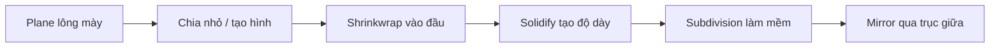

# Bài 08 — Vẽ miệng và làm lông mày bám bề mặt đầu

**Mốc video:** 20:22–25:52 · **Thời lượng học gợi ý:** 45–60 phút

## Mục tiêu

Vẽ đường miệng có nét rõ, tùy chỉnh biểu cảm bất đối xứng; dựng lông mày từ mặt phẳng và áp lên bề mặt đầu bằng Shrinkwrap.

## Phần A — Miệng bằng Draw Sharp

1. Vào Sculpt Mode với mesh đầu, chọn **Draw Sharp** hoặc brush tương đương chuyên tạo rãnh sắc.
2. Nếu muốn miệng **không cân xứng**, tắt `Symmetry X` trước khi vẽ (ví dụ một bên mép nhếch lên).
3. Đặt radius nhỏ và strength thấp-vừa. Trong phần tùy chọn **Stroke**, có thể bật **Stabilize Stroke** (tên có thể khác theo phiên bản) để nét đều hơn.
4. Vẽ đường miệng bằng vài lượt nhẹ. Từ phía trước, xác định vị trí so với cằm và mũi; từ bên, kiểm tra rãnh có quá sâu không.
5. Nếu miệng quá rộng, dùng **Grab** hoặc brush co/đẩy phù hợp để chỉnh góc miệng, sau đó Smooth thật nhẹ quanh đường rãnh.

> Video tạo **rãnh miệng trên mesh**, không xây môi, răng, lưỡi hay hệ thống shape keys hoàn chỉnh.

## Phần B — Lông mày bằng Shrinkwrap

1. Chuyển **Object Mode** và `Shift + A > Mesh > Plane`; xoay và scale để mặt phẳng hướng về phía trước đầu.
2. Vào Edit Mode, tạo thêm cạnh hoặc subdivide mặt phẳng để có đủ điểm bẻ cong. Tạo hình dải lông mày thuôn hai đầu bằng di chuyển đỉnh/mặt.
3. Thêm **Shrinkwrap Modifier** cho lông mày, đặt **Target** là mesh đầu; chọn chế độ projection/nearest surface phù hợp để dải lông mày áp lên trán.
4. Điều chỉnh **Offset** một lượng nhỏ để không bị chìm vào da. Kiểm tra dải đã nằm trên đầu ở góc nghiêng.
5. Thêm **Solidify** để tạo độ dày nếu lông mày xuất phát từ plane; có thể dùng **Subdivision Surface** sau đó để làm mềm.
6. **Thứ tự modifier cần kiểm tra** (gợi ý, tùy hình học): `Shrinkwrap → Solidify → Subdivision Surface → Mirror` hoặc `Mirror → Shrinkwrap → Solidify → Subdivision`. Thay đổi thứ tự sẽ thay đổi kết quả và có thể làm dải bị chìm.
7. Tạo bên đối diện bằng Mirror Modifier, bảo đảm trục đúng theo tâm đầu.

## Sơ đồ các modifier

## Phân biệt thuật ngữ

- **Shrinkwrap:** ép/chiếu mesh lên bề mặt một mesh **Target**.
- **Solidify:** tạo độ dày cho mặt phẳng/bề mặt.
- **Subdivision Surface:** chia lưới và làm mượt hình dạng.
- **Mirror:** phản chiếu hình học qua mặt phẳng đối xứng.

## Tự kiểm tra

- [ ] Nét miệng có hướng rõ và biểu cảm chủ đích.
- [ ] Lông mày bám theo độ cong trán, không lơ lửng và không chìm vào đầu.
- [ ] Hai bên tương đồng nhưng vẫn có thể chỉnh thành biểu cảm khác nhau.

**Bài tập:** tạo 3 biểu cảm bằng thay đổi đường miệng và lông mày: vui, ngạc nhiên, khó chịu. Lưu mỗi biểu cảm ở bản copy riêng.
