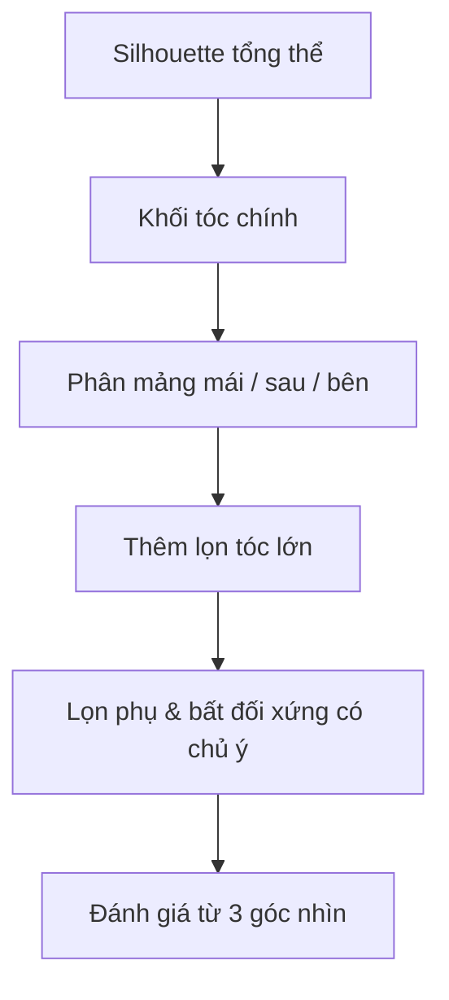

# Bài 09 — Điêu khắc khối tóc và lọn tóc hoạt hình

**Mốc video:** 25:52–36:20 · **Thời lượng học gợi ý:** 60–90 phút

## Mục tiêu

Dựng tóc theo **khối lớn–khối trung–lọn nhỏ**; tạo mái bằng Grab, thêm lọn riêng từ khối cơ bản; kiểm tra và remesh khi thật cần.

## Giai đoạn 1 — Dựng khối tóc chính

1. Trong Object Mode, thêm `UV Sphere` làm mũ tóc, dùng `S`, `G`, `R` để khớp đường sọ.
2. Đặt tóc **phủ trên da đầu** với độ dày phù hợp. Không để khối tóc trùng hoàn toàn bề mặt đầu vì dễ bị xuyên/z-fighting khi nhìn.
3. `Ctrl + A > Scale` nếu trước đó đã scale không đồng đều và dự định sculpt; sau đó chuyển Sculpt Mode.
4. Chọn **Grab** với bán kính lớn, kéo đỉnh tóc và phần sau đầu tạo silhouette. Lưu bản trước khi giảm Voxel Size.
5. Tạo khối mái: kéo vùng trước thành một hoặc nhiều mảng lớn. Nhìn từ góc trước và nghiêng; đừng chỉ vẽ tóc trên bề mặt.
6. Nếu lưới không đủ mịn để sculpt, dùng **Voxel Remesh** với giá trị thích hợp; bắt đầu thô rồi tinh chỉnh, không đặt ngay mật độ rất cao.
7. Sử dụng Smooth vừa phải để bỏ các gợn ngoài ý muốn nhưng giữ các đỉnh nhọn có chủ đích.

## Giai đoạn 2 — Thêm những lọn tóc cách điệu

1. Thêm mesh khối nhỏ, thu nhỏ và kéo đến vị trí trên mũ tóc.
2. Trong Edit Mode, kéo điểm/face thành một **lọn cong có hướng**; thêm subdivision nếu cần bo mềm.
3. Dùng `Shift + D` để nhân bản 2–3 lọn, đổi độ dài, góc xoay và độ dày để tránh lặp máy móc.
4. Dùng **Mirror** cho lọn nếu muốn tóc cân; **tắt đối xứng** ở vài lọn mái để tạo sự tự nhiên.
5. Nếu cần gộp các lọn tóc thành một khối điêu khắc, có thể `Convert to Mesh` khi đối tượng chưa phải Mesh và `Ctrl + J`, sau đó Voxel Remesh. **Không phải lúc nào cũng cần**: giữ nhiều lọn riêng có thể thuận lợi hơn cho chỉnh sửa và dựng tóc game.

## Giai đoạn 3 — Định hình kiểu tóc

- Nhìn từ **trước**: tóc có làm khuôn mặt mất cân đối không?
- Nhìn từ **ngang**: phía sau có đủ khối lượng, trán có bị trống không?
- Nhìn **3/4**: các lọn có chiều sâu, không chỉ là nét 2D trên mặt trước?
- Kiểm tra xuyên lưới giữa tóc và da, đặc biệt tại thái dương, gáy và đường tóc mái.

## Sơ đồ tư duy tạo kiểu tóc

## Cảnh báo kỹ thuật

- **Lạm dụng Remesh:** có thể làm mất lọn sắc hoặc làm toàn bộ tóc nặng hàng triệu mặt.
- **Lạm dụng Smooth:** làm tóc giống mũ tròn thay vì các mảng tóc có hướng.
- **Mirror lọn có vẻ sai:** kiểm tra `Mirror Object` và origin trước khi Apply.
- Đối với **nhân vật dùng trong game**, lưới tóc high-poly sculpt thường **chưa phải game-ready**; cần tối ưu topology/UV/material ở quy trình kế tiếp (không nằm trong video nguồn).

## Tự kiểm tra

- [ ] Có 1 khối chính và tối thiểu 3 lọn tóc có hướng.
- [ ] Tóc nhìn có chiều sâu ở góc nghiêng và 3/4.
- [ ] Không có lỗi xuyên lớn hoặc bề mặt gợn quá mức.

**Bài tập:** từ cùng một mô hình đầu, tạo hai kiểu tóc: mái lệch năng động và tóc ngắn gọn. Giữ lại các file trước/sau để so sánh.
