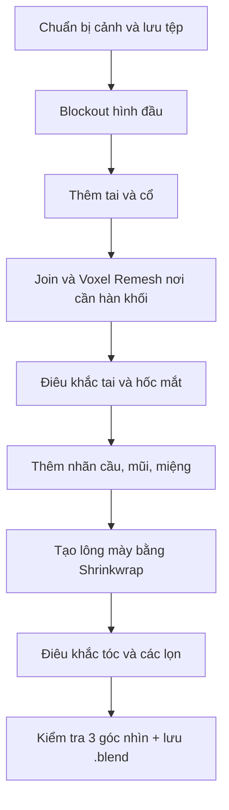

# KHÓA HỌC BLENDER — ĐIÊU KHẮC ĐẦU NHÂN VẬT 3D PHONG CÁCH HOẠT HÌNH

> Giáo trình thực hành bằng tiếng Việt, biên soạn từ bản ghi lời nói của một video hướng dẫn dài khoảng **36 phút 39 giây**. Nội dung trọng tâm là **blockout → sculpt → hoàn thiện đầu, các bộ phận khuôn mặt và tóc**. Thời gian học gợi ý: **5–7 giờ**, chưa tính luyện tập mở rộng.

## 1. Kết quả đầu ra

Sau khóa học, người học có thể:

- Tạo hình đầu cách điệu từ khối cơ bản và chỉnh tỷ lệ ở nhiều góc nhìn.
- Dùng **Grab**, **Draw**, **Draw Sharp**, **Smooth** để điêu khắc khối đầu, hốc mắt, tai, mũi và đường miệng.
- Phân biệt **Mirror Modifier**, **Sculpt Symmetry**, **Subdivision Surface**, **Voxel Remesh**, **Shrinkwrap** và **Solidify**.
- Ghép các khối đầu–cổ bằng voxel remesh khi cần; giữ các phần còn lại tách biệt để sửa dễ dàng.
- Tạo lông mày áp lên bề mặt đầu, tóc khối lớn và các lọn tóc cách điệu.
- Quản lý bản sao lưu, mật độ lưới và kiểm tra mô hình bằng các góc nhìn.

## 2. Đối tượng và công cụ

- Phù hợp: người mới biết thao tác Blender cơ bản (chọn vật thể, di chuyển, xoay, phóng to/thu nhỏ).
- Cần: Blender 4.x/5.x (giao diện và phím tắt có thể thay đổi theo phiên bản/keymap), chuột có nút giữa; bảng vẽ là tùy chọn.
- Tệp sản phẩm: `stylized_head_v01.blend`, `stylized_head_final.blend`; ảnh chụp góc chính diện, nghiêng, 3/4.

## 3. Lộ trình học

| Bài | Chủ đề | Mốc trong video gốc | Sản phẩm sau bài |
|---|---|---|---|
| [01](01-chuan-bi-blender-va-quy-trinh.md) | Chuẩn bị Blender & định hướng | 00:00–00:40 | Cảnh sạch, kế hoạch làm việc |
| [02](02-tao-khoi-dau-va-doi-xung.md) | Tạo khối đầu, Grab, đối xứng | 00:40–03:09 | Silhouette đầu hoạt hình |
| [03](03-tao-tai-bang-khoi-co-ban.md) | Tạo hai tai từ khối cơ bản | 03:10–04:48 | Cặp tai đối xứng |
| [04](04-tao-co-join-va-voxel-remesh.md) | Cổ, Join, sao lưu & voxel remesh | 04:49–10:01 | Đầu–cổ có bề mặt liên tục |
| [05](05-dieu-khac-chi-tiet-tai.md) | Điêu khắc rãnh vành tai | 10:03–14:16 | Tai có chiều sâu |
| [06](06-hoc-mat-va-nhan-cau.md) | Hốc mắt, nhãn cầu | 14:17–16:47 | Đôi mắt dạng khối |
| [07](07-tao-khoi-mui-va-lo-mui.md) | Mũi, lỗ mũi | 16:47–20:21 | Mũi mềm, khớp với mặt |
| [08](08-tao-mieng-va-long-may.md) | Miệng và lông mày bám mặt | 20:22–25:52 | Biểu cảm ban đầu |
| [09](09-tao-toc-va-lon-toc.md) | Khối tóc, mái, lọn tóc | 25:52–36:20 | Kiểu tóc hoàn chỉnh |
| [10](10-kiem-tra-va-hoan-thien.md) | Kiểm tra & kết xuất sản phẩm học tập | 36:20–36:39 + mở rộng | Bộ ảnh kiểm tra, file `.blend` |
| [11](11-bai-tap-du-an-cuoi-khoa.md) | Đồ án: đầu nhân vật cách điệu | Thực hành mở rộng | Sản phẩm đánh giá |
| [12](12-trac-nghiem-va-dap-an.md) | Ôn tập kiến thức & đáp án | Tổng hợp | Tự đánh giá |

## 4. Sơ đồ quy trình

> **Lưu ý phạm vi:** video nguồn kết thúc sau phần điêu khắc đầu và **thông báo** rằng vật liệu, tô màu, ánh sáng, render sẽ được hướng dẫn ở video sau. Vì vậy, giáo trình này **không coi** UV, retopology game-ready, rigging hay render hoàn chỉnh là nội dung đã được giảng dạy trong video.

## 5. Cách học hiệu quả

1. Mở bài `.md`, xem mục **Mục tiêu** và **Các bước**.
2. Thực hành trong Blender, lưu thêm tệp tại các mốc có **Apply** hoặc **Remesh**.
3. So sánh ba góc nhìn (trước/nghiêng/3⁄4) trước khi chuyển bài.
4. Hoàn thành mục **Tự kiểm tra** và chụp ảnh tiến độ.
5. Làm đồ án cuối khóa mà không xem lại toàn bộ hướng dẫn.

## 6. Cấu trúc tệp

- `01–10-*.md`: bài học tiếng Việt, thao tác và bài tập.
- `11-bai-tap-du-an-cuoi-khoa.md`: yêu cầu và thang đánh giá dự án.
- `12-trac-nghiem-va-dap-an.md`: câu hỏi ôn tập và đáp án.
- `PHIM_TAT_VA_THUAT_NGU.md`: tra cứu nhanh.
- `NGUON_VA_LUU_Y_KY_THUAT.md`: phần xuất phát từ lời giảng, phần được chuẩn hóa và tài liệu tham khảo.

**Gợi ý:** Markdown có sơ đồ Mermaid hiển thị tốt trong nhiều trình xem Markdown hiện đại. Nếu trình xem Drive không dựng được sơ đồ, mở tệp trong VS Code với Markdown Preview hoặc GitHub.
