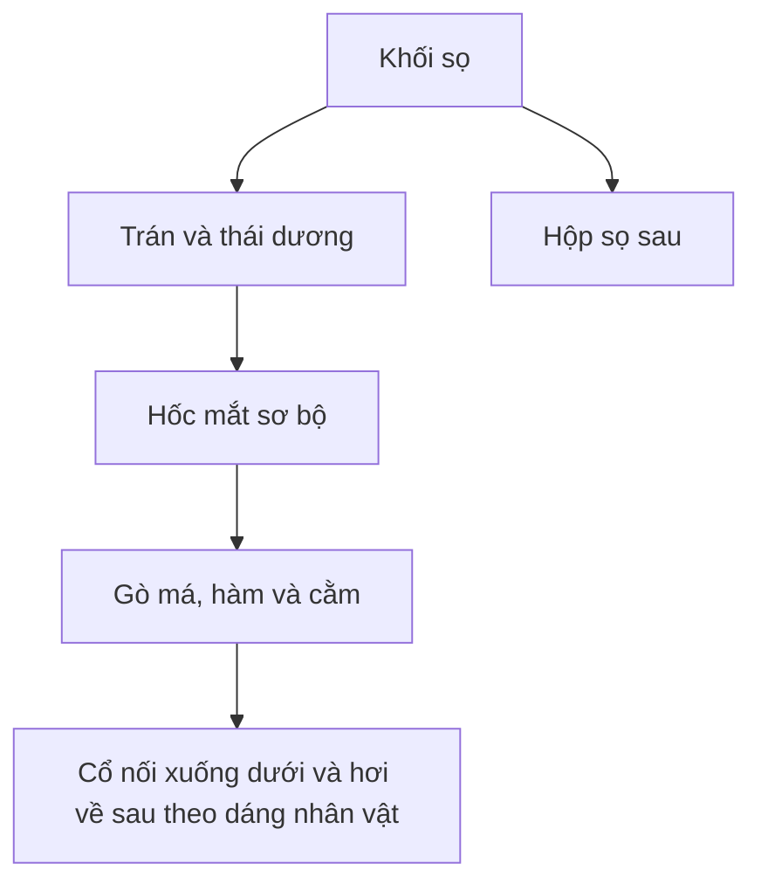

# Bài 02 — Tạo khối sọ, hàm và cổ

> **Khóa học Blender Sculpting — đầu nhân vật stylized | Tài liệu tiếng Việt**  
> **Nguồn chính:** transcript dài khoảng 1 giờ 34 phút do người học cung cấp. **Mốc trong mỗi bài là thời gian video**, không phải thời lượng thực hành.  
> **Mức độ:** bắt đầu → trung cấp; ưu tiên dựng hình khối đầu và học kỹ thuật Sculpt Mode.

> **Quy ước biên tập:** Nội dung *Theo bài gốc* bám sát trình tự và ý tưởng người dạy; các mục ghi **bổ sung** là hướng dẫn sư phạm/kiến thức phần mềm, không phải lời nói nguyên văn. Transcript có lỗi dịch máy: "không khí" = *ear (tai)*, "máy xay sinh tố" = *Blender*, "xe" có thể là *ears*, "sấy" là *sculpt* trong ngữ cảnh. Các vị trí không rõ đã được diễn đạt thận trọng. **Phím tắt và menu khác nhau giữa các phiên bản.**

**Đối chiếu bản ghi:** 01:25–08:42.

## Mục tiêu học tập
- Tạo được silhouette đầu nhìn thẳng, nghiêng và từ trên.
- Nối một khối cổ hợp lý và đặt vị trí hốc mắt sơ bộ.
- Dùng Grab, Mask, Smooth và Voxel Remesh đúng thời điểm.

## Phân tích hình khối
Giảng viên dùng **Grab** đẩy hai bên đầu, rút ngắn đỉnh sọ, chỉnh nhìn nghiêng, làm phần hộp sọ phía sau đầy hơn. Dáng đầu được so sánh với một dạng bầu dục/khối trứng; đây là **hình dung khối điêu khắc**, không phải công thức tỷ lệ giải phẫu cố định. Phần sau sọ thường cần đủ thể tích khi nhìn Top và Side; đừng để đầu giống một mặt nạ phẳng.

### Sơ đồ đọc tỷ lệ

## Quy trình sculpt
1. Dùng Grab cọ lớn, thao tác ở **mặt trước** để nới/hẹp hai bên; quan sát đường ngoài đầu chứ không nhìn các điểm lưới riêng lẻ.
2. Đổi sang **Side** để chỉnh độ nhô trán, cằm và bề dày hộp sọ; xem từ **Top** để xác minh hậu sọ không bị bóp dẹt.
3. Khi mesh bị kéo quá dài, cân nhắc **Voxel Remesh** để phân bố lại hình học. Giá trị `0.05` mà video dùng là ví dụ theo kích thước mesh của giảng viên, **không phải thông số chuẩn cho mọi project**.
4. Dùng **Mask** bảo vệ vùng đầu, **Invert Mask** để chuyển sang chỉnh phần cổ; kéo phần cổ theo dáng nối xuống thân. Xóa mask khi xong.
5. Smooth nhẹ ở điểm nối cổ–hàm rồi dùng Grab sửa lại khối, tránh làm mất gờ cần thiết.
6. Đánh dấu vị trí hai hốc mắt bằng vùng lõm sơ bộ, chưa cần bờ mí chi tiết.

## Phân tích theo từng góc
| Góc nhìn | Điều cần kiểm tra |
|---|---|
| Trước | Tính cân đối trái–phải, chiều rộng thái dương–hàm |
| Nghiêng | Khối trán, độ lồi gáy, góc cổ, độ nhô cằm |
| Trên | Hậu sọ đủ đầy, không phẳng hoặc thắt bất thường |
| 3/4 | Mối liên kết trán–gò má–hàm tạo chiều sâu |

## Lỗi cần sửa
- Cổ là một ống thẳng gắn ngay dưới cằm, không ăn khớp với phần gáy.
- Hốc mắt khắc quá sâu khi tổng thể chưa ổn.
- Remesh quá mịn gây lag; hãy **lưu file trước** và quan sát thống kê.

## Bài tập
Sculpt một đầu không có mắt, mũi, miệng nhưng nhận ra được trán, gò má, hàm, cằm và cổ. Chụp 4 góc.

## Tiêu chí hoàn thành
- [ ] Bốn góc nhìn nhất quán.
- [ ] Hậu sọ và cổ có thể tích hợp lý.
- [ ] Không còn vùng mesh kéo dài bất thường.

---
## Tự đánh giá nhanh
1. Phần nào trong bài là khối lớn cần ưu tiên hơn nếp/rãnh nhỏ?
2. Ảnh góc 3/4 cho thấy vấn đề gì mà ảnh Front không thể hiện đủ?
3. Bạn sẽ lưu file và kiểm tra mật độ mesh vào thời điểm nào?

**Chuyển tiếp:** Hoàn thành checklist và lưu ảnh trước khi mở bài tiếp theo.
