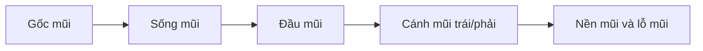

# Bài 03 — Dựng sống mũi, đầu mũi và cánh mũi

> **Khóa học Blender Sculpting — đầu nhân vật stylized | Tài liệu tiếng Việt**  
> **Nguồn chính:** transcript dài khoảng 1 giờ 34 phút do người học cung cấp. **Mốc trong mỗi bài là thời gian video**, không phải thời lượng thực hành.  
> **Mức độ:** bắt đầu → trung cấp; ưu tiên dựng hình khối đầu và học kỹ thuật Sculpt Mode.

> **Quy ước biên tập:** Nội dung *Theo bài gốc* bám sát trình tự và ý tưởng người dạy; các mục ghi **bổ sung** là hướng dẫn sư phạm/kiến thức phần mềm, không phải lời nói nguyên văn. Transcript có lỗi dịch máy: "không khí" = *ear (tai)*, "máy xay sinh tố" = *Blender*, "xe" có thể là *ears*, "sấy" là *sculpt* trong ngữ cảnh. Các vị trí không rõ đã được diễn đạt thận trọng. **Phím tắt và menu khác nhau giữa các phiên bản.**

**Đối chiếu bản ghi:** 08:43–16:07.

## Mục tiêu học tập
- Đắp một mũi theo các khối chính thay vì kéo một nêm tam giác phẳng.
- Kết hợp **Clay Strips, Grab, Scrape/Flatten, Draw Sharp** và Smooth.
- Kiểm soát trục nhìn nghiêng để mũi không quá dài hoặc mất thể tích.

## Cấu trúc khối mũi
Khối mũi có thể phân thành **gốc mũi → sống mũi → đầu mũi → cánh mũi và nền mũi**. Người dạy bắt đầu bằng sống mũi với Clay Strips, làm phẳng mặt bên, sau đó thêm khối đầu mũi nhìn nghiêng và khắc nhẹ vùng lỗ mũi. Cách chia này phù hợp với blockout nhân vật stylized: **khối rộng trước, rãnh hẹp sau**.

## Các bước
1. Tăng mật độ **chỉ khi cần** để bề mặt đủ đỉnh; video minh họa `Voxel Size ≈ 0.025` theo tỷ lệ riêng.
2. Từ Front, dùng **Clay Strips** đắp dọc gốc–sống mũi, tăng thể tích bằng nhiều nét nhẹ thay vì một nét rất mạnh.
3. Từ Side, dùng **Grab** chỉnh độ nhô sống mũi. Dùng Scrape/Flatten để kiểm soát các mảng phẳng và chống hiện tượng đầu mũi bóng tròn không chủ ý.
4. Đắp một khối gần dạng cầu cho **đầu mũi**, rồi thêm hai cánh mũi. Không cần khoét sâu lỗ mũi từ đầu.
5. Tạo mép lỗ mũi bằng rãnh vừa đủ, dùng **Draw Sharp/Crease** tiết chế, Smooth lại vùng bị nứt gắt.
6. Chụp Front, Side, 3/4; quay lại sửa đầu mũi nếu mặt trước ổn nhưng góc nghiêng quá to.

## Nguyên tắc thẩm mỹ
Video nói tới kiểu mũi nhân vật nữ mềm mại và hơi gồ ở đầu sống mũi. Đó là **lựa chọn phong cách của giảng viên**, không phải quy tắc giải phẫu bắt buộc. Với nam/nữ/kiểu anime, thay đổi khối là hợp lý nếu vẫn duy trì cấu trúc 3D thuyết phục.

## Bảng chẩn đoán
| Hiện tượng | Nguyên nhân khả dĩ | Cách sửa |
|---|---|---|
| Mũi như một chiếc gai | Tạo sống mũi quá sắc | Clay Strips + Smooth nhẹ, kiểm tra Side |
| Đầu mũi như quả bóng | Thiếu mảng chuyển tiếp | Flatten nhẹ, xây lại cánh mũi |
| Mũi dính phẳng vào mặt | Thiếu độ nhô | Grab từ Side/3/4 |
| Lỗ mũi bị đục quá sâu | Chi tiết quá sớm | Đắp lại thể tích và giảm độ sâu |

## Bài tập
Tạo hai phiên bản từ một khối đầu: mũi mềm stylized và mũi có sống rõ hơn. Giữ nguyên các vùng khác để so sánh silhouette.

## Tiêu chí hoàn thành
- [ ] Phân biệt được sống, đầu và cánh mũi.
- [ ] Silhouette nhìn nghiêng có chủ đích.
- [ ] Không có vùng mesh nhọn lỗi.

---
## Tự đánh giá nhanh
1. Phần nào trong bài là khối lớn cần ưu tiên hơn nếp/rãnh nhỏ?
2. Ảnh góc 3/4 cho thấy vấn đề gì mà ảnh Front không thể hiện đủ?
3. Bạn sẽ lưu file và kiểm tra mật độ mesh vào thời điểm nào?

**Chuyển tiếp:** Hoàn thành checklist và lưu ảnh trước khi mở bài tiếp theo.
