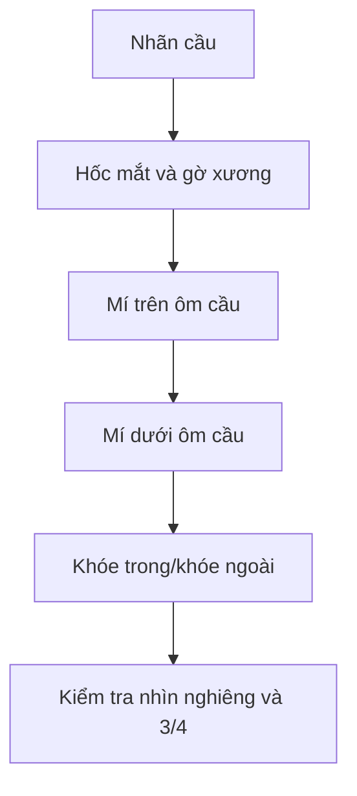

# Bài 04 — Tạo nhãn cầu, hốc mắt và mí mắt

> **Khóa học Blender Sculpting — đầu nhân vật stylized | Tài liệu tiếng Việt**  
> **Nguồn chính:** transcript dài khoảng 1 giờ 34 phút do người học cung cấp. **Mốc trong mỗi bài là thời gian video**, không phải thời lượng thực hành.  
> **Mức độ:** bắt đầu → trung cấp; ưu tiên dựng hình khối đầu và học kỹ thuật Sculpt Mode.

> **Quy ước biên tập:** Nội dung *Theo bài gốc* bám sát trình tự và ý tưởng người dạy; các mục ghi **bổ sung** là hướng dẫn sư phạm/kiến thức phần mềm, không phải lời nói nguyên văn. Transcript có lỗi dịch máy: "không khí" = *ear (tai)*, "máy xay sinh tố" = *Blender*, "xe" có thể là *ears*, "sấy" là *sculpt* trong ngữ cảnh. Các vị trí không rõ đã được diễn đạt thận trọng. **Phím tắt và menu khác nhau giữa các phiên bản.**

**Đối chiếu bản ghi:** 16:08–24:36.

## Mục tiêu học tập
- Đặt nhãn cầu như một khối hỗ trợ để sculpt mí.
- Phân biệt hốc mắt, bờ trên/dưới và độ dày mí.
- Sửa khóe mắt bằng Grab và Mask, tránh tạo đường mắt như rãnh khắc phẳng.

## Tư duy khối
Trong transcript, giảng viên thêm quả cầu làm mắt, đặt đối xứng qua **Mirror** hoặc bố trí hai mắt tương ứng; sau đó đắp xương gờ ổ mắt và các mí xung quanh. **Nhãn cầu là dạng cầu**, còn mí là các dải mô có bề dày **ôm cong mặt cầu**. Mí trên và mí dưới không nhất thiết cùng một độ cong. Khoảng cách mắt có thể tham khảo gần bằng bề rộng một mắt trong phong cách thường gặp, nhưng nhân vật stylized cho phép thay đổi.

## Các bước thực hiện
1. Thêm **UV Sphere** trong Object/Edit Mode để đặt nhãn cầu; kiểm tra trục tọa độ trước khi dùng Mirror.
2. Nhìn Front để đặt tâm hai mắt và kiểm tra khoảng cách, sau đó nhìn Side để nhãn cầu không nằm hoàn toàn phía trước xương mặt.
3. Dùng Grab và Clay Strips đắp khối vùng **gờ lông mày / hốc mắt**; chừa không gian cho nhãn cầu.
4. Dùng Clay Strips/Draw tạo mí trên và mí dưới theo quỹ đạo cong của cầu. **Không chỉ khắc một đường mỏng**: mí cần có chiều dày.
5. Dùng **Crease/Draw Sharp** định ranh giới tại các góc; Smooth chỉ đủ để làm chuyển tiếp. Grab điều chỉnh khóe trong/ngoài.
6. Mask phần đã đúng trước khi đẩy vùng mí còn sai; quan sát đầu từ phía dưới và góc 3/4.

## Lỗi dễ gặp
- **Mí mỏng như sợi chỉ:** đắp bề dày, nhất là ở cạnh tiếp xúc với nhãn cầu.
- **Mắt bị lồi:** kiểm tra chiều sâu nhãn cầu so với gờ xương ổ mắt.
- **Mắt như được vẽ trên mặt phẳng:** dùng Side và 3/4 để đánh giá chiều sâu.
- **Khóe mắt quá sắc:** dùng Smooth và Grab sau Draw Sharp.

## Bài tập
Làm một mắt trước, sau đó đối xứng. Xuất ảnh Front, Side và macro close-up cho thấy mí có độ dày thực.

## Tiêu chí hoàn thành
- [ ] Nhãn cầu đặt đúng vị trí tương đối.
- [ ] Mí trên và dưới ôm theo mặt cầu.
- [ ] Khóe mắt không rách/nhọn.

---
## Tự đánh giá nhanh
1. Phần nào trong bài là khối lớn cần ưu tiên hơn nếp/rãnh nhỏ?
2. Ảnh góc 3/4 cho thấy vấn đề gì mà ảnh Front không thể hiện đủ?
3. Bạn sẽ lưu file và kiểm tra mật độ mesh vào thời điểm nào?

**Chuyển tiếp:** Hoàn thành checklist và lưu ảnh trước khi mở bài tiếp theo.
