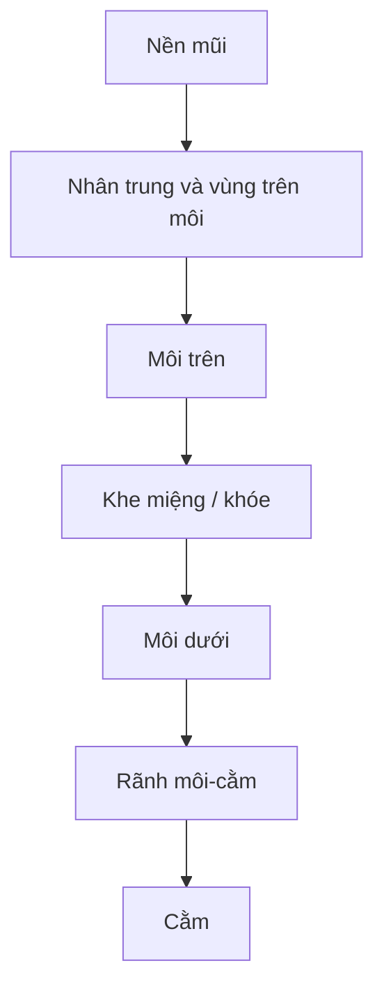

# Bài 05 — Dựng khối quanh miệng và môi

> **Khóa học Blender Sculpting — đầu nhân vật stylized | Tài liệu tiếng Việt**  
> **Nguồn chính:** transcript dài khoảng 1 giờ 34 phút do người học cung cấp. **Mốc trong mỗi bài là thời gian video**, không phải thời lượng thực hành.  
> **Mức độ:** bắt đầu → trung cấp; ưu tiên dựng hình khối đầu và học kỹ thuật Sculpt Mode.

> **Quy ước biên tập:** Nội dung *Theo bài gốc* bám sát trình tự và ý tưởng người dạy; các mục ghi **bổ sung** là hướng dẫn sư phạm/kiến thức phần mềm, không phải lời nói nguyên văn. Transcript có lỗi dịch máy: "không khí" = *ear (tai)*, "máy xay sinh tố" = *Blender*, "xe" có thể là *ears*, "sấy" là *sculpt* trong ngữ cảnh. Các vị trí không rõ đã được diễn đạt thận trọng. **Phím tắt và menu khác nhau giữa các phiên bản.**

**Đối chiếu bản ghi:** 24:37–31:19.

## Mục tiêu học tập
- Hiểu rằng khu vực miệng nổi trên khối mõm/mặt trước, không phải một rãnh kẻ trên mặt phẳng.
- Dựng khối môi trên, môi dưới, khe môi và phần chuyển tiếp tới cằm.
- Kiểm soát độ nhô môi từ góc nghiêng.

## Khối quanh miệng
Giảng viên mở đầu bằng cách đắp **một gờ thể tích dưới vị trí miệng**, rồi mới dùng Crease tạo khe và chỉnh hai môi. Bài gốc nhiều lần nhấn mạnh quan hệ **môi – vùng dưới mũi – cằm**. Khi các khối quanh miệng sai, riêng đường môi có đẹp cũng chưa thuyết phục.

## Thực hành
1. Đặt đường miệng tương đối trên mặt trước. Vẫn giữ biểu cảm trung tính; chưa làm nụ cười.
2. Dùng **Clay Strips** đắp vùng quanh môi để tạo một nền cong nhẹ; quan sát Side để tránh một phần nhô bất thường.
3. Dùng **Crease** khắc khe tiếp xúc môi trên và môi dưới, giữ mép cong tự nhiên.
4. Dùng **Grab** sửa hai khóe; tạo thể tích hai môi bằng nét Clay/Inflate rất nhẹ nếu cần.
5. Từ Side, đánh giá mức nhô môi trên/môi dưới, sự chuyển tiếp từ mũi qua môi tới cằm. Không lấy quy tắc 'môi trên luôn trước môi dưới' làm luật cứng cho mọi người thật.
6. Dùng Mask bảo vệ môi để thay đổi cằm hoặc ngược lại; làm mượt cục bộ, không xóa mất gờ của môi.
7. Thay đổi **cả khối quanh miệng** khi cảm thấy miệng 'không đúng', đừng chỉ sửa khe môi.

## Sơ đồ tương quan

## Dấu hiệu cần tránh
- Môi là hai ống tròn đặt dính vào khuôn mặt.
- Miệng quá dài ở góc nhìn chính diện nhưng quá phẳng ở góc 3/4.
- Môi dưới hòa vào cằm không có vùng chuyển tiếp.
- Khe môi sâu và đều như một đường cắt máy.

## Bài tập
Sculpt hai biến thể môi với biểu cảm trung tính: môi mỏng và môi đầy hơn. Chụp Side và 3/4 để nhận xét khối môi–cằm.

## Tiêu chí hoàn thành
- [ ] Đã có nền cong quanh miệng.
- [ ] Môi có thể tích nhưng không bị hình ống.
- [ ] Cằm và khu vực dưới môi có ranh giới chuyển tiếp hợp lý.

---
## Tự đánh giá nhanh
1. Phần nào trong bài là khối lớn cần ưu tiên hơn nếp/rãnh nhỏ?
2. Ảnh góc 3/4 cho thấy vấn đề gì mà ảnh Front không thể hiện đủ?
3. Bạn sẽ lưu file và kiểm tra mật độ mesh vào thời điểm nào?

**Chuyển tiếp:** Hoàn thành checklist và lưu ảnh trước khi mở bài tiếp theo.
