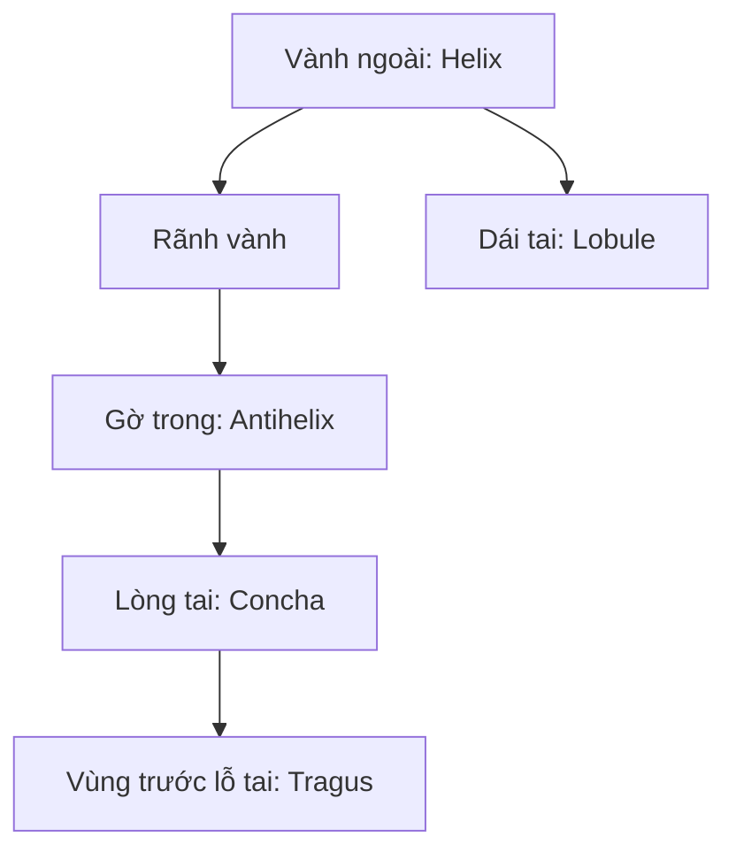

# Bài 06 — Điêu khắc tai: khối ngoài và lòng tai

> **Khóa học Blender Sculpting — đầu nhân vật stylized | Tài liệu tiếng Việt**  
> **Nguồn chính:** transcript dài khoảng 1 giờ 34 phút do người học cung cấp. **Mốc trong mỗi bài là thời gian video**, không phải thời lượng thực hành.  
> **Mức độ:** bắt đầu → trung cấp; ưu tiên dựng hình khối đầu và học kỹ thuật Sculpt Mode.

> **Quy ước biên tập:** Nội dung *Theo bài gốc* bám sát trình tự và ý tưởng người dạy; các mục ghi **bổ sung** là hướng dẫn sư phạm/kiến thức phần mềm, không phải lời nói nguyên văn. Transcript có lỗi dịch máy: "không khí" = *ear (tai)*, "máy xay sinh tố" = *Blender*, "xe" có thể là *ears*, "sấy" là *sculpt* trong ngữ cảnh. Các vị trí không rõ đã được diễn đạt thận trọng. **Phím tắt và menu khác nhau giữa các phiên bản.**

**Đối chiếu bản ghi:** 31:20–41:13.

## Mục tiêu học tập
- Định vị tai theo gờ chân mày/mắt và nền mũi để làm mốc tham khảo.
- Tạo vành tai, vùng lòng tai, rãnh và các gờ chính mà không mất độ dày.
- Kết hợp Mask, Invert Mask, Grab, Clay Strips, Draw Sharp và Inflate.

## Nhận diện hình khối
Trong bản ghi, từ 'air/không khí' là lỗi nhận diện của từ **ear/tai**. Giảng viên tạo hình tai bằng mask trên phần bên của đầu, nâng khối ra ngoài rồi làm lõm phần lòng tai. Tai **có độ dày** và cả phần sau, không phải một miếng dán phẳng. Với stylized head, vị trí trên gần vùng mày/mắt, dưới gần chân mũi là chỉ dẫn tương đối; **đừng biến thành thước đo giải phẫu tuyệt đối**.

## Thao tác
1. Từ Side, đánh dấu vị trí tai giữa vùng thái dương và phần sau hàm; từ Front, xác nhận tai nhô ra ngoài silhouette ở mức vừa phải.
2. Dùng **Mask** vẽ hình tai trên mặt bên, chỉnh lại mask cho rõ bờ; có thể **Invert** để kéo đúng vùng cần thao tác.
3. Dùng **Grab** đẩy khối tai ra ngoài. Giữ chân tai nối với mặt và độ dày nhất định.
4. Dùng **Clay Strips/Sculpt Draw** làm dày vành ngoài (helix) và tạo lòng tai (concha) bằng tương phản giữa vùng nhô/lõm.
5. Tạo một số gờ/rãnh lớn bên trong tai, không khắc toàn bộ đường nhỏ cùng lúc. Có thể dùng **Draw Sharp** nhấn ranh giới rồi Smooth.
6. Nếu vành quá mỏng, sử dụng **Inflate** rất nhẹ và kéo lại. Khi mesh bị kéo giãn, remesh ở độ phân giải phù hợp.
7. Kiểm tra **mặt sau tai** và góc 3/4; sửa bờ nối vào đầu, tránh dạng 'miếng lá' hoàn toàn tách rời.

## Bản đồ đơn giản

## Bảng đối chiếu
| Quan sát | Điều chỉnh |
|---|---|
| Tai quá cao hoặc nhô quá xa | Grab + Mask, nhìn Front và Side |
| Vành mỏng như giấy | Inflate nhẹ, đắp volume vành |
| Lòng tai phẳng | Phân lớp gờ lớn và vùng lõm |
| Tai đẹp ở phía trước, lỗi ở phía sau | Sculpt mặt sau, làm dày chân tai |

## Bài tập
Dựng một tai chỉ với 3 khối chính (vành, lòng, dái tai); sau đó thêm 2 gờ. Đưa ảnh chụp Side và 3/4.

## Tiêu chí hoàn thành
- [ ] Tai không phẳng, có chiều dày.
- [ ] Lòng tai có vùng lõm; vành tai có gờ.
- [ ] Chân tai nối hợp lý với khối đầu.

---
## Tự đánh giá nhanh
1. Phần nào trong bài là khối lớn cần ưu tiên hơn nếp/rãnh nhỏ?
2. Ảnh góc 3/4 cho thấy vấn đề gì mà ảnh Front không thể hiện đủ?
3. Bạn sẽ lưu file và kiểm tra mật độ mesh vào thời điểm nào?

**Chuyển tiếp:** Hoàn thành checklist và lưu ảnh trước khi mở bài tiếp theo.
