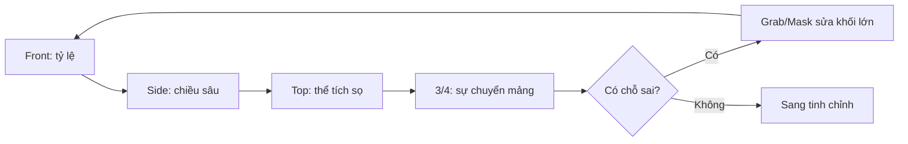

# Bài 07 — Tái cân chỉnh tổng thể và cấu trúc gò má–hàm

> **Khóa học Blender Sculpting — đầu nhân vật stylized | Tài liệu tiếng Việt**  
> **Nguồn chính:** transcript dài khoảng 1 giờ 34 phút do người học cung cấp. **Mốc trong mỗi bài là thời gian video**, không phải thời lượng thực hành.  
> **Mức độ:** bắt đầu → trung cấp; ưu tiên dựng hình khối đầu và học kỹ thuật Sculpt Mode.

> **Quy ước biên tập:** Nội dung *Theo bài gốc* bám sát trình tự và ý tưởng người dạy; các mục ghi **bổ sung** là hướng dẫn sư phạm/kiến thức phần mềm, không phải lời nói nguyên văn. Transcript có lỗi dịch máy: "không khí" = *ear (tai)*, "máy xay sinh tố" = *Blender*, "xe" có thể là *ears*, "sấy" là *sculpt* trong ngữ cảnh. Các vị trí không rõ đã được diễn đạt thận trọng. **Phím tắt và menu khác nhau giữa các phiên bản.**

**Đối chiếu bản ghi:** 41:14–52:28.

## Mục tiêu học tập
- Nhìn nhận lại cả khuôn mặt sau khi thêm các bộ phận.
- Tạo chuyển tiếp giữa gò má, rãnh dưới mắt, quai hàm và vùng quanh miệng.
- Sửa form ở nhiều góc nhìn, đặc biệt là 3/4.

## Luận điểm chính của video
Người dạy khẳng định: **mắt, mũi, tai và cằm riêng lẻ chưa đủ để tạo một khuôn mặt thuyết phục**. Các mảng mô mềm bọc qua nền xương làm cho gương mặt có liên kết. Vùng má được hình dung là một mảng/khối tam giác hỗ trợ từ dưới mắt qua gò má, rồi chuyển xuống miệng và hàm. 'Tam giác' là cách đơn giản hóa để sculpt, không phải bản vẽ cơ chính xác.

## Thực hành có kiểm soát
1. Tắt chú thích, quan sát silhouette từ Back và Top: hậu sọ không được quá phẳng; hai bên sọ giữ mảng chuyển tiếp.
2. Từ Side, chỉnh đường hàm hướng lên tai và đổ về cằm bằng **Grab**.
3. Từ Front/3-4, đắp nhẹ vùng gò má, rìa dưới mắt; chú ý nối mảng mới vào bề mặt chung bằng Smooth vừa đủ.
4. Đánh giá vùng giữa mắt–mũi–miệng; dùng Mask để **di chuyển cả một nhóm khối** nếu tỷ lệ sai, thay vì chỉnh từng khe.
5. Xoay 3/4: kiểm tra độ cong mặt trước–mặt bên, khối gò má có chiều sâu và chuyển tiếp miệng–hàm mềm mại.
6. Lưu phiên bản để so sánh trước/sau sửa tỷ lệ. Đừng phụ thuộc hoàn toàn vào vẻ đẹp ở góc Front.

## Sơ đồ kiểm tra hình khối

## Đặt câu hỏi với từng vùng
- **Gò má:** Có nhô ra và nối về hốc mắt–mũi tự nhiên không?
- **Hàm:** Có góc chuyển rõ nhưng không gãy cứng nếu hướng phong cách mềm không?
- **Vùng miệng:** Nếu bỏ nét khe môi, khối quanh môi còn tạo hình đúng không?
- **Hộp sọ:** Có đủ chiều sâu ở sau đầu không?

## Bài tập
Lấy ảnh ở bài 06, chụp ba góc; sửa tổng thể mà **không thêm chi tiết nhỏ nào mới**. So sánh trước/sau ở 3/4.

## Tiêu chí hoàn thành
- [ ] Gò má và hàm không bị tách thành các 'mảng dán'.
- [ ] Môi/mũi/mắt tương quan cân đối với cả đầu.
- [ ] Góc 3/4 thuyết phục, không chỉ Front.

---
## Tự đánh giá nhanh
1. Phần nào trong bài là khối lớn cần ưu tiên hơn nếp/rãnh nhỏ?
2. Ảnh góc 3/4 cho thấy vấn đề gì mà ảnh Front không thể hiện đủ?
3. Bạn sẽ lưu file và kiểm tra mật độ mesh vào thời điểm nào?

**Chuyển tiếp:** Hoàn thành checklist và lưu ảnh trước khi mở bài tiếp theo.
