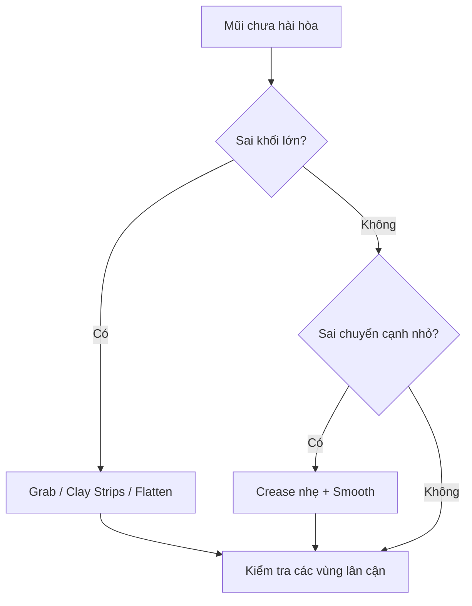

# Bài 09 — Tinh chỉnh mũi và vùng chuyển giữa mắt–má

> **Khóa học Blender Sculpting — đầu nhân vật stylized | Tài liệu tiếng Việt**  
> **Nguồn chính:** transcript dài khoảng 1 giờ 34 phút do người học cung cấp. **Mốc trong mỗi bài là thời gian video**, không phải thời lượng thực hành.  
> **Mức độ:** bắt đầu → trung cấp; ưu tiên dựng hình khối đầu và học kỹ thuật Sculpt Mode.

> **Quy ước biên tập:** Nội dung *Theo bài gốc* bám sát trình tự và ý tưởng người dạy; các mục ghi **bổ sung** là hướng dẫn sư phạm/kiến thức phần mềm, không phải lời nói nguyên văn. Transcript có lỗi dịch máy: "không khí" = *ear (tai)*, "máy xay sinh tố" = *Blender*, "xe" có thể là *ears*, "sấy" là *sculpt* trong ngữ cảnh. Các vị trí không rõ đã được diễn đạt thận trọng. **Phím tắt và menu khác nhau giữa các phiên bản.**

**Đối chiếu bản ghi:** 1:05:12–1:10:39.

## Mục tiêu học tập
- Chỉnh lại sống và đầu mũi trong bối cảnh cả khuôn mặt.
- Phân biệt làm mượt, làm phẳng và thay đổi thể tích.
- Xử lý artifact do kéo lưới và remesh.

## Ý chính theo bản ghi
Khi tinh chỉnh mũi, người dạy nhận thấy sống mũi quá mảnh và một số mảng chuyển xuống đầu mũi không hợp ý. Người dạy dùng **Crease/Draw Sharp** xác định cạnh, Clay Strips bổ sung thể tích, Grab chỉnh độ nhô, đôi khi Flatten để mũi bớt tròn. Sau khi thay đổi, cần nhìn lại **cả mắt, má và môi** vì chúng ảnh hưởng cảm nhận về kích thước mũi.

## Thực hành
1. Chụp ba góc của mũi đang có và ghi lại đặc điểm: sống, đầu, cánh, độ nhô.
2. Trên vùng chuyển từ trán xuống mũi, dùng **Clay Strips** bổ sung ít thể tích nếu cầu mũi quá lõm.
3. Chỉnh đường sống bằng **Grab** cọ lớn từ Side; dùng Flatten chạm nhẹ vào các mặt bên quá phồng.
4. Vẽ đường tiếp giáp cánh mũi với vùng má bằng **Crease/Draw Sharp** ở độ mạnh thấp; hạn chế cắt sâu.
5. Nếu xuất hiện artifact do mật độ không đều, lưu dự phòng rồi mới remesh; không remesh liên tục như cách thay thế việc sửa hình khối.
6. Quan sát 3/4, rồi nhìn cả khuôn mặt. Có thể giảm độ chi tiết đầu mũi nếu không phù hợp phong cách stylized.

## Sơ đồ quyết định

## Bài tập
Sửa mũi mà chỉ được phép thay đổi tối đa ba khu vực: sống, đầu, cánh; giải thích mỗi lần chỉnh bằng một ảnh trước/sau.

## Tiêu chí hoàn thành
- [ ] Sống mũi có hướng và bề dày rõ.
- [ ] Đầu mũi không như hình cầu đơn giản.
- [ ] Khu vực cánh mũi hòa vào má mượt.

---
## Tự đánh giá nhanh
1. Phần nào trong bài là khối lớn cần ưu tiên hơn nếp/rãnh nhỏ?
2. Ảnh góc 3/4 cho thấy vấn đề gì mà ảnh Front không thể hiện đủ?
3. Bạn sẽ lưu file và kiểm tra mật độ mesh vào thời điểm nào?

**Chuyển tiếp:** Hoàn thành checklist và lưu ảnh trước khi mở bài tiếp theo.
