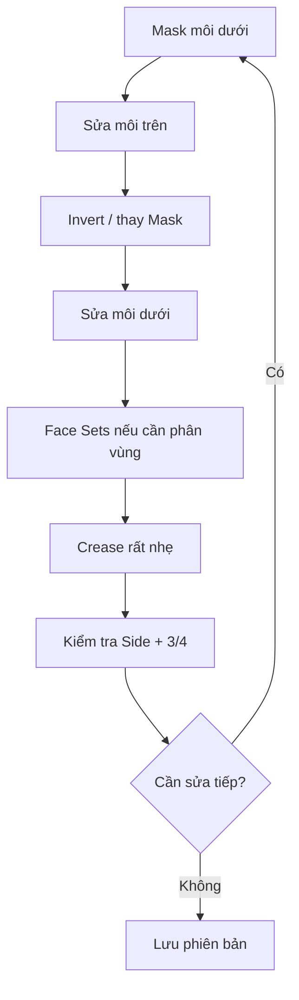

# Bài 10 — Tinh chỉnh môi bằng Mask và Face Sets

> **Khóa học Blender Sculpting — đầu nhân vật stylized | Tài liệu tiếng Việt**  
> **Nguồn chính:** transcript dài khoảng 1 giờ 34 phút do người học cung cấp. **Mốc trong mỗi bài là thời gian video**, không phải thời lượng thực hành.  
> **Mức độ:** bắt đầu → trung cấp; ưu tiên dựng hình khối đầu và học kỹ thuật Sculpt Mode.

> **Quy ước biên tập:** Nội dung *Theo bài gốc* bám sát trình tự và ý tưởng người dạy; các mục ghi **bổ sung** là hướng dẫn sư phạm/kiến thức phần mềm, không phải lời nói nguyên văn. Transcript có lỗi dịch máy: "không khí" = *ear (tai)*, "máy xay sinh tố" = *Blender*, "xe" có thể là *ears*, "sấy" là *sculpt* trong ngữ cảnh. Các vị trí không rõ đã được diễn đạt thận trọng. **Phím tắt và menu khác nhau giữa các phiên bản.**

**Đối chiếu bản ghi:** 1:10:40–1:23:20.

## Mục tiêu học tập
- Điều chỉnh môi trên và dưới độc lập bằng Mask.
- Phân biệt cách dùng **Face Sets** với **Mask** trong Sculpt Mode.
- Giữ được thể tích môi sau các lần Pinch/Crease và remesh.

## Giải thích
Đoạn này tập trung vào môi rất lâu: giảm kích thước khi nhìn nghiêng, bù lại thể tích, tạo khe môi và nét hai khóe. Giảng viên dùng **Mask** để khóa một bên môi trong khi chỉnh bên còn lại, sau đó đề cập **Face Sets from Masked** như một cách tổ chức vùng sculpt. **Face Sets là phân nhóm bề mặt thuận tiện**, không phải rig, không phải tách mesh thành các đối tượng độc lập.

## Quy trình
1. Quan sát Front và Side để xác định: môi trên quá nhỏ/to? môi dưới quá nhô? cằm có đủ chuyển tiếp?
2. Dùng **Mask** trên môi dưới để thao tác môi trên; tăng/giảm thể tích với Grab và Clay/Inflate rất nhẹ.
3. Đảo mask khi cần chỉnh môi dưới. Smooth rìa mask để chuyển tiếp không đột ngột.
4. Tạo **Face Set from Masked** bằng menu Sculpt Mode khi muốn lưu vùng phân nhóm; kiểm tra đúng hướng dẫn của phiên bản đang cài.
5. Sử dụng **Crease** tạo khe hai môi và rãnh góc môi, giữ đường khe không sâu đều.
6. Nếu Pinch làm mất thể tích, đắp bù rồi mới làm sắc đường; lặp nhiều vòng nhỏ thay vì một lần chỉnh cực đoan.
7. Quay lại hình chiếu 3/4 để kiểm tra tổng thể quanh nhân trung, rãnh môi-cằm và mũi.

## Khi nào cần Mask, khi nào cần Face Sets?
| Công cụ | Dùng khi |
|---|---|
| Mask | Khóa tác động cọ ở các khu vực, khoanh vùng nhanh |
| Face Sets | Tổ chức vùng mặt, quản lý chọn/ẩn, tiện sửa nhiều vòng |
| Grab | Điều chỉnh silhouette và khối lớn |
| Pinch | Thu gọn vùng cạnh khi đã đủ volume |
| Crease | Nhấn ranh giới khe môi và khóe, không thay việc tạo thể tích |

## Bài tập
Xuất 3 ảnh so sánh: môi trước chỉnh, môi sau chỉnh nhìn Front, môi sau chỉnh nhìn Side. Nêu lý do thay đổi thể tích.

## Tiêu chí hoàn thành
- [ ] Điều chỉnh được môi trên mà ít ảnh hưởng môi dưới.
- [ ] Face Sets và Mask được dùng đúng vai trò.
- [ ] Môi có liên kết tự nhiên với cằm/nhân trung.

---
## Tự đánh giá nhanh
1. Phần nào trong bài là khối lớn cần ưu tiên hơn nếp/rãnh nhỏ?
2. Ảnh góc 3/4 cho thấy vấn đề gì mà ảnh Front không thể hiện đủ?
3. Bạn sẽ lưu file và kiểm tra mật độ mesh vào thời điểm nào?

**Chuyển tiếp:** Hoàn thành checklist và lưu ảnh trước khi mở bài tiếp theo.
