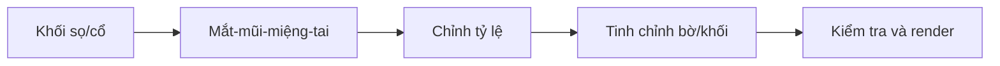

# Đồ án cuối khóa — Sculpt đầu nhân vật stylized

## Đề bài
Từ mesh đầu thô, thiết kế một đầu nhân vật tự chọn và xuất một bộ ảnh có thể đọc rõ khối từ nhiều góc. Đồ án có thể theo phong cách anime/stylized bán hiện thực, nhưng phải cho thấy quy trình tạo khối có chủ đích. Không cần tóc, mắt texture hoặc rig.

## Sản phẩm bắt buộc
- `head_final.blend`: dự án Blender có mesh đầu, nhãn cầu (nếu dùng riêng), camera/đèn.
- `head_front.png`, `head_side.png`, `head_three_quarter.png`: ảnh clay render cùng tỷ lệ/ánh sáng dễ so sánh.
- `head_detail_eye.png`, `head_detail_nose.png`, `head_detail_ear.png`: ảnh close-up để đánh giá hình khối.
- `process.md`: tối đa 1–2 trang ghi các giai đoạn, Voxel Size đã dùng (nếu có), vấn đề đã sửa và lý do.

## Quy trình 5 giai đoạn

### Giai đoạn 1 — Khối nền
Tạo silhouette sọ/cổ, chụp Front/Side/Top. Chỉ thêm các mốc lớn. Điều kiện chuyển bước: hậu sọ, hàm và cổ hợp lý ở góc 3/4.

### Giai đoạn 2 — Đặc điểm
Đặt nhãn cầu, mũi, vùng miệng, tai. Ưu tiên thể tích đặc điểm lớn, không vội nếp nhỏ.

### Giai đoạn 3 — Cân đối
Đánh giá mắt–mũi–miệng trên cùng một gương mặt. Dùng Grab/Mask để điều chỉnh cả vùng. So sánh trước/sau chỉnh tỷ lệ.

### Giai đoạn 4 — Hoàn thiện
Dùng Crease/Pinch cục bộ làm rõ mí, cánh mũi, khe môi, vành tai. Tránh chi tiết làm méo silhouette. Save As trước remesh.

### Giai đoạn 5 — Trình bày
Chọn chất liệu clay, ánh sáng rõ khối, camera ổn định. Xuất ảnh không bị crop cụt trán/cằm/tai. Không dùng hiệu ứng hậu kỳ che hình dạng lỗi.

## Rubric tự chấm (100 điểm)
| Tiêu chí | Điểm | Biểu hiện |
|---|---:|---|
| Silhouette sọ, hàm, cổ | 25 | Ổn định từ Front, Side và 3/4 |
| Tỷ lệ và mối liên kết | 20 | Mắt–mũi–miệng–tai hợp lý, gò má chuyển tự nhiên |
| Chi tiết hình khối | 25 | Mí dày, mũi có cánh/đầu, môi có volume, tai có vành/lòng |
| Kỹ thuật Sculpt | 15 | Biết dùng Grab, Clay, Mask, Smooth, remesh có chủ đích |
| Trình bày và tài liệu | 15 | Ảnh rõ ràng, file và ghi chú đầy đủ |

**Gợi ý tự đánh giá:** 90–100 = vững, 75–89 = tốt, 60–74 = cần chỉnh một vài vùng, dưới 60 = quay lại khối nền và quan sát ảnh tham chiếu.

## Checklist cuối
- [ ] Không có vùng nhọn, lưới rách hoặc artifact dễ thấy.
- [ ] Mí không quá mỏng; nhãn cầu không lộ bất thường.
- [ ] Mũi nhìn nghiêng và 3/4 hợp lý.
- [ ] Môi không phải hai ống tròn; cằm có thể tích.
- [ ] Tai có phía sau và chân tai.
- [ ] Đã thử lighting trung tính và đọc được form.
- [ ] Đã sao lưu file `.blend`.

## Giới hạn của đồ án
Kết quả là **high-poly sculpt**, không mặc định phù hợp Unity/Unreal. Quy trình game-ready cần retopology, baking, UV, texture, và rigging ở khóa khác.
