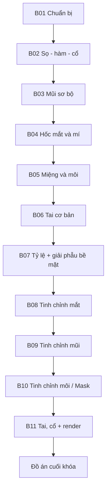

# Khóa học: Điêu khắc đầu nhân vật Stylized trong Blender (tiếng Việt)

> Tài liệu Markdown biên soạn từ bản ghi video khoảng **01:34:20**; dùng để tự học và thực hành. Không phải bản chép lại nguyên văn hoặc bản hướng dẫn chính thức do Blender phát hành.

## Kết quả cuối khóa
Bạn tạo được một đầu nhân vật stylized có hộp sọ, hàm, cổ, mũi, mắt, môi, tai; biết quy trình blockout → chỉnh tỷ lệ → sculpt chi tiết → kiểm tra nhiều góc → lighting/render. Bài học gồm thao tác minh họa, lỗi cần tránh, checklist và bài tập.

## Lộ trình học


| Bài | Nội dung | Mốc video |
|---|---|---|
| [01](01-chuan-bi-blender-va-quy-trinh-blockout.md) | Giao diện, công cụ và quy trình | 00:00–01:24 |
| [02](02-tao-khoi-hop-so-ham-va-co.md) | Dựng khối sọ, hàm và cổ | 01:25–08:42 |
| [03](03-blockout-mui.md) | Sống và đầu mũi | 08:43–16:07 |
| [04](04-tao-hoc-mat-mi-mat.md) | Hốc mắt, nhãn cầu, mí | 16:08–24:36 |
| [05](05-blockout-mieng-va-moi.md) | Dựng khối quanh miệng | 24:37–31:19 |
| [06](06-sculpt-tai-co-ban.md) | Vành tai và lòng tai | 31:20–41:13 |
| [07](07-giai-phau-be-mat-va-ty-le-tong-the.md) | Gò má, hàm, form tổng thể | 41:14–52:28 |
| [08](08-tinh-chinh-mat-va-vung-hoc-mat.md) | Tinh chỉnh vùng mắt | 52:29–1:05:11 |
| [09](09-tinh-chinh-mui.md) | Tinh chỉnh mũi | 1:05:12–1:10:39 |
| [10](10-tinh-chinh-moi-va-mask-face-sets.md) | Môi, Mask và Face Sets | 1:10:40–1:23:20 |
| [11](11-hoan-thien-tai-co-va-render.md) | Hoàn thiện và trình bày | 1:23:21–1:34:20 |

## Cách học đề xuất
1. Đọc phần **Mục tiêu học tập** trước khi xem đoạn video tương ứng.
2. Dừng ở các bước thực hành; lưu file `.blend` theo mốc bài học, ví dụ `head_03_nose.blend`.
3. Cuối mỗi bài chụp Front / Side / 3/4 và điền checklist.
4. Cuối khóa hoàn thành [đồ án thực hành](12-do-an-cuoi-khoa.md), làm [kiểm tra](13-cau-hoi-on-tap.md) và tra [thuật ngữ](14-thuat-ngu-va-tai-lieu.md).

## Cấu trúc thư mục
```text
Blender_Sculpting_Stylized_Head_VI/
├── README.md
├── 01-...md đến 11-...md          # 11 bài học
├── 12-do-an-cuoi-khoa.md           # Đồ án và rubric
├── 13-cau-hoi-on-tap.md            # Tự kiểm tra có đáp án
├── 14-thuat-ngu-va-tai-lieu.md     # Thuật ngữ, nguồn đọc thêm
└── transcript-goc.txt             # Bản ghi do người dùng cung cấp
```

## Chú ý quan trọng trước khi thực hành
- Giá trị **Voxel Size = 0.05, 0.025, 0.009** và số lượng đỉnh đề cập trong video chỉ phù hợp với **tỷ lệ lưới và cấu hình máy của giảng viên**; giảm Voxel Size sẽ tăng độ chi tiết và thường tăng chi phí xử lý.
- Mốc giải phẫu và nhận xét thẩm mỹ liên quan 'dễ thương', 'mặt nữ' là đặc trưng **phong cách cá nhân** của người dạy, không phải quy tắc áp dụng với mọi khuôn mặt.
- Bản ghi được chuyển ngữ tự động nên một số lệnh/phím mơ hồ; tài liệu không khẳng định các phím đó là mặc định. Tra menu chính thức trong phiên bản Blender đang dùng.
- Đây là **khóa Sculpting**, chưa dạy Retopology, UV, Rigging hoặc tối ưu asset để đưa vào game. Muốn nhân vật game-ready cần các công đoạn bổ sung.

## Nguồn đối chiếu kỹ thuật
- Blender Manual (Sculpting): https://docs.blender.org/manual/en/latest/sculpt_paint/sculpting/index.html
- Blender Manual (Remesh): https://docs.blender.org/manual/en/latest/sculpt_paint/sculpting/tool_settings/remesh.html
- Blender Manual (Face Sets): https://docs.blender.org/manual/en/latest/sculpt_paint/sculpting/editing/face_sets.html

**Bắt đầu:** [Bài 01 — Chuẩn bị Blender và cách học sculpt](01-chuan-bi-blender-va-quy-trinh-blockout.md)
