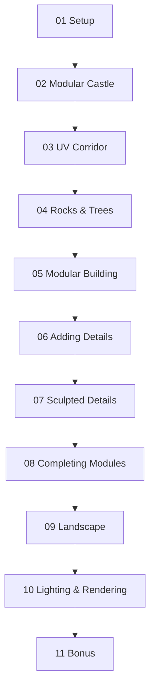

# Blender Environment Artist — Sổ tay học tập (Blender 5.1)

> Nguồn đề cương: [Udemy – Blender Environment Artist: Create 3D Worlds in Blender 5.1](https://www.udemy.com/course/blenderenvironment/)  
> Ngày biên soạn: 01/11/2026.  
> **Lưu ý bản quyền:** Đây là ghi chú **tự biên soạn** dựa trên tiêu đề, thời lượng và mô tả bài giảng **công khai** trên Udemy cùng kiến thức chung về Blender. Không có quyền truy cập video trả phí, phụ đề đầy đủ, lời giảng riêng, project files có bản quyền hoặc các tài nguyên khóa học nội bộ. Để học đúng từng thao tác của giảng viên, hãy mở video từ tài khoản có quyền truy cập.

## Thông số khóa học (tham khảo tại thời điểm thu thập)

- **Tác giả:** GameDev.tv Team, Rick Davidson, Grant Abbitt.
- **Blender:** 5.1 (khóa được remaster; bản 3.1 cũ được thông báo chuyển lưu trữ).
- **Tổng:** 11 module, 102 bài; Udemy ghi 14 giờ 15 phút.
- **Độ khó:** người mới đến trung cấp, làm dự án thực tế.
- **Sản phẩm thực hành:** lâu đài modular, hành lang, đá/cây, nhà kiểu trung cổ, một cảnh môi trường hoàn chỉnh với lighting/render/animation.

## Bản đồ module

| Module | Tên Udemy | Số bài | Thư mục |
|---:|---|---:|---|
| 01 | Introduction & Setup | 8 | [01-introduction-and-setup](01-introduction-and-setup/README.md) |
| 02 | Modular Castle | 8 | [02-modular-castle](02-modular-castle/README.md) |
| 03 | Spooky Corridor | 8 | [03-spooky-corridor](03-spooky-corridor/README.md) |
| 04 | Rock & Trees | 12 | [04-rock-and-trees](04-rock-and-trees/README.md) |
| 05 | Modular Building | 7 | [05-modular-building](05-modular-building/README.md) |
| 06 | Adding Details | 11 | [06-adding-details](06-adding-details/README.md) |
| 07 | Sculpted Details | 11 | [07-sculpted-details](07-sculpted-details/README.md) |
| 08 | Completing the Modules | 11 | [08-completing-the-modules](08-completing-the-modules/README.md) |
| 09 | The Landscape | 16 | [09-the-landscape](09-the-landscape/README.md) |
| 10 | Lighting & Rendering | 9 | [10-lighting-and-rendering](10-lighting-and-rendering/README.md) |
| 11 | Bonus: One Last Thing... | 1 | [11-bonus](11-bonus/README.md) |

## Sơ đồ tiến trình

## Cách học đề xuất

1. Mở bài tương ứng trong Udemy, xem video trên tài khoản hợp lệ.
2. Mở file `.md` của bài, đọc mục tiêu và nguyên lý.
3. Làm theo video; dùng hướng dẫn trong file như bài luyện bổ sung, **không xem đó là transcript**.
4. Xuất ảnh kiểm chứng, tick checklist và ghi khó khăn.
5. Kết thúc mỗi module, cập nhật README bằng ảnh/file `.blend` thực tế.

## Đánh giá khóa học có đáng học không?

**Đáng học** nếu muốn xây scene Blender có cấu trúc, đặc biệt là kiến thức modular assets, UV, texture, sculpt-to-bake, Asset Browser, bố cục và render. Đây là khóa học project-based có độ dài vừa phải, phù hợp người mới và người đã biết sơ bộ Blender nhưng thiếu pipeline làm một environment hoàn chỉnh.

**Chưa đủ một mình** nếu mục tiêu chính là kỹ thuật chuyên sâu Geometry Nodes, photorealistic foliage, procedural terrain quy mô lớn, tối ưu trên Unreal/Unity, hoặc pipeline AAA có yêu cầu chặt về LOD và performance profiling. Cần học thêm theo các chủ đề đó.

Đánh giá công khai thời điểm kiểm tra: khoảng 4,77/5 với hơn 4.500 lượt đánh giá; dữ liệu có thể thay đổi.

## Tài nguyên tham khảo miễn phí

- [Blender Manual](https://docs.blender.org/manual/en/latest/)
- [Blender Download](https://www.blender.org/download/)
- [Poly Haven](https://polyhaven.com/) (xem giấy phép từng tài nguyên)
- [Blender Studio](https://studio.blender.org/) (một số nội dung cần tài khoản)
