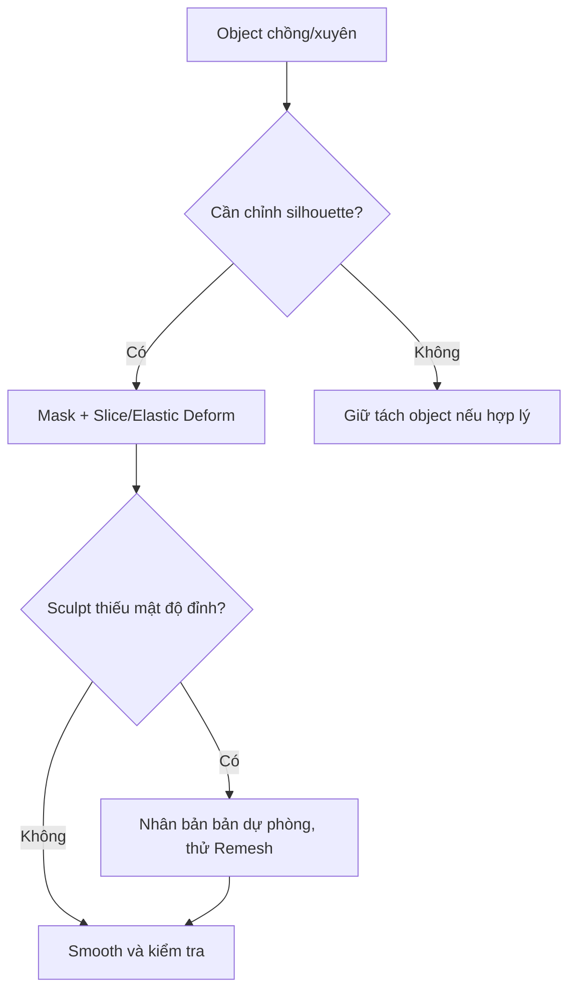

# Bài 03 — Lắp ráp trong Blender và sửa hình học bằng Sculpt

> **Vị trí trong video:** 06:48–14:11 · **Đầu vào:** bản ghi tiếng Việt do người học cung cấp.  
> **Phạm vi:** tái cấu trúc nội dung video thành bài thực hành; không phải phụ đề nguyên văn hay tài liệu chính thức của nhà cung cấp công cụ.

## Mục tiêu học tập

- Căn nhân vật theo reference và mặt đất trong Blender.
- Dùng Mask, Slice/Fill, Smooth, Elastic Deform, Remesh có chủ đích.
- Áp dụng Mirror để tiết kiệm công và sửa lỗi phần chồng nhau.

## Nội dung bài học

### 1. Dựng scene tham chiếu

1. Import các FBX đã sinh vào Blender.
2. **Add → Image → Reference** để đặt ảnh mẫu. Căn thân người với trục giữa và chân gần mặt đất.
3. Dùng chế độ **X-Ray** khi các lớp áo/giáp che nhau.
4. Điều chỉnh từng phần: `G` di chuyển, `R` xoay, `S` thu phóng. Khóa trục khi cần (`G`, `X`; `R`, `Z`...).
5. Duy trì nhiều object tách biệt nếu vai trò khác nhau; **không bắt buộc hàn hết** vào một mesh.

### 2. Sửa phần xuyên nhau hoặc phình thừa

Ví dụ từ video: vùng bụng có phần thừa của áo và quần chồng lên nhau.

- Vào **Sculpt Mode**, dùng **Mask** chọn vùng cần giữ hoặc cần thao tác.
- Dùng thao tác **Mask Slice** kèm lựa chọn giữ mặt cắt được bịt kín nếu phù hợp với phiên bản Blender.
- Xóa mask sau thao tác để tránh tình trạng cọ không ảnh hưởng vùng còn che.
- Giữ `Shift` để **Smooth** ở các công cụ sculpt thường dùng.
- `Ctrl` thường đảo hướng thao tác trên nhiều cọ, nhưng hãy kiểm tra từng cọ cụ thể.
- Dùng **Elastic Deform** (tên được chuẩn hóa từ lời nhận dạng âm thanh) để nắn quần/giáp ôm cơ thể.

### 3. Đối xứng với Mirror

Với găng tay hoặc hai phụ kiện tương đồng:

1. Chỉ làm một bên.
2. Căn **Origin** hoặc dùng đối tượng tham chiếu sao cho mặt phẳng gương đi qua giữa cơ thể.
3. Áp dụng Rotation/Scale nếu cần (`Ctrl + A`), kiểm tra tọa độ gốc.
4. Thêm **Mirror Modifier** theo X, bật Clipping khi mép giữa cần dính nhau.
5. **Giữ modifier chưa áp dụng** trong lúc chỉnh topology và UV nếu workflow phù hợp; chỉ apply ở bước xuất khi cần.

> Cảnh báo: `Ctrl+A` không tự chuyển Origin về world origin. Nếu hai nửa lệch, cần sửa điểm gốc hoặc Mirror Object.

### 4. Khi nào Remesh?

Nếu sculpt không đủ đỉnh hoặc lưới sau khi cắt trở nên không đều, có thể **Voxel Remesh** trên bản high-poly rồi tiếp tục làm mịn. Tuy nhiên, phải giữ bản sao và xem xét mesh bị hở: remesh có thể thay đổi chi tiết nhỏ, phá topology/UV đã tạo. Video nhấn mạnh làm việc với hình dạng tương đối kín trước thao tác.

### 5. Kiểm tra đầu ra

Xoay góc nhìn 360 độ, tập trung cổ, nách, eo, ngón tay, các mảng áo giáp; kiểm tra xuyên mặt và các mảng thừa.

## Bài thực hành và tiêu chí hoàn thành

- [ ] Import và căn ít nhất 4 bộ phận theo một ảnh reference.
- [ ] Sửa một lỗi chồng hình bằng Sculpt và lưu ảnh trước/sau.
- [ ] Dùng Mirror cho một cặp phụ kiện; kiểm tra trục và Origin.

## Tự kiểm tra

1. **Vì sao không Join hết mesh?**  
   *Gợi ý đáp án:* Object tách biệt vẫn dễ quản lý/UV/vật liệu và không nhất thiết gây vấn đề.
2. **Điểm cần lưu ý khi Remesh?**  
   *Gợi ý đáp án:* Sao lưu vì remesh phá topology cũ và có thể làm mất chi tiết.

## Ghi chú học tập

- Lưu bản `.blend` phiên bản mới trước các thao tác phá hủy như remesh, áp modifier hoặc join mesh.
- Các số poly, thông số bake và công cụ trong video là **ví dụ theo nhân vật Queen of Hearts**, không phải chuẩn bắt buộc cho mọi dự án.
- Tên tính năng có thể khác giữa phiên bản phần mềm; khi bản ghi tự động nhận sai tên, khóa học giữ khái niệm kỹ thuật và nêu những chỗ cần đối chiếu giao diện.
