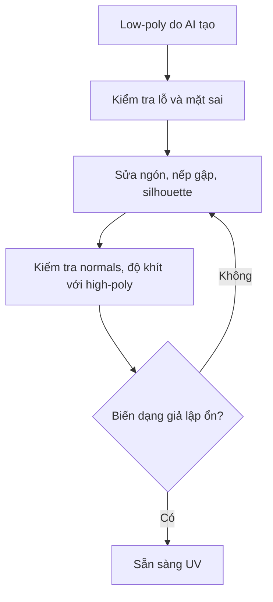

# Bài 05 — Retopology thủ công bằng RetopoFlow

> **Vị trí trong video:** 18:16–25:40 · **Đầu vào:** bản ghi tiếng Việt do người học cung cấp.  
> **Phạm vi:** tái cấu trúc nội dung video thành bài thực hành; không phải phụ đề nguyên văn hay tài liệu chính thức của nhà cung cấp công cụ.

## Mục tiêu học tập

- Đọc và sửa luồng cạnh của mesh AI.
- Biết chức năng PolyPen, Strokes, Loops, Contours và Patches.
- Hoàn thiện găng tay/mặt nạ rồi kiểm tra topology.

## Nội dung bài học

### 1. Tại sao phải sửa tay nếu đã có AI?

AI retopo thường để lại lỗ, mặt kéo dài, các vùng ngón tay rối hoặc đường cạnh không theo form. Kỹ năng đọc topology giúp quyết định đâu là lỗi thực sự, tránh bake và skinning trên một mesh yếu.

### 2. Thiết lập RetopoFlow

1. Giữ bản **high-poly** làm bề mặt tham chiếu và **low-poly** làm lưới sẽ chỉnh.
2. Cô lập hai object để tránh chọn nhầm.
3. Chọn low-poly, mở công cụ RetopoFlow theo giao diện phiên bản bạn cài.
4. Kiểm tra các đỉnh mới có bám đúng bề mặt high-poly không.

> Trong transcript, tên các nút được nhận dạng không ổn định; dùng ý nghĩa tác vụ để dò đúng công cụ trong bản RetopoFlow hiện tại.

### 3. Bộ công cụ cốt lõi

| Công cụ | Cách dùng |
|---|---|
| **PolyPen** | Dựng quad thủ công từ cạnh/đỉnh hiện có; vá vùng khó |
| **Strokes** | Nối nhiều hàng polygon dọc theo đường dẫn, nhanh cho vùng dài |
| **Loops** | Thêm vòng chia nơi cần cong hoặc gập khớp |
| **Contours** | Tạo các mặt cắt quanh ngón tay/cổ tay và nối các vòng |
| **Patches** | Lấp vùng trống có biên tương thích |

Video minh họa trên **găng tay**: loại lỗ thừa, làm lại ngón, thêm vòng quads theo chiều ngón. Với **mặt nạ**, tác giả bắt đầu từ PolyPen, vẽ đường viền, đi qua các cạnh tạo khối, rồi hoàn thiện bằng Strokes/Patches.

### 4. Nguyên tắc bố trí polygon

- Ưu tiên **silhouette** và khớp quan trọng (ngón, khuỷu, vai, cổ).
- Đi vòng quanh vùng biến dạng; tránh tam giác dài ngay nếp gập.
- Bộ phận chỉ thấy từ xa không cần những vòng ngón tay quá dày.
- Đảm bảo low-poly **bao đúng high-poly** để baking hiệu quả.
- Ở bề mặt phẳng/ít biến dạng, có thể dùng ít polygon hơn; không chạy theo lưới quad hoàn hảo ở mọi vị trí.

### 5. Kiểm tra cuối phần này

Trong video, một nhân vật chính tương đối chi tiết được báo khoảng **60.000 tam giác** sau khi tối ưu. Đây là **kết quả của ví dụ**, không phải mục tiêu mặc định.

## Bài thực hành và tiêu chí hoàn thành

- [ ] Sửa một vùng có lỗ/mặt kéo dài trên găng tay hoặc giáp.
- [ ] Dùng ít nhất 2 công cụ RetopoFlow khác nhau.
- [ ] Đo số triangles và lưu wireframe sau sửa.

## Tự kiểm tra

1. **Khi nào cần thêm edge loop?**  
   *Gợi ý đáp án:* Nơi cần theo độ cong của silhouette hoặc cần gập khớp.
2. **Retopology có phải chỉ là giảm polygon?**  
   *Gợi ý đáp án:* Không; còn cần luồng cạnh thích hợp, không lỗi và khả năng biến dạng.

## Ghi chú học tập

- Lưu bản `.blend` phiên bản mới trước các thao tác phá hủy như remesh, áp modifier hoặc join mesh.
- Các số poly, thông số bake và công cụ trong video là **ví dụ theo nhân vật Queen of Hearts**, không phải chuẩn bắt buộc cho mọi dự án.
- Tên tính năng có thể khác giữa phiên bản phần mềm; khi bản ghi tự động nhận sai tên, khóa học giữ khái niệm kỹ thuật và nêu những chỗ cần đối chiếu giao diện.
