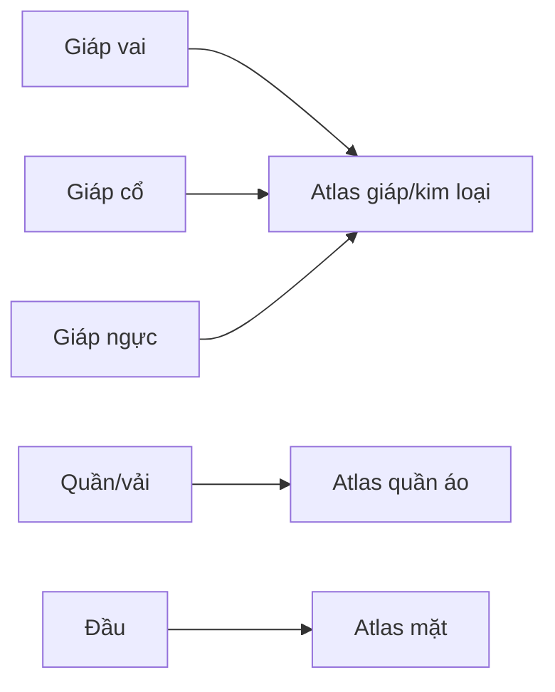

# Bài 06 — UV Unwrap, đường seam và đóng gói UV

> **Vị trí trong video:** 25:41–31:30 · **Đầu vào:** bản ghi tiếng Việt do người học cung cấp.  
> **Phạm vi:** tái cấu trúc nội dung video thành bài thực hành; không phải phụ đề nguyên văn hay tài liệu chính thức của nhà cung cấp công cụ.

## Mục tiêu học tập

- Hiểu UV island và độ kéo giãn texture.
- Biết sửa UV AI sinh bị vụn hoặc seam quá nhiều.
- Đóng gói UV theo nhóm vật liệu và tránh chồng island khi bake.

## Nội dung bài học

### 1. UV như trải vải ra mặt phẳng

UV Mapping chuyển bề mặt 3D thành tọa độ 2D để tô/bake texture. Nếu mặt cong bị trải không hợp lý, texture có thể **méo, kéo giãn hoặc thiếu độ phân giải**.

### 2. Kiểm tra UV AI

1. Chọn object, mở **UV Editing** và hiển thị toàn bộ UV islands.
2. Quan sát số đảo cực nhỏ; quá nhiều đảo có thể gây seam rõ và lãng phí pixel.
3. Dùng chế độ kiểm tra **stretch** trong Blender để nhận ra vùng bị biến dạng (quy ước màu phụ thuộc chế độ hiển thị).
4. Đồng bộ selection UV–mesh nếu cần, chọn một island rồi tìm phần tương ứng trên mesh.
5. Kiểm tra cạnh đánh dấu `Sharp` không mong muốn; làm sạch khi phù hợp với normal shading của model.

### 3. Đặt seam thủ công

Trong ví dụ video, một lọn tóc bị chia thành nhiều island nhỏ. Người hướng dẫn:

- Loại bỏ seam thừa.
- Đánh dấu một đường seam chạy dọc **mặt khuất** của lọn tóc.
- Unwrap lại để được một island dài, gọn và ít méo.
- Kiểm tra distortion lần nữa.

Quy tắc tương tự với quần áo: đặt seam ở cạnh bên, sau, dưới hoặc vùng dễ giấu; với gai/khối phức tạp, thêm đủ seam để có thể trải phẳng.

### 4. Unwrap và Pack

1. Trong Edit Mode chọn mặt cần unwrap (`A`).
2. Dùng `U → Unwrap`; lựa chọn thuật toán phụ thuộc phiên bản Blender và cấu trúc mesh.
3. Kiểm tra từng UV island có nằm đúng vùng texture dự kiến.
4. Dùng **Pack Islands** hoặc add-on UV Packer nếu có; đảm bảo margin phù hợp và **không overlap** giữa những phần cần bake độc lập.
5. Với bộ phận đối xứng dùng Mirror, có thể chia sẻ UV để tăng mật độ texel; nhưng nếu cần bake thông tin mỗi bên khác nhau hoặc tránh đè lên nhau, tách/bố trí UV phù hợp.

### 5. Tổ chức atlas theo vật liệu

Video gom nhiều mảng giáp có cùng material vào **một UV/texture set**. Cách này tránh một nhân vật có quá nhiều texture và material riêng lẻ.

> Khi chọn nhiều object và unwrap cùng nhau, cần đối chiếu UV map active, kích thước atlas và việc chúng có chung material được dùng trong engine hay không.

## Bài thực hành và tiêu chí hoàn thành

- [ ] Làm lại UV cho ít nhất một lọn tóc hoặc mảnh vải có seam quá nhiều.
- [ ] Pack UV của hai object vào chung atlas nếu dùng chung vật liệu.
- [ ] Kiểm tra stretch, margin và chồng đảo UV trong vùng cần bake.

## Tự kiểm tra

1. **Dấu hiệu seam xấu?**  
   *Gợi ý đáp án:* Đường nối ở chỗ dễ nhìn hoặc chia vật thể thành quá nhiều đảo UV.
2. **Vì sao pack các phần dùng chung vật liệu?**  
   *Gợi ý đáp án:* Tổ chức atlas gọn hơn và dễ baking/đưa vào engine.

## Ghi chú học tập

- Lưu bản `.blend` phiên bản mới trước các thao tác phá hủy như remesh, áp modifier hoặc join mesh.
- Các số poly, thông số bake và công cụ trong video là **ví dụ theo nhân vật Queen of Hearts**, không phải chuẩn bắt buộc cho mọi dự án.
- Tên tính năng có thể khác giữa phiên bản phần mềm; khi bản ghi tự động nhận sai tên, khóa học giữ khái niệm kỹ thuật và nêu những chỗ cần đối chiếu giao diện.
