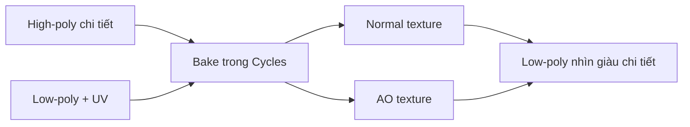

# Bài 07 — Baking Normal Map và Ambient Occlusion

> **Vị trí trong video:** 31:31–37:29 · **Đầu vào:** bản ghi tiếng Việt do người học cung cấp.  
> **Phạm vi:** tái cấu trúc nội dung video thành bài thực hành; không phải phụ đề nguyên văn hay tài liệu chính thức của nhà cung cấp công cụ.

## Mục tiêu học tập

- Hiểu cách lưu chi tiết high-poly vào low-poly.
- Thiết lập bake normal trong Blender Cycles.
- Nhận diện và xử lý artifact do ray/cage/UV.

## Nội dung bài học

### 1. Normal Map làm nhiệm vụ gì?

Low-poly có ít mặt hơn high-poly nên những đường rãnh, nếp gấp nhỏ có thể biến mất. **Tangent-space normal map** ghi thông tin hướng bề mặt, giúp ánh sáng phản ứng như thể mesh có nhiều chi tiết hơn, dù silhouette vẫn là low-poly.

### 2. Quy trình Selected to Active

1. Bảo đảm high-poly và low-poly trùng tỷ lệ, vị trí và hướng.
2. Unwrap low-poly; chuẩn bị image mới (`normal_cloth`, `normal_armor`...) với độ phân giải dự án yêu cầu.
3. Tạo material trên low-poly; thêm **Image Texture** và chọn đúng ảnh làm mục tiêu bake (node cần được active).
4. Chuyển **Render Engine → Cycles** và mở mục **Bake**.
5. Chọn **Bake Type: Normal**; nếu baking high→low, bật **Selected to Active**.
6. Chọn high-poly trước, **low-poly cuối cùng để nó là active object**.
7. Cấu hình ray distance / extrusion / cage phù hợp rồi Bake.
8. Lưu ảnh đã bake ra tệp, tránh mất kết quả khi đóng Blender.

### 3. Chỉnh cage/extrusion

Video bắt đầu thử với **extrusion khoảng 0,01** rồi điều chỉnh theo artifact. Có đoạn nghe như `0.006`; do chất lượng nhận dạng âm thanh, đây chỉ nên coi là **con số tham khảo cần tự thử lại**.

| Triệu chứng | Khả năng | Cách kiểm tra |
|---|---|---|
| Mảng màu khác thường | Ray miss hoặc chiếu nhầm bề mặt | Chỉnh extrusion/cage, xem vị trí hai mesh |
| Nếp gấp bị sai | UV seam, normal hoặc hướng high/low | Kiểm tra UV, smooth shading, normals |
| Chi tiết lan sang phần khác | UV bị overlap hoặc chọn nhầm object | Xem atlas và thứ tự chọn |
| Mảng đen/kỳ lạ | Sai image node, UV map hoặc tangent space | Kiểm tra node active/UV map/normals |

Không có một giá trị extrusion tối ưu cho mọi mesh. Bake một bộ phận nhỏ trước, quan sát và tăng giảm từng bước.

### 4. Ambient Occlusion (AO)

Video còn bake **AO map**, biểu diễn bóng che khuất mềm ở khe, dưới giáp, nếp vải... Với AO, các đối tượng lân cận có thể ảnh hưởng bóng; nếu cần AO riêng của một đối tượng, cân nhắc ẩn những phần không muốn góp bóng theo cấu hình bake.

### 5. Một bản đồ cho nhiều object

Nếu nhiều mảng dùng **cùng material/texture atlas**, bảo đảm UV của chúng không chồng nhau và chọn cùng mục tiêu ảnh khi lần lượt bake. Kiểm tra tùy chọn **Clear Image** để không xóa kết quả đã bake ở các vùng khác.

## Bài thực hành và tiêu chí hoàn thành

- [ ] Bake normal map cho một phần giáp hoặc quần và lưu PNG.
- [ ] Chụp so sánh low-poly trước/sau khi gắn normal map dưới cùng ánh sáng.
- [ ] Cố ý thử 2 mức extrusion; ghi artifact nào tăng/giảm.

## Tự kiểm tra

1. **Vì sao normal map không thay silhouette?**  
   *Gợi ý đáp án:* Vì chỉ sửa hướng chiếu sáng, không thêm hình học thực.
2. **Selected to Active chọn thứ tự nào?**  
   *Gợi ý đáp án:* High-poly trước, low-poly cuối cùng là active object.

## Ghi chú học tập

- Lưu bản `.blend` phiên bản mới trước các thao tác phá hủy như remesh, áp modifier hoặc join mesh.
- Các số poly, thông số bake và công cụ trong video là **ví dụ theo nhân vật Queen of Hearts**, không phải chuẩn bắt buộc cho mọi dự án.
- Tên tính năng có thể khác giữa phiên bản phần mềm; khi bản ghi tự động nhận sai tên, khóa học giữ khái niệm kỹ thuật và nêu những chỗ cần đối chiếu giao diện.
