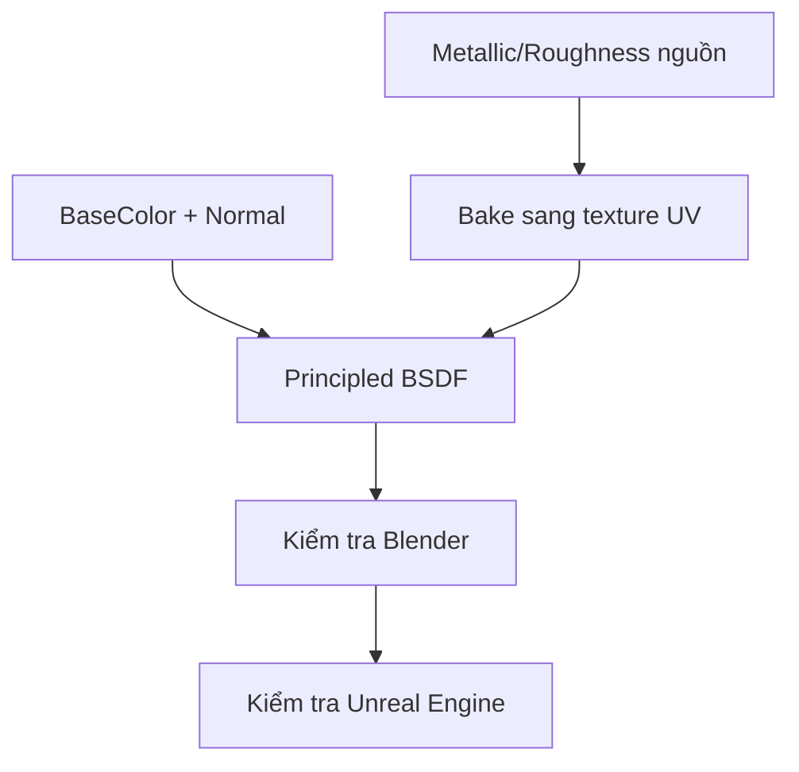

# Bài 09 — Thiết lập PBR: Metallic, Roughness và texture baking

> **Vị trí trong video:** 42:09–47:34 · **Đầu vào:** bản ghi tiếng Việt do người học cung cấp.  
> **Phạm vi:** tái cấu trúc nội dung video thành bài thực hành; không phải phụ đề nguyên văn hay tài liệu chính thức của nhà cung cấp công cụ.

## Mục tiêu học tập

- Phân biệt Base Color, Normal, Roughness và Metallic.
- Dùng map họa tiết kim loại và điều chỉnh độ lặp.
- Bake vật liệu thủ tục thành ảnh UV để đưa sang game engine.

## Nội dung bài học

### 1. Vì sao màu đẹp vẫn chưa giống kim loại?

**Base Color** chỉ xác định màu; phản ứng với ánh sáng còn do **Metallic** và **Roughness**. Video cho thấy bộ giáp sau khi có màu cần điều chỉnh mạnh về cảm giác bóng và chất kim loại.

| Map | Vai trò |
|---|---|
| Base Color / Albedo | Màu nhìn thấy của bề mặt |
| Normal | Vi chi tiết hướng bề mặt |
| Roughness | Độ tán xạ phản xạ: thấp bóng, cao nhám |
| Metallic | Xác định tính kim loại cho quy trình metal/rough |
| AO | Che khuất vùng tiếp giáp, khe nhỏ |

### 2. Tạo bộ vật liệu phong cách kim loại

Trong video, người hướng dẫn minh họa tạo texture **brushed metal/patina** bằng AI và sử dụng riêng **Roughness** cùng **Metallic** (normal map đã được bake trước). Bộ map được kết nối vào **Principled BSDF** của nhóm giáp.

1. Tạo/chuẩn bị bộ map ở độ phân giải mong muốn (video minh họa 2K).
2. Image Texture của Roughness/Metallic/Normal dùng **Non-Color**, Base Color dùng chế độ màu phù hợp.
3. Kiểm tra tỷ lệ vân kim loại trên bề mặt; nếu pattern quá to, điều chỉnh mapping/scale.
4. Dùng cùng material cho các mảnh giáp có tính chất bề mặt tương tự.

### 3. Vấn đề với vật liệu procedural khi export

Khi Blender dùng **Mapping, Texture Coordinate, các node phức tạp hoặc UV scale** không tương ứng với bộ ảnh đã export, engine có thể hiển thị khác. Video đề xuất **bake map Roughness/Metallic thành image theo UV**.

Quy trình có thể thực hành:

1. Tạo Image Texture mới trên vật liệu để chứa roughness/metallic.
2. Lấy giá trị bề mặt cần bake qua nhánh shader/emission phù hợp với quy trình hiện có.
3. Trong Cycles sử dụng bake loại **Emit** cho từng giá trị scalar khi cần, kiểm soát color management.
4. Với nhiều mảnh cùng atlas, kiểm tra UV không overlap, dùng đúng tên UV map và cùng image target.
5. Lưu PNG cho roughness/metallic, gắn lại map vào Principled BSDF và so sánh với shader ban đầu.

**Lưu ý chuẩn hóa kỹ thuật:** tên lựa chọn Bake trong bản ghi có thể bị nhận dạng sai; phương pháp Emit ở trên là cách thực hành bổ sung để tránh hiểu rằng mọi phiên bản Blender đều có nút Bake riêng tên `Roughness` hoặc `Metallic`.

### 4. Khi Join tạo mảng đen

Một trường hợp video mô tả là sau khi Join các object, mảng giáp bị đen. Nguyên nhân được xử lý bằng việc **chuẩn hóa tên UV map** giữa các object trước khi Join, rồi gắn/bake đúng UV active. Ngoài tên UV, cũng nên xem lại material slot, normals và UV bị chồng.

## Bài thực hành và tiêu chí hoàn thành

- [ ] Tạo một vật liệu giáp dùng đủ BaseColor, Normal, Roughness, Metallic.
- [ ] Thay đổi độ lặp pattern, chọn tỷ lệ hợp lý theo độ lớn giáp.
- [ ] Bake roughness/metallic ra ảnh UV và đối chiếu kết quả trước–sau.

## Tự kiểm tra

1. **Tại sao nên dùng Non-Color?**  
   *Gợi ý đáp án:* Vì Roughness/Metallic/Normal chứa dữ liệu, không phải thông tin màu hiển thị.
2. **Vì sao material có thể đổi khi export?**  
   *Gợi ý đáp án:* Không phải mọi node/mapping Blender đều có bản tương đương trong engine.

## Ghi chú học tập

- Lưu bản `.blend` phiên bản mới trước các thao tác phá hủy như remesh, áp modifier hoặc join mesh.
- Các số poly, thông số bake và công cụ trong video là **ví dụ theo nhân vật Queen of Hearts**, không phải chuẩn bắt buộc cho mọi dự án.
- Tên tính năng có thể khác giữa phiên bản phần mềm; khi bản ghi tự động nhận sai tên, khóa học giữ khái niệm kỹ thuật và nêu những chỗ cần đối chiếu giao diện.
