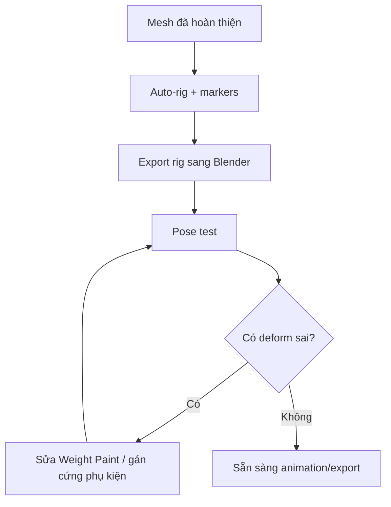

# Bài 11 — Auto-rig với AccuRig và Weight Paint trong Blender

> **Vị trí trong video:** 51:43–56:10 · **Đầu vào:** bản ghi tiếng Việt do người học cung cấp.  
> **Phạm vi:** tái cấu trúc nội dung video thành bài thực hành; không phải phụ đề nguyên văn hay tài liệu chính thức của nhà cung cấp công cụ.

## Mục tiêu học tập

- Đặt marker rig cơ thể và ngón tay hợp lý.
- Nhận diện biến dạng sai sau auto-rig.
- Sửa Weight Paint và gán phụ kiện cứng theo xương.

## Nội dung bài học

### 1. Rigging là gì?

Rigging thêm bộ xương điều khiển chuyển động; **Skinning/Weight Paint** xác định ảnh hưởng mỗi xương tới vertex. Video minh họa một công cụ được phiên âm méo thành “acrylic”; ngữ cảnh phù hợp với **AccuRig**. Cần đối chiếu đúng tên và giao diện phiên bản đang dùng.

### 2. Quy trình auto-rig

1. Export nhân vật ở A-pose/T-pose trung tính.
2. Import vào công cụ auto-rig.
3. Kiểm tra đường trục cơ thể và hướng nhân vật.
4. Đặt marker ở vai, khuỷu, cổ tay, hông, gối, cổ chân; đảm bảo mỗi marker đúng khớp.
5. Đặt marker cho bàn tay/ngón; video cho biết hệ thống có thể xử lý số ngón không nhất thiết là 5.
6. **Calibrate/Generate Rig** rồi preview pose hoặc animation.
7. Export bộ mesh + armature và import ngược vào Blender.

### 3. Sửa biến dạng bằng Weight Paint

Khi nâng tay, vùng **nách** có thể bị kéo theo xương sai. Chọn mesh phù hợp, vào **Weight Paint**, tìm bone deform tương ứng và xem bản đồ trọng số:

- Màu nóng thường là trọng số cao, xanh là thấp/0 (phụ thuộc giao diện).
- Sơn giảm ảnh hưởng xương sai hoặc tăng ảnh hưởng xương đúng.
- Kiểm tra thêm các xương lân cận: một điểm có thể còn bị kéo vì trọng số từ bone khác.
- Pose lại nhiều góc độ và kiểm tra khuỷu, nách, háng, ngón tay.

### 4. Phụ kiện cứng nên xử lý khác vải

Giáp đầu, mũ hoặc phụ kiện cứng không nhất thiết uốn cùng da. Trong video, người hướng dẫn **gán trọng số 1.0 cho xương đầu** với một số bộ phận để chúng đi theo đầu như vật cứng. Có thể dùng parenting/bone attachment tùy cấu trúc scene và engine.

### 5. Các lỗi cần rà soát

- Găng tay/ngón tay bị dính hoặc đảo chiều khi nắm.
- Vùng nách rách/kéo thân khi giơ tay.
- Giáp cứng bị uốn như vải.
- Vũ khí/phụ kiện không đi theo xương mục tiêu.
- Mesh thiếu Armature Modifier hoặc bị rớt vertex groups sau import.

## Bài thực hành và tiêu chí hoàn thành

- [ ] Đặt đủ marker của tay/chân và ngón trên tool auto-rig.
- [ ] Thử pose giơ hai tay, gập khuỷu và gập gối; chụp ảnh lỗi.
- [ ] Sửa ít nhất một lỗi weight hoặc phụ kiện cứng rồi kiểm tra lại.

## Tự kiểm tra

1. **Marker sai vị trí gây vấn đề gì?**  
   *Gợi ý đáp án:* Bone đặt lệch khớp dẫn đến biến dạng sai.
2. **Tại sao cần test pose sau auto-rig?**  
   *Gợi ý đáp án:* Rig tự động không biết chính xác cấu trúc giáp/vải và có thể sai trọng số.

## Ghi chú học tập

- Lưu bản `.blend` phiên bản mới trước các thao tác phá hủy như remesh, áp modifier hoặc join mesh.
- Các số poly, thông số bake và công cụ trong video là **ví dụ theo nhân vật Queen of Hearts**, không phải chuẩn bắt buộc cho mọi dự án.
- Tên tính năng có thể khác giữa phiên bản phần mềm; khi bản ghi tự động nhận sai tên, khóa học giữ khái niệm kỹ thuật và nêu những chỗ cần đối chiếu giao diện.
