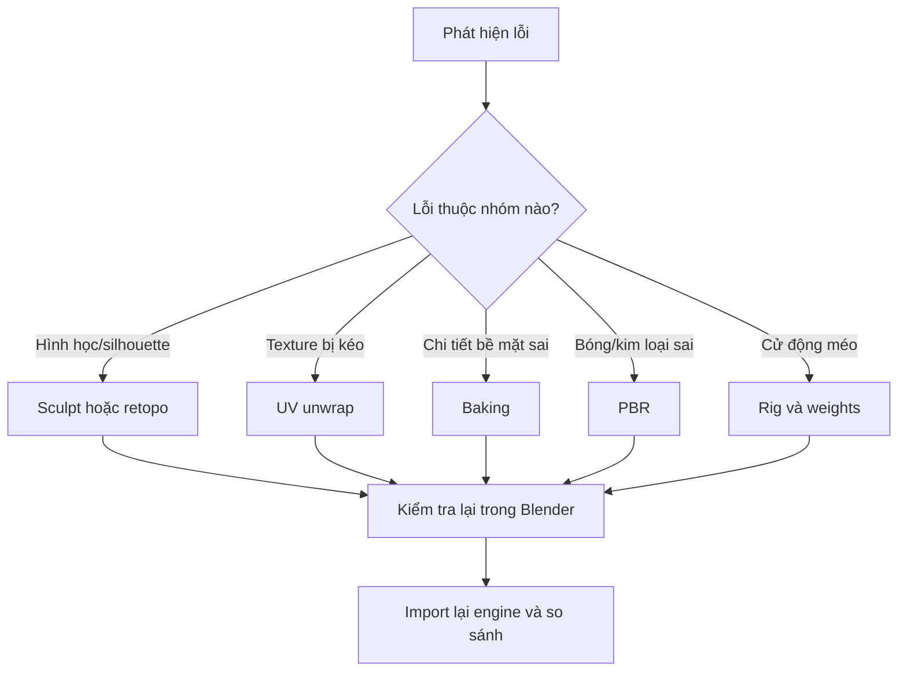

# Bài 13 — Thực hành tổng hợp: chẩn đoán lỗi AI 3D và bài tốt nghiệp

> **Vị trí trong video:** Ôn tập toàn bộ 00:06–57:17 · **Đầu vào:** bản ghi tiếng Việt do người học cung cấp.  
> **Phạm vi:** tái cấu trúc nội dung video thành bài thực hành; không phải phụ đề nguyên văn hay tài liệu chính thức của nhà cung cấp công cụ.

## Mục tiêu học tập

- Phân loại lỗi theo từng công đoạn để sửa tận gốc.
- Thực hiện quy trình xuyên suốt từ ảnh AI đến nhân vật rigged.
- Biết cách tự đánh giá chất lượng và lưu hồ sơ dự án.

## Nội dung bài học

### 1. Bảng chẩn đoán nhanh

| Quan sát | Nhóm lỗi gốc khả dĩ | Nơi xử lý trước tiên |
|---|---|---|
| Hai ngón dính nhau | Sinh mesh hoặc retopo sai | Sculpt/retopo; nếu hỏng nặng tái tạo bộ phận |
| Giáp xuyên qua bụng | Assembly và high-poly sculpt | Move/Elastic Deform/Mask Slice |
| Low-poly bẹp, mất form | Giảm poly quá mạnh | Chọn retopo khác hoặc sửa loops |
| Texture méo như kéo cao su | UV stretch | Seam/Unwrap/Pack |
| Normal map có các vệt lạ | Baking ray/cage/UV/normals | Bake test một object, đổi extrusion |
| Kim loại trông như nhựa | Metallic/Roughness chưa hợp lý | Material PBR |
| Mất vân khi sang engine | Procedural mapping chưa bake | Bake PBR maps theo UV |
| Giáp đen sau Join | UV map/material/normal sai | Đồng bộ UV map, slot, shading |
| Lông mi là miếng đen | Alpha sai | Shader alpha và texture mask |
| Vai/nách kéo méo | Weight/bone sai | Weight Paint, test pose |
| Mũ quay sai khi gật đầu | Phụ kiện gán sai bone | Head bone weights/attachment |

### 2. Dự án cuối khóa — Character Game-Ready

**Đề bài:** Dùng một ảnh nhân vật fantasy do bạn được phép sử dụng (có thể chọn Queen of Hearts như minh họa hoặc nhân vật riêng), tạo phiên bản 3D sử dụng được trong game, bao gồm ít nhất một phụ kiện cứng và một vùng cần biến dạng.

**Đầu ra đề nghị:**

```text
Character_GameReady/
├── README.md
├── 01_references/
├── 02_mesh_high/
├── 03_mesh_low/
├── 04_blender/
│   ├── character_working.blend
│   └── character_final.blend
├── 05_textures/
│   ├── base_color.png
│   ├── normal.png
│   ├── roughness.png
│   └── metallic.png
├── 06_rig/
├── 07_engine/
└── 08_evidence/
    ├── high_vs_low.png
    ├── uv_layout.png
    ├── rig_pose_test.png
    └── demo.mp4
```

### 3. Quy trình giải lỗi theo nguồn phát sinh



### 4. Rubric chấm bài (100 điểm — do khóa học tự biên soạn)

| Tiêu chí | Điểm |
|---|---:|
| Concept rõ, pose trung tính, phân tách hợp lý | 10 |
| Mesh đã sửa lỗi và bám reference | 20 |
| Retopology, silhouette, định mức tam giác | 20 |
| UV và normal/AO bake chính xác | 20 |
| PBR nhất quán và export không mất texture | 15 |
| Rig/weight và pose test ổn | 10 |
| Hồ sơ kỹ thuật, ảnh chứng minh | 5 |
| **Tổng** | **100** |

### 5. Ranh giới và chất lượng nguồn

Bản ghi là lời thoại phiên âm tự động, có nhiều tên riêng bị nhận dạng sai (ví dụ Blender, AccuRig, Tripo, Hunyuan3D, RetopoFlow, Unreal Engine). Các bài học đã **chuẩn hóa ý nghĩa kỹ thuật rõ ràng**, nhưng những thao tác phụ thuộc phiên bản hoặc tên tính năng không thể xác nhận chỉ từ phụ đề đều được ghi là cần đối chiếu. Những quy trình rõ ràng được phân biệt với phần thực hành mở rộng.

## Bài thực hành và tiêu chí hoàn thành

- [ ] Nộp ít nhất 1 dự án nhân vật có rig và đầy đủ texture set.
- [ ] Điền rubric và chụp bằng chứng từng tiêu chí.
- [ ] Viết nhật ký 5 lỗi đã gặp, nguyên nhân, cách sửa và cách ngăn lặp lại.

## Tự kiểm tra

1. **Khi gặp artifact màu lạ trên normal map, nên retopo ngay không?**  
   *Gợi ý đáp án:* Chưa; cần phân biệt ray/cage/UV/normals trước khi làm lại mesh.
2. **Dấu hiệu dự án đã đủ để bàn giao?**  
   *Gợi ý đáp án:* Có file xuất sạch, UV/texture đúng, rig test ổn, QA/đầu ra kiểm chứng rõ.

## Ghi chú học tập

- Lưu bản `.blend` phiên bản mới trước các thao tác phá hủy như remesh, áp modifier hoặc join mesh.
- Các số poly, thông số bake và công cụ trong video là **ví dụ theo nhân vật Queen of Hearts**, không phải chuẩn bắt buộc cho mọi dự án.
- Tên tính năng có thể khác giữa phiên bản phần mềm; khi bản ghi tự động nhận sai tên, khóa học giữ khái niệm kỹ thuật và nêu những chỗ cần đối chiếu giao diện.
