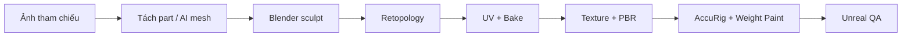

# Khóa học AI 3D Character — Từ concept đến Game-Ready

> Khóa học tiếng Việt tự biên soạn từ **bản ghi 00:06–57:17** đã cung cấp. Case study: nhân vật fantasy **Queen of Hearts**, sử dụng AI để tạo bộ phận 3D, Blender để hoàn thiện, công cụ retopo/texturing, rigging và giới thiệu trong Unreal Engine. Không phải bản sao/phiên âm đầy đủ video.

## Kết quả sau khóa học

Bạn có thể xây dựng một quy trình kiểm soát được từ hình 2D đến nhân vật có hình học chỉnh sửa được, low-poly sạch, UV atlas, normal/AO map, vật liệu PBR và skeleton có trọng số đúng.

## Sơ đồ lộ trình

## Danh sách bài học

| Bài | Tên bài | Đoạn video |
|---|---|---|
| 01 | [Toàn cảnh quy trình và chuẩn bị concept](01-lo-trinh-va-tham-chieu.md) | 00:06–02:51 |
| 02 | [Tách bộ phận và sinh mô hình 3D với AI](02-tach-bo-phan-va-sinh-mesh.md) | 02:51–06:47 |
| 03 | [Lắp ráp trong Blender và sửa hình học bằng Sculpt](03-lap-rap-va-sculpt.md) | 06:48–14:11 |
| 04 | [Retopology bằng AI: Tripo và Hunyuan3D](04-retopology-ai.md) | 14:12–18:15 |
| 05 | [Retopology thủ công bằng RetopoFlow](05-retopoflow-thu-cong.md) | 18:16–25:40 |
| 06 | [UV Unwrap, đường seam và đóng gói UV](06-uv-unwrap-va-packing.md) | 25:41–31:30 |
| 07 | [Baking Normal Map và Ambient Occlusion](07-baking-normal-ao.md) | 31:31–37:29 |
| 08 | [Tạo và vá texture màu bằng Tripo và Modif](08-ai-texturing-modif.md) | 37:30–42:08 |
| 09 | [Thiết lập PBR: Metallic, Roughness và texture baking](09-vat-lieu-pbr-kim-loai.md) | 42:09–47:34 |
| 10 | [Tạo mắt hai lớp và lông mi bằng alpha texture](10-mat-va-long-mi.md) | 47:35–51:42 |
| 11 | [Auto-rig với AccuRig và Weight Paint trong Blender](11-rigging-accurig.md) | 51:43–56:10 |
| 12 | [Đưa nhân vật vào Unreal Engine và kiểm tra game-ready](12-unreal-engine-va-qa.md) | 56:10–57:17 |
| 13 | [Thực hành tổng hợp: chẩn đoán lỗi AI 3D và bài tốt nghiệp](13-xu-ly-loi-tong-hop.md) | Ôn tập toàn bộ 00:06–57:17 |

## Chuẩn bị

- Blender, một nền tảng tạo mesh 3D từ ảnh (video minh họa Tripo), tùy chọn Hunyuan3D, add-on RetopoFlow/UV packing nếu tương thích phiên bản.
- Công cụ texturing (video nhắc Modif), công cụ auto-rig (AccuRig), engine game nếu thực hành đầu ra.
- Ảnh concept có quyền sử dụng; ưu tiên A-pose hoặc T-pose, có ảnh nhiều góc khi cần.
- Mỗi bài có mục tiêu, kiến thức, thao tác, bài tập và 2 câu tự kiểm tra kèm gợi ý.

## Nguyên tắc học

- Học theo thứ tự 01 → 13: sửa sai ở công đoạn sớm luôn rẻ hơn sửa ở khâu engine.
- Sau mỗi bài **lưu phiên bản mới** và ghi số poly, texture resolution, lỗi đã xử lý.
- Bản ghi có lỗi nhận dạng tên phần mềm và thuật ngữ. Các tên kỹ thuật đã được chuẩn hóa khi đủ căn cứ; một số hướng dẫn được đánh dấu là **thực hành bổ sung** chứ không gán cho video.
- Những ngưỡng poly, thời gian xử lý, giá công cụ, tên phiên bản không phải bảo đảm hiện hành.

## Các mốc để tự kiểm tra

| Mốc | Bằng chứng |
|---|---|
| Sau bài 3 | Scene Blender đã ráp và sửa phần xuyên nhau |
| Sau bài 5 | Low-poly có wireframe rõ, retopo lại vùng khó |
| Sau bài 7 | UV layout và normal bake trước/sau |
| Sau bài 9 | Material metal/roughness hoạt động khi export |
| Sau bài 11 | Pose test vai, gối, ngón tay |
| Sau bài 13 | Hồ sơ dự án và demo ngắn trong game engine |
