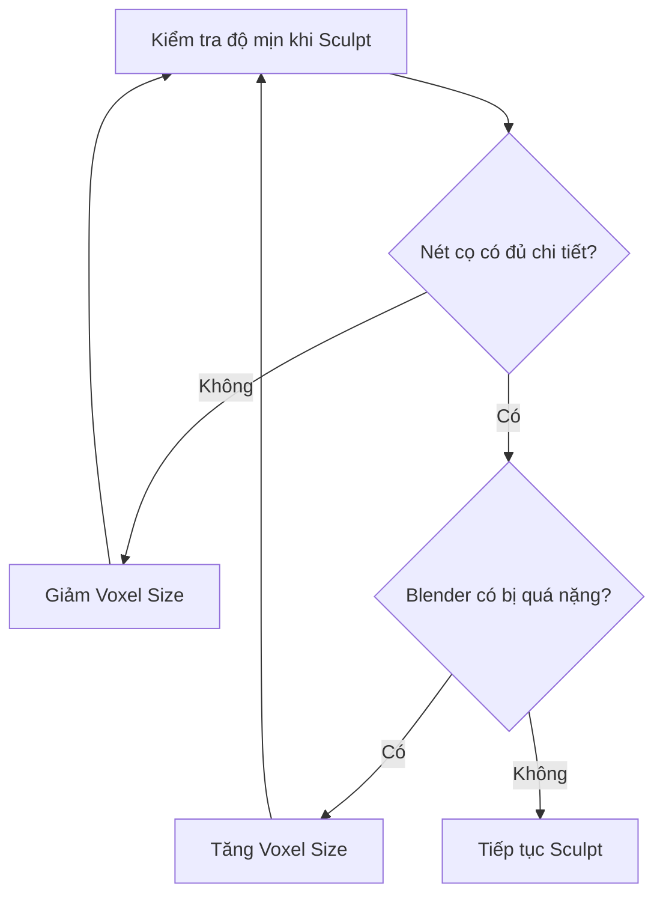

# Bài 01 — Sculpting và sửa lỗi hình học mô hình 3D do AI tạo

> **Chủ đề:** Mesh Cleanup, Sculpt Mode, Voxel Remesh, Symmetry và chỉnh sửa chi tiết  
> **Công cụ:** Blender  
> **Bài thực hành:** Sửa một nhân vật khủng long 3D nhập từ GLB, bao gồm mắt, răng, sọc da, đuôi và móng vuốt.

## 1. Tóm tắt

Mô hình 3D sinh bằng AI thường có chi tiết hấp dẫn nhưng đi kèm những lỗi khó phát hiện nếu chỉ nhìn ở một góc: mắt dính với phần đầu, răng méo, các đường rãnh mất cân đối, móng vuốt dẹt hoặc bề mặt không đều. **Sculpting** cho phép chỉnh lại hình học trực tiếp bằng cọ, giống như nặn đất sét kỹ thuật số. Mục tiêu của bài là tạo bản **High Poly sạch và có chủ đích**, làm nền tảng để tối ưu hóa sau này.

## 2. Mục tiêu học tập

Sau bài này, người học có thể:

- Nhập một mô hình `.glb` vào Blender và quan sát lưới từ nhiều góc.
- Phân biệt chỉnh hình học với chỉnh texture; biết khi nào phải bỏ qua hoặc làm lại texture cũ.
- Sử dụng `Voxel Remesh`, `Mirror Modifier`, `Sculpt Symmetry`, `Mask` và `Dyntopo` đúng mục đích.
- Thay mắt và răng bị lỗi bằng hình học dễ kiểm soát.
- Sửa chuyển tiếp của da, sọc, đuôi và móng bằng các cọ Sculpt thích hợp.

## 3. Chuẩn bị mô hình

### 3.1. Import GLB và điều hướng

Xuất mô hình từ công cụ AI ở định dạng `.glb`, sau đó dùng `File > Import > glTF 2.0` hoặc kéo thả tệp vào Blender nếu giao diện hỗ trợ. Khi nhập xong, lưu ngay một bản dự phòng.

| Thao tác | Phím hoặc công cụ |
| --- | --- |
| Xoay góc nhìn | Giữ nút chuột giữa và kéo |
| Lia góc nhìn | `Shift` + nút chuột giữa |
| Phóng to/thu nhỏ | Lăn bánh xe |
| Chọn hướng nhìn nhanh | Phím `~` mở View Pie Menu trong keymap phù hợp |
| Chuyển Object/Edit Mode | `Tab` |
| Chọn toàn bộ hình học trong Edit Mode | `A` |
| Di chuyển / Xoay / Co giãn | `G` / `R` / `S` |
| Hoàn tác | `Ctrl + Z` |

Đổi chế độ hiển thị sang **Solid** để tập trung vào bề mặt thay vì màu sắc. Trước khi Sculpt, kiểm tra cả mặt trước, mặt bên, mặt sau và phía dưới đuôi.

### 3.2. Phân loại lỗi và lập thứ tự sửa

Ở nhân vật ví dụ, những vùng cần ưu tiên là mắt, răng, sọc ở cổ và bụng, ranh giới dưới đuôi, cùng móng tay/chân. Nên sửa phần hình khối lớn trước, sau đó mới tạo lại các rãnh nhỏ. Nếu chỉnh hình học mạnh, texture AI ban đầu có thể không còn khớp; hãy **giữ bản gốc trong collection dự phòng** rồi tạm ngắt hoặc gỡ vật liệu trên bản đang sculpt.

Đừng đồng nhất thao tác `Remove Material` với xóa ảnh texture trên ổ đĩa: vật liệu, nút shader và file ảnh là những thành phần khác nhau.

## 4. Dọn cạnh và chuẩn bị độ phân giải Sculpt

### 4.1. Kiểm tra cạnh Sharp

Vào `Edit Mode`, chọn các cạnh cần xử lý và kiểm tra thuộc tính **Sharp**. Với những cạnh đánh dấu sắc ngoài ý muốn từ mô hình AI, dùng `Clear Sharp` để tránh tạo đường gãy shading không hợp lý. Không xóa bừa tất cả cạnh Sharp: một số cạnh ở móng hoặc ranh giới phụ kiện có thể cần giữ độ sắc.

### 4.2. Voxel Remesh

`Voxel Remesh` tái tạo lưới thành mạng đa giác có mật độ đều hơn, nhờ đó cọ Sculpt không bị ảnh hưởng quá nhiều bởi vùng có tam giác lộn xộn. Trong `Sculpt Mode`, chọn Voxel Size rồi thực hiện Remesh. Với mô hình ví dụ, **Voxel Size `0.002`** cho độ mịn phù hợp.

Giá trị này phụ thuộc kích thước thật của đối tượng trong Blender. Voxel nhỏ tạo nhiều chi tiết nhưng nặng RAM và dễ chậm; voxel lớn làm ít đa giác hơn nhưng có thể mất hình khối nhỏ. Thử cọ `Clay` trên bản sao, quan sát đường cọ có mịn không, rồi mới quyết định. Voxel Remesh có thể làm mất hoặc thay đổi các dữ liệu lưới như UV; chỉ thực hiện trên bản High Poly trước khi tạo UV mới.

## 5. Thiết lập đối xứng

### 5.1. Khi nên dùng Mirror

Nhân vật đối xứng hai bên rất phù hợp với `Mirror Modifier` trên trục ngang tương ứng, thông thường là X. Vào góc nhìn trước, bật Wireframe/X-Ray, chọn chính xác một nửa mặt và xóa phần đó. Sau đó thêm `Mirror Modifier`, bật `Clipping` để các đỉnh ở đường giữa không vượt qua mặt phẳng đối xứng.

Kiểm tra `Origin` và trục địa phương: nếu gốc đối tượng không nằm trên trục giữa, hai bên có thể phản chiếu lệch. Chỉ `Apply` modifier khi đã kiểm tra hình dạng và chắc chắn muốn biến kết quả đối xứng thành mesh thật.

### 5.2. Symmetry trong Sculpt Mode

Ngoài modifier, Blender có tùy chọn **Sculpt Symmetry** để phản chiếu nét cọ theo trục. Kiểm tra đúng trục trước khi tạo chi tiết. Nếu đã thay đổi hình học mạnh sau khi đặt Mirror, có thể cần Remesh lại trên bản làm việc. Không dựa vào tính đối xứng khi nhân vật mang trang bị hoặc có hình dạng bất đối xứng.

## 6. Bộ cọ cần nắm

| Công cụ | Công dụng điển hình |
| --- | --- |
| `Mask` / Box Mask | Khóa vùng không muốn tác động |
| `Grab` / Elastic Deform | Kéo thay đổi hình khối lớn, chỉnh ổ mắt và đuôi |
| `Inflate` | Làm phồng/lõm vùng đang sửa (có thể đảo chiều bằng `Ctrl` tùy cọ) |
| `Smooth` | Làm giảm bề mặt gồ ghề; `Shift` thường kích hoạt làm mịn tạm thời |
| `Clay` | Bồi thêm thể tích để tái tạo form |
| `Draw Sharp` | Khắc rãnh rõ giữa các mảng da |
| `Pinch` | Thu hẹp đường rãnh hoặc tăng độ sắc của chi tiết |
| `Crease Polish` / cọ nếp gấp tương ứng | Tăng cảm giác tách biệt quanh chân móng và ranh giới hình khối |

`F` điều chỉnh bán kính cọ trong các chế độ vẽ/sculpt thích hợp; Strength chỉnh trong thuộc tính cọ. Dùng lực nhẹ và đi nhiều lượt sẽ dễ kiểm soát hơn một nét quá mạnh.

## 7. Thực hành sửa từng bộ phận

### 7.1. Sửa ổ mắt và tạo nhãn cầu mới

1. Trong Sculpt Mode, dùng `Mask` bao quanh khu vực mắt cần thay; tinh chỉnh mask và làm sắc ranh giới bằng thao tác `Sharpen Mask` nếu cần.
2. Đảo mask để chỉ tác động vùng mong muốn, dùng `Grab`/`Elastic Deform` đẩy hình mắt cũ vào trong và `Inflate` theo hướng lõm để tạo ổ mắt.
3. Làm mịn rìa ổ mắt bằng `Smooth`; xóa mask khi hoàn tất.
4. Quay về Object Mode, thêm `UV Sphere`, co giãn và xoay phù hợp, đặt nhãn cầu vào ổ mắt.
5. Chỉnh `Origin` và thiết lập Mirror cho quả cầu để có mắt phía đối diện; bật shading mượt nếu cần.
6. Chọn lại phần đầu và điều chỉnh mí/viền hốc mắt sao cho nhãn cầu không xuyên thủng bề mặt khi quan sát từ bên cạnh.

Giữ mắt như đối tượng riêng giúp điều chỉnh kích thước, shader và vật liệu độc lập với đầu.

### 7.2. Xóa răng lỗi và dựng lại răng

Sử dụng `Box Mask` và mask thường để khoanh vùng răng bị méo, sau đó đảo mask và chỉnh hình học xung quanh. Khi vùng miệng bị răng cũ làm hỏng, `Dyntopo` có thể giúp tái chia đa giác ở đúng nơi cần bổ sung thể tích. **Dyntopo làm thay đổi topology liên tục**, vì vậy hãy lưu bản sao, kiểm tra modifier đang áp dụng và tắt tính năng khi không còn cần thiết.

Để dựng răng mới theo cách của bài thực hành:

1. Thêm một `Cube`, vào Edit Mode và xóa mặt thích hợp để dễ tạo hình răng.
2. Thu gọn đầu răng, kéo phần chân theo miệng; dùng `Subdivision Surface` mức ví dụ `2` để làm mềm hình học.
3. Đặt răng vào hàm, kiểm tra góc nhìn bên và phía dưới.
4. Trong Edit Mode, dùng `Shift + D` để nhân bản các răng trong cùng một đối tượng; thay đổi kích thước từng chiếc để tránh cảm giác rập khuôn.
5. Nếu hàm đối xứng, phản chiếu dãy răng qua `Mirror Modifier`.

### 7.3. Chỉnh sọc trên cổ, bụng và đuôi

Đầu tiên dùng `Smooth` xóa các rãnh lệch, quá nông hoặc bị đứt. Tiếp theo, dùng `Draw Sharp` vẽ lại một đường chính, `Pinch` để gọn ranh giới và `Smooth` lực nhẹ để chuyển tiếp tự nhiên. Đối với ranh giới dài dưới đuôi, có thể chọn kiểu `Stroke` dạng đường thẳng nếu phù hợp. Chỉ tăng độ sâu của rãnh khi quan sát toàn bộ silhouette vẫn hợp lý.

### 7.4. Chỉnh móng vuốt

Dùng `Grab` sửa trục và độ cong của móng, `Smooth` loại gồ ghề, cọ nếp gấp làm rõ chân móng rồi `Pinch` thu viền. Lặp lại trên tay và chân; nếu bật đối xứng, kiểm tra hai bên sau khi hoàn tất. Móng cần có phần chân liên kết rõ với ngón, không chỉ là một gai nhọn dính vào bề mặt.

## 8. Lỗi thường gặp

| Hiện tượng | Nguyên nhân thường gặp | Cách xử lý |
| --- | --- | --- |
| Sculpt bị rỗ hoặc có nét gãy | Mật độ lưới không phù hợp | Thử Voxel Remesh với kích thước phù hợp |
| Máy chậm đột ngột | Voxel quá nhỏ hoặc Dyntopo sinh quá nhiều mặt | Tăng kích thước voxel, tắt Dyntopo khi không cần |
| Hai bên không giống nhau | Sai trục, Origin lệch hoặc chưa bật Symmetry | Kiểm tra Origin, trục đối xứng, Clipping |
| Mắt lồi/lõm mất tự nhiên | Chỉnh ổ mắt quá mạnh | Quay lại form lớn bằng Grab rồi Smooth nhẹ |
| Rãnh da bị nhão | Làm mịn quá mức | Khắc lại bằng Draw Sharp, thu bằng Pinch |
| Texture cũ không khớp | Hình học đã bị sửa | Giữ bản gốc và tạo UV/texture mới sau khi khóa form |

## 9. Bài thực hành và tiêu chí hoàn thành

**Nhiệm vụ:** Sử dụng một nhân vật AI có tối thiểu ba vùng lỗi hình học. Tạo một bản High Poly mới, thay một chi tiết hỏng bằng mesh dựng tay và sửa tối thiểu hai vùng bằng Sculpt.

**Kiểm tra kết quả:**

- [ ] Có bản nhập gốc để đối chiếu.
- [ ] Bề mặt cơ bản mượt, không còn phần mắt/răng méo rõ rệt.
- [ ] Đối xứng không tạo khe hở dọc đường giữa.
- [ ] Đã quan sát kết quả ở cả mặt trước, mặt bên và phía dưới.
- [ ] Lưu file `01_sculpt_highpoly.blend`.

## 10. Câu hỏi ôn tập

### Câu 1

Khi mô hình AI có texture đẹp nhưng mắt và răng bị méo nghiêm trọng, nên ưu tiên làm gì?

A. Tăng Metallic.  
B. Render với nhiều đèn hơn.  
C. Sửa hình học rồi xử lý lại texture khi cần.  
D. Chỉ tăng độ phân giải ảnh texture.

**Đáp án:** C.  
**Giải thích:** Lỗi của mesh không thể được giải quyết bằng cách tăng chất lượng texture hay ánh sáng.

### Câu 2

Thay đổi nào thường làm **tăng** mật độ hình học của Voxel Remesh ở cùng kích thước đối tượng?

A. Giảm Voxel Size.  
B. Tăng Voxel Size.  
C. Tắt Solid View.  
D. Đổi tên Object.

**Đáp án:** A.  
**Giải thích:** Voxel nhỏ hơn lấy mẫu hình học chi tiết hơn và thường tạo nhiều mặt hơn.

### Câu 3

Trong quy trình đối xứng, bật `Clipping` của Mirror giúp ích chủ yếu ở đâu?

A. Làm tăng độ bóng của da.  
B. Xóa toàn bộ UV.  
C. Chuyển răng thành texture.  
D. Giữ các đỉnh ở đường giữa khỏi trượt xuyên qua mặt phẳng gương.

**Đáp án:** D.  
**Giải thích:** Clipping khóa chuyển động qua đường biên ở mặt phẳng mirror khi thao tác thích hợp.

### Câu 4

Khi cần làm cho một rãnh Sculpt sắc nét và gọn hơn sau khi khắc bằng `Draw Sharp`, lựa chọn phù hợp là gì?

A. Thêm camera.  
B. Dùng `Pinch` có kiểm soát.  
C. Xóa vật liệu của toàn bộ scene.  
D. Tăng alpha cho texture.

**Đáp án:** B.  
**Giải thích:** Pinch thu hẹp hình học quanh nét rãnh, giúp ranh giới rõ hơn.

### Câu 5

Vì sao không nên để `Dyntopo` hoạt động liên tục trong mọi thao tác?

A. Nó chỉ làm việc trong UV Editor.  
B. Nó ngăn lưu `.blend`.  
C. Nó có thể tăng số đa giác mạnh và gây chậm máy.  
D. Nó tự tắt mọi modifier trong Blender.

**Đáp án:** C.  
**Giải thích:** Dyntopo tạo lại cấu trúc lưới động, rất hữu ích cục bộ nhưng dễ làm mesh quá nặng.

## 11. Tổng kết

Một bản High Poly tốt phải có form đáng tin cậy trước khi tối ưu số đa giác. Trọng tâm bài này là **nhìn ra lỗi của AI, điều khiển mật độ lưới phù hợp, sửa hình khối lớn trước và tinh chỉnh chi tiết sau**. Kết quả là bản nhân vật sạch hơn, đủ chi tiết để làm đầu vào cho Retopology.
