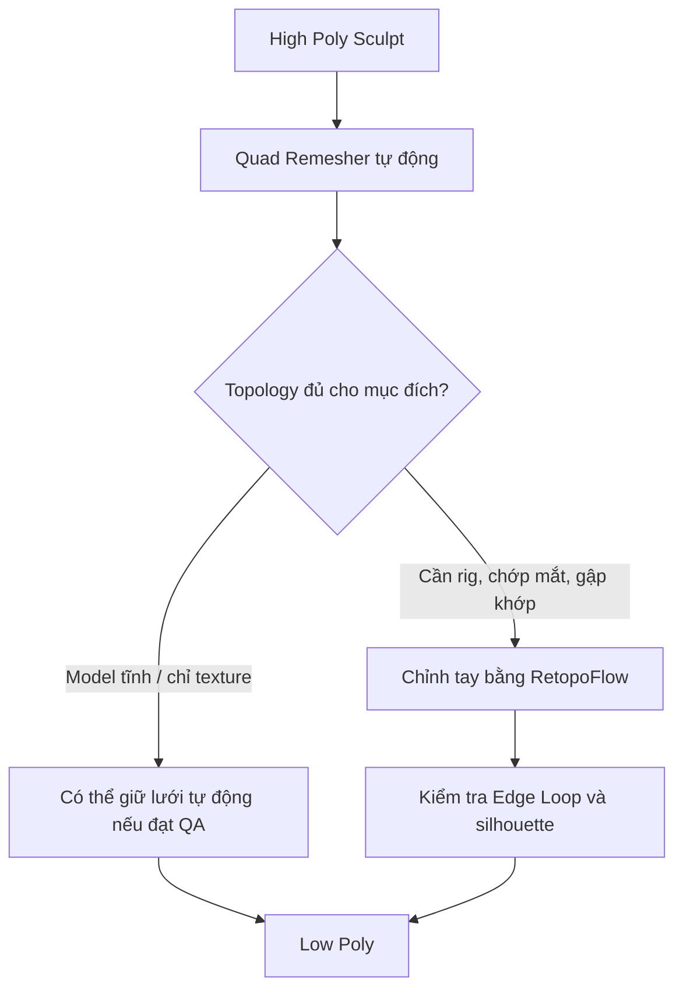

# Bài 02 — Retopology: Tối ưu lưới AI 3D để sẵn sàng Rigging

> **Chủ đề:** High Poly / Low Poly, Quad Remesher, RetopoFlow và Edge Loop  
> **Công cụ:** Blender; Quad Remesher, RetopoFlow (công cụ bổ trợ, không bắt buộc phải có cả hai)  
> **Sản phẩm:** Phiên bản Low Poly có luồng cạnh hợp lý quanh mắt, mũi, tay, chân và đuôi.

## 1. Tóm tắt

Mô hình sau Sculpt có thể chứa hàng triệu tam giác. Nó đủ tốt để giữ chi tiết, nhưng quá nặng để chỉnh tay, UV hoặc tạo hoạt ảnh thuận tiện. **Retopology** là quá trình xây dựng lại cấu trúc lưới của một hình dạng đã có: giảm số đa giác nhưng vẫn giữ silhouette và bố trí cạnh sao cho những vùng chuyển động có thể uốn cong tự nhiên.

Trong bài này, một bản sculpt chứa **hơn hai triệu tam giác** được dùng làm tham chiếu. Quy trình bắt đầu bằng tạo lưới tự động khoảng **4.000 quad**, sau đó tinh chỉnh thủ công; mô hình Low Poly minh họa hoàn thiện ở mức khoảng **8.800 tam giác**. Các con số đó phản ánh *ví dụ*, không phải một mức ngân sách chung cho mọi game.

## 2. Mục tiêu học tập

Người học có thể:

- Giải thích bốn mục đích của Retopology: hiệu năng, rigging, UV/texture và tái sử dụng.
- Phân biệt `Voxel Remesh` cho Sculpt với `Retopology` cho cấu trúc Low Poly.
- Tạo lưới giảm đa giác bằng Quad Remesher, kiểm tra hạn chế của kết quả tự động.
- Sửa topology thủ công với các thao tác tạo/di chuyển cạnh, vòng và miếng lưới bằng RetopoFlow.
- Ưu tiên Edge Loop cho mắt, mũi, tay, ngón tay, chân và vùng cong nổi bật.
- Hoàn thiện mặt phẳng đối xứng, shading và lưu riêng High Poly/Low Poly.

## 3. Topology tốt khác lưới ít đa giác thế nào?

Một mesh với ít mặt có thể trông ổn khi đứng yên nhưng gãy ở vùng vai hoặc khuỷu tay khi rig. Vì vậy cần xét hai tiêu chí: **mật độ đủ** để diễn tả hình dạng và **hướng đi của cạnh** theo chuyển động dự kiến.

| Khu vực | Tiêu chí topology | Vì sao quan trọng |
| --- | --- | --- |
| Mặt phẳng ít biến dạng | Ít cạnh, mật độ vừa đủ | Không lãng phí đa giác |
| Gai, đường cong, silhouette | Tăng mật độ nơi cong rõ | Tránh cạnh gãy lộ ra |
| Mắt và mí | Vòng cạnh bao quanh mắt | Hỗ trợ nhắm/chớp mắt |
| Mũi và lỗ mũi | Các vòng theo khối mũi | Bảo toàn hình dạng đặc trưng |
| Tay, chân, ngón | Edge Loop quanh khớp | Khớp gập không kéo méo mặt bất thường |
| Gốc đuôi | Các vòng chuyển tiếp liên tục | Đuôi cong mềm khi animate |

**Nguyên tắc:** Không dồn đều đa giác khắp nơi. Chỉ tăng mật độ ở nơi hình dạng hoặc chuyển động thực sự cần.

## 4. Chuẩn bị dự án và cài add-on

Tạo hai collection như `HIGH_POLY` và `LOW_POLY`. Đặt mesh sculpt đã hoàn chỉnh trong collection High Poly, tạo bản Low Poly mới từ nó. Giữ mắt/răng dựng riêng nếu chúng vốn đã đơn giản và không cần tự động giảm lưới.

Có hai nhóm công cụ:

- **Quad Remesher:** Sinh lưới quad tự động theo hình khối; tiết kiệm thời gian ở bước dựng nền.
- **RetopoFlow:** Cho phép vẽ và chỉnh topology thủ công trên bề mặt mesh tham chiếu; hữu ích để sửa từng vùng mà bước tự động không đảm bảo.

Để cài add-on dưới dạng `.zip`, tải bản thích hợp từ nguồn phát hành, mở `Edit > Preferences > Add-ons` hoặc mục quản lý Extensions tùy phiên bản Blender, chọn cài từ đĩa, kích hoạt rồi kiểm tra bảng công cụ. Không nên mặc định một phiên bản add-on tương thích với mọi bản Blender.

## 5. Tạo Low Poly tự động bằng Quad Remesher

1. Chọn mesh High Poly, chạy Quad Remesher để tạo đối tượng lưới mới.
2. Với nhân vật ví dụ, đặt mục tiêu **4.000 quad**, **Adaptive Size 50%** và bật chế độ **Symmetry** theo trục phù hợp.
3. Chạy Remesh, quan sát kết quả ở Solid View và Edit Mode.
4. Đặc biệt kiểm tra hình mắt, mũi, gốc gai, ngón và các khớp.
5. Không xóa bản High Poly: bản đó còn cần để bake Normal Map.

Thành công của remesher được đánh giá bởi chất lượng hình khối *và* cấu trúc các vòng. Nếu quanh mắt sinh ra cạnh gần như hình vuông, khớp tay thiếu vòng, hoặc mũi không đủ mật độ, chưa nên coi đó là topology cuối.

## 6. Chỉnh topology bằng RetopoFlow

### 6.1. Thiết lập mesh nguồn và mesh đích

Chuẩn bị High Poly làm bề mặt tham chiếu và Low Poly làm mesh cần chỉnh. Kiểm tra và áp dụng những modifier cần thiết trên **bản sao làm việc** để tránh việc topology thay đổi bất ngờ khi add-on hoạt động. Chọn đúng hai đối tượng theo hướng dẫn của phiên bản RetopoFlow đã cài, mở công cụ `RetopoFlow` và vào chế độ chỉnh active mesh.

Một ưu điểm của retopology bám bề mặt là các đỉnh Low Poly được đặt gần hình dáng High Poly. Điều này giữ hình tương ứng với bản sculpt, làm bước bake về sau đơn giản hơn.

### 6.2. Nhóm công cụ sử dụng

| Công cụ | Mục đích trong bài |
| --- | --- |
| `PolyPen` | Tạo mặt, nối đỉnh, kéo dài cạnh |
| `Contours` / `PolyStrips` | Dựng các dải vòng bao quanh vùng cong hoặc khớp |
| `Knife` / thao tác cắt | Chia mặt để tăng mật độ cục bộ |
| `Loops` | Thêm một vòng cạnh theo cấu trúc hiện có |
| `Patches` | Lấp một vùng trống bằng topology có tổ chức |
| `Tweak` | Dịch chuyển và điều chỉnh nhiều đỉnh |
| `Relax` | Phân bố kích thước các mặt đều và mượt hơn |

`G` thường là phím di chuyển trong Blender; `K` dùng Knife ở chế độ tương ứng; `Ctrl + R` thêm Loop Cut trong Edit Mode thông thường. Công cụ RetopoFlow có tương tác riêng, vì vậy ưu tiên tên công cụ và kiểm tra shortcut trong giao diện add-on đang dùng.

### 6.3. Sửa vùng gai trên lưng

Ở vùng gai, hãy xóa các mặt Low Poly đang có hướng cạnh hỗn loạn, sau đó dùng PolyPen nối lại thành một chuỗi mặt xoay quanh chân gai. Với đoạn cong, thêm một vài cạnh bằng Knife hoặc Loop; với vùng phẳng, giữ mật độ thấp hơn. Dùng `Relax` để tránh một số quad quá dài hoặc méo.

Không phải mọi mặt đều phải là quad; tam giác có thể chấp nhận tại vùng ít biến dạng khi được dùng có chủ đích. Điều quan trọng là **hướng cạnh đi quanh chân gai rõ ràng**, không tạo mặt chồng lên nhau và silhouette không bị gãy khi nhìn từ xa.

### 6.4. Làm Edge Loop quanh mắt

1. Chọn và xóa các mặt Low Poly xấu quanh ổ mắt.
2. Dùng `PolyStrips` hoặc PolyPen đặt vòng mặt đầu tiên men theo viền mắt.
3. Chỉnh từng đỉnh để vòng cạnh tròn và nằm gần bề mặt sculpt.
4. Nối vòng mới với lưới ngoài, thêm một vòng trong nếu cần tránh lộ khe khi chuyển động.
5. Dùng `Relax` để tránh quad bị kéo dài hoặc tụ lại thành cục.

**Lưu ý:** Lớp topology quanh mắt đáng đầu tư khi nhân vật cần chớp mắt. Nếu nhân vật chỉ đứng tĩnh hoặc mắt là một khối cầu bất động, có thể đơn giản hóa.

### 6.5. Mũi, tay, chân và ngón

Lỗ mũi có độ lõm và độ cong nên thường cần thêm mật độ xung quanh để giữ form. Tay và ngón phải có những vòng rõ dọc chiều dài và quanh khớp, tránh kết thúc các đường cạnh phức tạp ngay tại nơi gập. Chân và đuôi áp dụng nguyên tắc tương tự: các vòng cạnh đi theo tiết diện và thay đổi mật độ dần dần, không chuyển đột ngột từ quá dày sang quá thưa.

## 7. Hoàn thiện đối xứng và shading

Sau khi thoát RetopoFlow, kiểm tra các modifier còn lại. Nếu hai nửa chưa khép, vào Edit Mode và chọn dải đỉnh theo đường giữa. Đưa tất cả tọa độ X của chúng về mặt phẳng giữa bằng `S`, `X`, `0` khi tâm thao tác thích hợp, hoặc nhập `X = 0` trong bảng Transform của lưới. Thêm/bật `Mirror Modifier` với `Merge` và `Clipping` để tránh khe hở.

Quan sát lớp shading. Có thể dùng `Shade Smooth` hoặc chế độ làm mượt theo góc phù hợp; không cố che lỗi silhouette hoặc topology chỉ bằng shading. Giữ modifier Mirror chưa Apply nếu việc UV theo đối xứng còn có ích và đã chủ động lên kế hoạch xử lý UV.

## 8. Kiểm tra chất lượng Low Poly

Với mô hình ví dụ, bản sau tinh chỉnh ở mức khoảng **8.800 tam giác**. Khi kiểm tra chất lượng, đừng chỉ đọc con số tổng.

- **Silhouette:** Hình dáng đầu, gai, đuôi và bàn chân có giống High Poly không?
- **Mật độ:** Có vùng ít quan trọng dùng quá nhiều mặt, hay vùng cong bị thiếu mặt?
- **Khả năng biến dạng:** Vai, háng, gối, ngón và quanh mắt có các vòng phù hợp không?
- **Đối xứng:** Đường giữa có kín, không bị chồng mặt hay lệch nửa?
- **Tổ chức:** High Poly và Low Poly có tách rành mạch để phục vụ bake không?

## 9. Lỗi thường gặp

| Lỗi | Dấu hiệu | Hướng giải quyết |
| --- | --- | --- |
| Auto Retopo đẹp khi tĩnh nhưng cong lỗi | Khớp gập bị bóp méo | Vẽ lại Edge Loop quanh khớp |
| Gai trông vuông | Thiếu mặt theo silhouette cong | Thêm cạnh cục bộ, tránh chia đều toàn mesh |
| Low Poly trôi khỏi sculpt | Đỉnh không bám đúng bề mặt | Chỉnh công cụ bám bề mặt/đặt lại đỉnh |
| Xuất hiện vết nứt giữa hai nửa | Tọa độ đỉnh ở trục giữa không khớp | Căn về trục 0, dùng Mirror Merge/Clipping |
| Quads biến dạng mạnh | Nhiều mặt dài, hẹp hoặc giao nhau | Dùng Relax và nối lại một số cạnh |

## 10. Bài thực hành và tiêu chí hoàn thành

**Đề bài:** Từ một bản High Poly đã Sculpt, tạo một bản Low Poly để có thể rig ít nhất tay, chân và đầu. Tập trung chỉnh lại **một vùng tròn** (ví dụ mắt hoặc mũi) và **một vùng có khớp** (ví dụ tay/chân).

- [ ] High Poly được giữ nguyên để bake.
- [ ] Low Poly có số mặt giảm mạnh và vẫn giữ silhouette.
- [ ] Có ít nhất hai vùng Edge Loop đã được kiểm tra thủ công.
- [ ] Không có khe hở đối xứng rõ rệt.
- [ ] Lưu file `02_lowpoly_retopo.blend` với tên collection dễ hiểu.

## 11. Câu hỏi ôn tập

### Câu 1

Vì sao một mô hình Low Poly có ít tam giác chưa chắc phù hợp để rig?

A. Vì Low Poly không thể có vật liệu.  
B. Vì hướng và vòng cạnh có thể không phù hợp với vùng biến dạng.  
C. Vì Blender không đọc được tam giác.  
D. Vì rig bắt buộc cần High Poly.

**Đáp án:** B.  
**Giải thích:** Topology cho rig phải bố trí các vòng cạnh theo chuyển động, không chỉ tối thiểu hóa số mặt.

### Câu 2

Chỗ nào thường cần thêm mật độ hình học hơn?

A. Vùng phẳng, không bao giờ chuyển động.  
B. Phần bên trong không nhìn thấy của model.  
C. Vùng rất xa camera mà không thay đổi silhouette.  
D. Đường cong đặc trưng và khu vực khớp chuyển động.

**Đáp án:** D.  
**Giải thích:** Đường cong mạnh và vùng uốn cần đủ mặt để giữ hình và biến dạng tự nhiên.

### Câu 3

Tác dụng chính của RetopoFlow trong quy trình này là gì?

A. Chỉnh các vòng, cạnh và mật độ Low Poly thủ công trên hình tham chiếu.  
B. Thay thế hoàn toàn bước rigging.  
C. Tự tạo texture chất lượng cao.  
D. Xuất bản asset lên marketplace.

**Đáp án:** A.  
**Giải thích:** RetopoFlow là công cụ trợ giúp xây dựng topology trên bề mặt tham chiếu.

### Câu 4

Khi thấy topology xung quanh mắt chỉ có nhiều đường cạnh vuông vức và nhân vật cần chớp mắt, nên làm gì?

A. Chỉ tăng độ phân giải render.  
B. Giữ nguyên vì mắt sẽ tự thích nghi.  
C. Tạo Edge Loop theo viền mắt.  
D. Xóa Armature.

**Đáp án:** C.  
**Giải thích:** Loop quanh mí cung cấp luồng cạnh thuận lợi cho biến dạng kiểu đóng/mở mắt.

### Câu 5

Vì sao phải giữ cả bản High Poly khi đã có Low Poly?

A. High Poly bắt buộc dùng để đăng thumbnail.  
B. High Poly chứa chi tiết cần chuyển sang texture bằng baking.  
C. Low Poly không lưu được.  
D. Để tăng số tam giác khi chạy animation.

**Đáp án:** B.  
**Giải thích:** Bản High Poly là nguồn chi tiết để tạo Normal Map hoặc các loại texture khi bake.

## 12. Tổng kết

Retopology là cầu nối giữa **hình đẹp** và **hình dùng được trong sản xuất**. Một Low Poly tốt có mật độ vừa đủ, các vòng cạnh có lý do rõ ràng và hình dáng gần với bản sculpt. Kiểm tra topology ngay từ giai đoạn này sẽ giảm đáng kể việc sửa biến dạng khi rig hoặc sửa texture khi bake.
