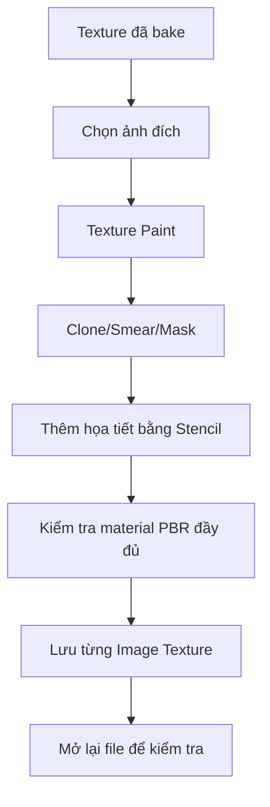

# Bài 04 — Texture Painting, sửa lỗi Bake và vật liệu PBR trong Blender

> **Chủ đề:** Texture Paint, Clone, Smear, Paint Mask, Roughness Map và Stencil Projection  
> **Công cụ:** Blender Texture Paint, UV Editor, Shader Editor  
> **Sản phẩm:** Texture hoàn chỉnh cho mắt và cơ thể nhân vật, có thể sử dụng cùng Normal Map.

## 1. Tóm tắt

Sau khi chuyển màu và chi tiết từ bản High Poly sang Low Poly, nhân vật có thể vẫn còn những vết loang hoặc chi tiết cũ không khớp hình mới. `Texture Paint` cho phép tô trực tiếp lên mô hình 3D hoặc ảnh UV để sửa màu, làm mềm ranh giới và thêm họa tiết. Khi kết hợp với hệ vật liệu **PBR (Physically Based Rendering)**, chúng ta còn có thể kiểm soát độ nhám, cảm giác bóng và mức kim loại của từng vùng.

Bài thực hành tập trung vào ba nhóm việc: **vẽ mới mắt**, **sửa texture lỗi bằng Clone và Smear**, rồi **tạo/kiểm tra thuộc tính PBR và chiếu logo bằng Stencil**.

## 2. Mục tiêu học tập

Sau bài này, người học có thể:

- Tạo ảnh texture mới trong Shader Editor và liên kết nó với vật liệu.
- Vẽ mắt nhiều lớp màu bằng cọ mềm và cọ sắc.
- Dùng `Clone`, `Smear`, `Paint Mask` để sửa vùng bake bị bẩn mà không ảnh hưởng chi tiết khác.
- Phân biệt Base Color, Roughness, Metallic và Normal Map.
- Tô và kiểm tra Roughness Map theo giá trị đen/trắng.
- Chiếu logo/họa tiết lên bề mặt qua `Stencil` và lưu ảnh texture đúng cách.

## 3. Chuẩn bị môi trường Texture Paint

Trong Object Mode, có thể gộp các phần nên dùng chung vật liệu và UV bằng cách chọn nhiều Object rồi `Ctrl + J`. Chỉ gộp khi chúng thực sự nên là một đối tượng: hai mắt có thể cùng material, còn thân/răng vẫn có thể tách tùy quy hoạch UV. `Join` không tự làm sạch UV và cũng không tự hàn các đỉnh trùng nhau.

Chọn mesh cần vẽ, mở Shader Editor, kiểm tra material chứa `Principled BSDF` và `Image Texture` của Base Color. Trong workspace `Texture Paint`, bố trí một vùng nhìn mô hình 3D và một `Image Editor` để quan sát ảnh UV. Ở viewport có thể bật Material Preview để đánh giá màu dưới ánh sáng, hoặc xem riêng texture để tránh bị ảnh hưởng bởi vật liệu.

**Quy tắc quan trọng:** Cần luôn biết **ảnh nào đang active** trong Texture Paint/Shader Editor. Vẽ vào nhầm Image Texture node có thể làm hỏng Roughness hoặc Normal Map thay vì Base Color.

## 4. Vẽ lại đôi mắt

### 4.1. Tạo ảnh màu cho mắt

1. Chọn mắt đã có UV, tạo material riêng nếu chưa có.
2. Trong Shader Editor, thêm `Image Texture` và chọn `New`, đặt tên như `Dino_Eyes_Color`.
3. Kết nối đầu ra `Color` của Image Texture tới `Base Color` của `Principled BSDF`.
4. Vào Texture Paint, chọn đúng ảnh vừa tạo. Có thể dùng Fill để đặt màu nền cho nhãn cầu.

### 4.2. Sơn các lớp màu

Bắt đầu với nền sáng cho lòng trắng, sau đó đặt một vòng màu tối làm viền mống mắt. Dùng cọ mềm tạo chuyển sắc từ màu tối sang màu xanh đậm hoặc xanh lục ở trung tâm, tiếp tục thêm vùng sáng nhỏ, rồi dùng cọ sắc tạo đồng tử sẫm màu. Kích thước cọ điều chỉnh bằng `F` khi phím tắt phù hợp.

Bài thực hành có hai nhãn cầu đối xứng: bật tùy chọn đối xứng trong Texture Paint khi muốn áp dụng nét tương ứng lên cả hai bên. Tuy vậy, cần kiểm tra UV và object transform, vì cấu hình của nhân vật có thể khiến kết quả phản chiếu không trùng mong muốn.

Sau khi hoàn tất hình mắt, điều chỉnh **Roughness** thấp hơn cho phần nhãn cầu nếu muốn cảm giác bóng. Thử các góc nhìn và nguồn sáng trước khi quyết định giá trị.

## 5. Sửa texture lỗi sau Baking

### 5.1. Tại sao bản Bake có thể có lỗi?

Khi nhãn cầu cũ được thay bằng hình cầu mới, màu quanh mí trên bản AI cũ không còn phù hợp với geometry mới. Các đường rãnh ở bụng, gai hoặc miệng có thể bị lệch; đôi khi màu vẽ tạo một đường tối trùng với Normal Map khiến bề mặt trông quá gắt. Những hiện tượng như vậy nên được sửa **trên ảnh Base Color**, không sửa trực tiếp trong Normal Map nếu vấn đề chỉ là màu.

### 5.2. Clone Brush — lấy màu từ vùng sạch

`Clone` dùng một vùng ảnh làm nguồn và tô sang vùng khác, phù hợp để xử lý rìa gai, bề mặt loang hoặc chấm bẩn. Trong chế độ công cụ tương ứng, chỉ định vị trí nguồn (ví dụ tổ hợp `Shift + chuột phải` ở cấu hình được dùng trong bài thực hành), sau đó tô cẩn thận từng lượt. Với bề mặt có hoa văn, chọn nguồn gần vùng lỗi để giữ nhịp họa tiết tương đồng.

### 5.3. Smear Brush — hòa vùng chuyển tiếp

`Smear` kéo và hòa màu đã có, hữu ích để làm mềm viền Clone quá cứng. Tránh kéo quá dài khiến đường rãnh sắc có chủ đích biến thành vệt nhòe. Cọ Smear phù hợp cho những lỗi nhỏ quanh mắt, hai bên miệng, chân gai và vùng nối các mảng da.

### 5.4. Chỉ vẽ trong vùng đã chọn

Khi Clone hoặc Smear dễ chạm nhầm gai bên cạnh, hãy dùng `Paint Mask`. Một cách làm:

1. Sang Edit Mode, chọn vùng mặt/đảo UV đang cần sửa. Có thể dùng `L` để chọn thành phần liên thông dưới con trỏ khi topology cho phép.
2. Trở lại Texture Paint và kích hoạt giới hạn vùng vẽ theo lựa chọn (Face Selection Masking).
3. Sơn sửa phần đang chọn; các vùng ngoài mask không bị cọ tác động.
4. Tắt mask sau khi hoàn tất để không gây nhầm trong thao tác kế tiếp.

**Ví dụ:** Khi chữa gai lưng, chỉ chọn các mặt thuộc một gai để Clone viền, tránh vô tình tô lên thân. Nếu mô hình đối xứng, tận dụng Symmetry nhưng nhớ tắt khi chỉnh chi tiết khác hai bên.

## 6. Kết hợp Base Color với Normal Map

Texture màu và Normal Map phải đóng vai trò khác nhau. `Base Color` mô tả màu/hoa văn; `Normal Map` mô phỏng hướng bề mặt khi nhận sáng. Nếu một đường rãnh đã rất rõ nhờ Normal Map, tô thêm đường đen quá đậm vào Base Color có thể tạo cảm giác rãnh quá sâu. Hãy quan sát shader hoàn chỉnh, giảm độ tương phản hoặc xóa bớt chi tiết màu không cần thiết.

Có thể dùng chức năng xem riêng node/texture trong Shader Editor nếu cấu hình hỗ trợ; sau khi sửa, nhớ nối lại vật liệu đầy đủ để kiểm tra hiệu quả cuối.

## 7. Vật liệu PBR: Roughness và Metallic

| Kênh | Vai trò | Nguyên tắc sử dụng |
| --- | --- | --- |
| `Base Color` | Màu cơ sở | Thường đọc ảnh theo sRGB |
| `Normal` | Phản ứng ánh sáng theo vi cấu trúc bề mặt | Đọc `Non-Color`, qua `Normal Map` node |
| `Roughness` | Mức độ nhám / độ sắc của phản chiếu | Đọc `Non-Color`; **đen (0) = bóng/mượt**, **trắng (1) = nhám/mờ** |
| `Metallic` | Mức độ đáp ứng kiểu vật liệu kim loại | Đọc `Non-Color`; giá trị 0 gần phi kim, 1 gần kim loại |

Để thử ảnh Roughness, tạo Image Texture mới, nối nó vào đầu vào `Roughness` của Principled BSDF, đặt `Non-Color` và tô giá trị sáng–tối. Ví dụ: muốn **bụng ít bóng hơn thân**, tô vùng bụng sáng hơn trong Roughness Map; muốn gai bóng rõ, tô vùng gai tối hơn. Khi không cần ảnh Roughness riêng, có thể bỏ node ảnh và dùng giá trị vật liệu chung, chẳng hạn **0.75** trong bài thực hành.

Lưu ý rằng chỉ tăng Metallic không biến mesh phi kim thành chất liệu vàng chân thực; màu, độ nhám và điều kiện ánh sáng cũng ảnh hưởng nhiều đến cảm giác vật liệu.

## 8. Chiếu họa tiết bằng Stencil Projection

Một kỹ thuật thuận tiện để thêm logo, biểu tượng, hình xăm hoặc mảng hoa văn là sử dụng ảnh làm `Stencil` trong công cụ vẽ:

1. Chuẩn bị ảnh logo, ưu tiên nền trong suốt nếu thích hợp.
2. Trong Texture Paint, chọn cọ vẽ và mở thuộc tính Texture của cọ.
3. Tạo hoặc nạp ảnh logo vào brush texture, chọn cách Mapping dạng **Stencil**.
4. Dùng chuột để di chuyển, xoay hoặc co giãn stencil theo những shortcut hiện trong phiên bản Blender.
5. Chọn **đúng ảnh Base Color cần tô**. Chọn cọ màu trắng khi muốn giữ màu gốc của hình chiếu, nếu công cụ phối màu theo brush color.
6. Tô qua vùng stencil để in hình lên bề mặt nhân vật, rồi quan sát hình khi xoay mô hình.

Nếu vừa tô và không thấy logo đúng màu, kiểm tra ảnh đích, màu cọ, độ mạnh, alpha ảnh và chế độ hòa trộn. Hình ảnh chiếu chỉ nên được lấy từ nguồn có quyền sử dụng phù hợp nếu asset sẽ đưa lên marketplace.

## 9. Lưu texture và kiểm tra lại

Blender có thể giữ ảnh đang chỉnh trong bộ nhớ nhưng **chưa ghi lại ra file**. Khi hoàn thành từng ảnh, dùng `Image > Save` / `Save As` cho Base Color, ảnh mắt và các map đã vẽ. Lưu `.blend` sau đó, đóng mở thử để xác nhận đường dẫn ảnh còn đúng. Nếu muốn bàn giao dự án đầy đủ, kiểm tra `Pack Resources` hoặc đóng gói ảnh riêng tùy định dạng bàn giao.

## 10. Lỗi thường gặp

| Lỗi | Nguyên nhân | Giải pháp |
| --- | --- | --- |
| Vẽ không thấy thay đổi | Chọn sai ảnh đích hoặc mask đang giới hạn | Chọn đúng texture; kiểm tra Paint Mask |
| Clone để lại mảng màu lạ | Vùng nguồn khác chất liệu/hoa văn | Lấy nguồn gần hơn, giảm lực, dùng Smear nhẹ |
| Màu đẹp riêng lẻ nhưng shader xấu | Base Color và Normal Map nhấn mạnh cùng một rãnh | Giảm tương phản màu nơi Normal Map đã đủ rõ |
| Roughness ngược mong muốn | Nhầm đen/trắng hoặc Color Space | Đen bóng, trắng nhám; dùng Non-Color |
| Stencil bị sai màu | Brush Color đang nhuộm lên ảnh | Kiểm tra màu cọ, Alpha và Blend Mode |
| Mất kết quả sau khi mở lại | Chưa Save ảnh Image Texture | Lưu từng ảnh ra ổ đĩa, sau đó lưu `.blend` |

## 11. Bài thực hành và tiêu chí hoàn thành

**Nhiệm vụ:** Sửa texture màu trên ít nhất ba vùng (quanh mắt, rìa gai và đường rãnh thân), vẽ một vật liệu mắt mới, thử một Roughness Map và chiếu một họa tiết nhỏ lên bề mặt.

- [ ] Mắt có mống mắt, đồng tử và độ bóng dễ nhận diện.
- [ ] Các vùng bake lỗi được sửa bằng Clone/Smear mà không tô hỏng chi tiết kề cận.
- [ ] Material hiển thị đúng Base Color + Normal Map.
- [ ] Đã thử Roughness với vùng bóng/vùng nhám khác nhau.
- [ ] Stencil Projection đặt đúng vị trí.
- [ ] Tất cả ảnh texture và file `04_painted_character.blend` đã được lưu.

## 12. Câu hỏi ôn tập

### Câu 1

Khi sửa lỗi màu sát một gai nhưng không muốn sơn lên chính gai đó, cách nào hiệu quả nhất?

A. Tăng Metallic.  
B. Dùng Face Selection Masking chỉ cho phép vẽ ở vùng cần sửa.  
C. Xóa UV của gai.  
D. Chuyển sang Pose Mode.

**Đáp án:** B.  
**Giải thích:** Paint Mask hạn chế vùng có thể nhận nét cọ, giúp không sửa nhầm bề mặt lân cận.

### Câu 2

Khi cần sao chép vùng texture sạch để che một vết bẩn, nên dùng cọ nào?

A. Smear hoàn toàn không có nguồn.  
B. Grab.  
C. Mask Sculpt.  
D. Clone.

**Đáp án:** D.  
**Giải thích:** Clone lấy dữ liệu ảnh từ một vùng nguồn sang vùng đích để thay thế chi tiết lỗi.

### Câu 3

Giá trị Roughness nào biểu thị bề mặt bóng/mượt hơn trong vật liệu PBR thông thường?

A. Gần 0.  
B. Gần 1.  
C. Không có liên hệ với Roughness.  
D. Chỉ phụ thuộc UV.

**Đáp án:** A.  
**Giải thích:** Roughness thấp tạo phản chiếu sắc hơn; Roughness cao làm phản chiếu loang/mờ hơn.

### Câu 4

Vì sao không nên tô một vệt quá đen lên Base Color ở nơi Normal Map đã thể hiện rãnh rất mạnh?

A. Vì Blender sẽ tự xóa ảnh.  
B. Vì nó làm biến mất xương.  
C. Vì màu tối cộng với shading của Normal Map có thể làm rãnh bị nhấn quá mức.  
D. Vì Base Color không hỗ trợ màu tối.

**Đáp án:** C.  
**Giải thích:** Hai kênh đang nhấn mạnh cùng một chi tiết theo các cách khác nhau, gây cảm giác không tự nhiên.

### Câu 5

Việc gì cần làm để tránh mất công sức sau khi Texture Paint?

A. Chỉ nhấn Play animation.  
B. Lưu từng ảnh texture ra file rồi lưu dự án Blender.  
C. Chỉ đổi chế độ sang Solid.  
D. Đổi tên camera.

**Đáp án:** B.  
**Giải thích:** Các ảnh trong Image Editor cần được ghi ra file, không chỉ lưu project `.blend`.

## 13. Tổng kết

Texture Paint là bước biến kết quả bake còn thô thành hình ảnh có thể sử dụng thực tế. Nắm vững Clone, Smear, Mask, Stencil và cách đọc các map PBR giúp sửa lỗi có chủ đích thay vì đè thêm màu một cách ngẫu nhiên. Đặc biệt, cần **kiểm tra đúng ảnh đang vẽ và lưu ảnh ra file** ở cuối mỗi lần chỉnh sửa.
