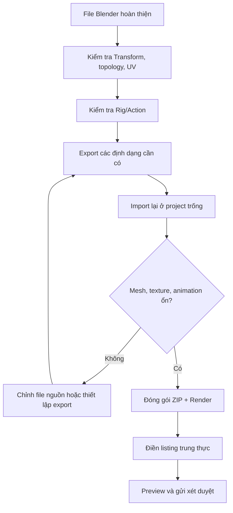

# Bài 06 — Kiểm tra, đóng gói và xuất bản mô hình 3D trên Marketplace

> **Chủ đề:** Quality Assurance, Transform, Naming, Render, Export và Product Listing  
> **Công cụ:** Blender; các nền tảng phân phối asset 3D như CGTrader và Fab  
> **Sản phẩm:** Bộ tệp mô hình, texture, ảnh giới thiệu và mô tả sản phẩm trung thực, sẵn sàng đưa lên marketplace.

## 1. Tóm tắt

Một nhân vật 3D được sculpt, retopology, bake texture và rig tốt vẫn có thể khó sử dụng nếu file bàn giao chứa quá nhiều đối tượng thừa, tên lộn xộn hoặc thiếu ảnh texture. Công đoạn xuất bản chuyên nghiệp gồm ba phần: **kiểm tra tài sản**, **chuẩn bị hình ảnh và gói file**, sau đó **tạo trang sản phẩm** với thông tin đúng về topology, định dạng, UV, vật liệu, rig và animation.

Bài thực hành dùng một nhân vật khủng long làm ví dụ. Các con số giá bán, thời gian xét duyệt và quy trình giao diện marketplace là **minh họa**, cần kiểm tra lại trên nền tảng thực tế khi đăng.

## 2. Mục tiêu học tập

Người học có thể:

- Kiểm tra Transform, topology, texture, vật liệu và Armature trước khi xuất.
- Đặt tên mesh, object, material và bộ dữ liệu animation thống nhất.
- Tạo ảnh giới thiệu nhân vật và một ảnh cho thấy Wireframe/Topology.
- Phân biệt mục đích của `.blend`, `.fbx`, `.glb`, `.obj` và các định dạng bổ trợ.
- Xây dựng gói sản phẩm với texture và các bản High Poly/Low Poly khi cần.
- Viết tiêu đề, mô tả, tags và khai báo rõ phạm vi nội dung AI, rig và animation.
- Kiểm tra độc lập gói bàn giao trước khi đưa lên marketplace.

## 3. Kiểm tra kỹ thuật lần cuối

### 3.1. Object Transform và Armature

Chọn từng mesh, kiểm tra `Location`, `Rotation`, `Scale`. Trong trường hợp có thể áp dụng an toàn, dùng `Ctrl + A` để Apply Rotation và Scale cho mesh: đối tượng giữ nguyên hình dáng hiện tại nhưng thông số biến đổi trở về trạng thái chuẩn (Rotation 0, Scale 1). Tuy nhiên, **không tùy tiện Apply biến đổi lên một Armature đã có animation**. Rig nhập từ Mixamo có thể hiển thị giá trị ví dụ Rotation 90° và Scale 0.01 nhưng vẫn hoạt động đúng trong pipeline đã thiết lập.

Nếu muốn sửa transform cho một nhân vật đã rig, luôn sao lưu, đánh giá quan hệ Armature–Mesh–Animation và kiểm tra động tác sau mọi thay đổi.

### 3.2. Tên đối tượng và dữ liệu

Nên đặt tên mà người nhận hiểu ngay tác dụng. Ví dụ:

| Loại | Tên minh họa | Vai trò |
| --- | --- | --- |
| Object/Mesh thân | `Dino_Body` | Mesh chính |
| Mắt | `Dino_Eyes` | Bộ phận dùng texture riêng |
| Răng | `Dino_Teeth` | Mesh răng |
| Armature | `Dino_Rig` | Hệ xương |
| Material thân | `Dino_Body_Mat` | Shader thân |
| Normal image | `Dino_Body_Normal_2K` | Texture pháp tuyến |
| Base Color image | `Dino_Body_Color_2K` | Texture màu |
| Animation Action | `Dino_Idle` | Chuyển động nhàn rỗi nếu có |

Blender có thể hiển thị riêng **Object Name** và **Mesh Data Name**; nên đặt chúng rõ ràng để tránh các hậu tố mặc định `.001`, `.002` khó hiểu.

### 3.3. Kiểm tra mặt đa giác và topology

Trong `Edit Mode`, kiểm tra các mặt có số cạnh lớn hơn 4 (n-gon). Những mặt như vậy có thể được nội suy tam giác khác nhau giữa các công cụ, đặc biệt khi bake hoặc animate. Dùng chức năng chọn mặt theo số cạnh để tìm chúng, rồi điều chỉnh hoặc triangulate cục bộ khi cần; không nhất thiết phải áp dụng Triangulate Modifier cho toàn bộ lưới dựng quad đẹp.

Bật **Statistics** ở viewport để xem tổng số Vertices, Faces hoặc Triangles thực tế. Nếu sản phẩm có nhiều phiên bản độ chi tiết, thống kê phải tương ứng đúng với phiên bản đang đăng. Mô hình thực hành đã có một bản Low Poly khoảng **8.800 tam giác**, nhưng cần kiểm tra lại số thực của file cuối sau mọi sửa đổi.

## 4. Render ảnh giới thiệu sản phẩm

Một trang bán asset cần hình ảnh giúp người mua đánh giá cả **vẻ ngoài** lẫn **chất lượng kỹ thuật**.

### 4.1. Render Beauty Shot

Tạo một scene trưng bày đơn giản gồm camera, ánh sáng chính ở phía trước, ánh sáng phụ và ánh sáng viền phía sau. Sắp nhân vật ở góc nhìn dễ nhận diện form. Có thể dùng `Eevee` để thử nhanh hoặc `Cycles` cho bản render theo nhu cầu chất lượng/thời gian. Chọn camera bằng `Numpad 0` và render ảnh bằng `F12`.

Nên có ảnh góc trước, góc nghiêng hoặc 3/4, góc sau và một ảnh tạo dáng khi nhân vật có rig. Những ảnh này cho thấy silhouette, texture, hình mắt và tỷ lệ cơ thể từ nhiều góc thay vì chỉ một pose đẹp.

### 4.2. Hình Wireframe/Topology

Người mua asset dành cho game thường cần thấy mật độ và đường đi của cạnh. Có thể tạo ảnh vật liệu xám/trắng đơn giản kèm Wireframe Overlay trong viewport, hoặc dùng kỹ thuật render đường biên như **Freestyle** ở những bản/cấu hình Blender hỗ trợ. Đối với ảnh chứng minh topology, nên hiển thị đúng các cạnh thực tế chứ không chỉ đường viền trang trí.

Tạo hình ở những vùng quan trọng: mắt, vai, đầu gối và các gai. Ảnh Wireframe hữu ích hơn nếu có cả thống kê polygon được xác nhận riêng.

## 5. Lựa chọn định dạng và nội dung file

| Định dạng | Công dụng khi bàn giao | Lưu ý kiểm tra |
| --- | --- | --- |
| `.blend` | Dự án Blender đầy đủ để chỉnh sửa | Kiểm tra đường dẫn ảnh, Action và collection |
| `.fbx` | Tương tác phổ biến với pipeline animation/engine | Kiểm tra rig, scale, bone, vật liệu và animation sau import |
| `.glb` | Tệp gọn có thể chứa mesh, material/texture và animation được hỗ trợ | Mở lại để thử hiển thị và chuyển động thực tế |
| `.obj` | Mesh tương đối phổ biến cho trao đổi hình học | Thường cần tệp `.mtl` và các ảnh texture riêng; không dùng OBJ cho rig/animation |
| `.usdz` | Dùng ở một số pipeline hỗ trợ USD/AR | Kiểm tra bộ chuyển đổi và nội dung mang theo thực tế |
| `.zip` | Đóng gói mọi tệp, hình ảnh và tài liệu bàn giao | Tránh chứa file thừa, đặt cấu trúc rõ ràng |

Đối với workflow bán model, có thể xuất nhiều định dạng để người mua lựa chọn, nhưng **không nên liệt kê định dạng chưa kiểm thử**. Khi dùng dịch vụ chuyển GLB sang USDZ, cần kiểm tra lại texture, tỷ lệ và khả năng đọc file xuất; không xem việc đổi đuôi tệp là đủ.

### 5.1. Gói thư mục đề xuất

```text
Dino_Character_Package/
├── Blender/
│   └── Dino_Rigged.blend
├── Exports/
│   ├── Dino_Rigged.fbx
│   ├── Dino_Rigged.glb
│   └── Dino_Static.obj
├── Textures/
│   ├── 2K/
│   │   ├── Dino_Body_Color.png
│   │   └── Dino_Body_Normal.png
│   └── 1K/
│       ├── Dino_Body_Color.png
│       └── Dino_Body_Normal.png
├── Previews/
│   ├── Beauty_Front.png
│   ├── Beauty_ThreeQuarter.png
│   ├── Wireframe.png
│   └── Rig_Pose.png
└── README.md
```

Sơ đồ là **gợi ý cấu trúc**, chỉ tạo những file thực sự có trong sản phẩm. Nếu có bản sculpt High Poly để người mua bake lại, có thể bổ sung `HighPoly/` chứa bản `.blend`/`.fbx`. Nếu đã có AO hoặc Roughness Map, đặt vào `Textures/` và khai báo chính xác kênh nào được cung cấp. Bài minh họa có các phiên bản ảnh **2K** và thu nhỏ **1K** nhằm phục vụ nhiều mục tiêu sử dụng.

## 6. Đóng gói texture đúng cách

Trước khi xuất:

1. Kiểm tra ảnh Base Color, Normal và các map khác đã lưu thật sự, không còn trạng thái ảnh chưa ghi.
2. Mở lại `.blend` trên bản sao để đảm bảo shader nối đúng ảnh.
3. Đối với FBX hoặc OBJ, thử nhập vào một scene trống để phát hiện texture bị thất lạc.
4. Đối với GLB, kiểm tra texture/màu đi kèm khi mở trong viewer hỗ trợ.
5. Nếu marketplace yêu cầu ảnh nằm thư mục riêng hoặc cách xuất không nhúng texture, làm theo **quy định hiện hành** của nền tảng; tránh xóa các Image Texture node trong file gốc chỉ vì một mẫu upload khác dùng cách đóng gói khác.

Việc phân phối **rig** và **animation** cũng cần ghi rõ ràng. Một nhân vật được gắn xương không đồng nghĩa với việc gói đã chứa điệu nhảy hoặc chuyển động idle. Chỉ ghi “animated” nếu file giao thực sự có animation tương ứng và quyền phân phối.

## 7. Viết trang sản phẩm có thông tin kỹ thuật rõ ràng

Một listing tốt thường bao gồm tiêu đề đủ cụ thể, mô tả hình dáng/công dụng, thông số thực, danh sách tệp, tình trạng UV/Texture/Rig/Animation, ảnh minh họa và giá. Bài minh họa thử mức giá **4,99 USD**, nhưng đây chỉ là quyết định của sản phẩm ví dụ, không phải gợi ý giá chuẩn.

### 7.1. Mẫu tiêu đề

**Stylized Dinosaur 3D Character — Low Poly, Rigged, UV Mapped, PBR Textures**

Nếu sản phẩm không thực sự rigged hoặc chưa có đầy đủ PBR maps, bỏ cụm tương ứng khỏi tiêu đề.

### 7.2. Mẫu mô tả sản phẩm

> Nhân vật khủng long phong cách stylized, có lưới Low Poly được tinh chỉnh, UV được mở và các texture đã kiểm tra. Sản phẩm phù hợp làm nhân vật thử nghiệm cho game hoặc cảnh hoạt hình. Bộ tệp bàn giao chứa những định dạng ghi trong danh sách tải về; vui lòng xem thông số mesh và phần mô tả rig/animation cụ thể trước khi sử dụng.

### 7.3. Bảng thông tin kiểm tra trước khi đăng

| Thông tin | Điền theo asset thực tế |
| --- | --- |
| Phân loại | Nhân vật/Creature hoặc danh mục phù hợp |
| Polycount | Số Faces/Triangles lấy từ Blender Statistics |
| UV | Có/không; số UV set nếu nền tảng yêu cầu |
| Texture | Có những map gì, độ phân giải từng map |
| Vật liệu | PBR hay vật liệu riêng; khai báo đúng chức năng |
| Rig | Có/không, dạng xương đã kiểm thử |
| Animation | Tên Action có trong gói hoặc ghi “không bao gồm” |
| Định dạng | Chỉ nêu định dạng đã xuất và thử nhập lại |
| Phần AI | Khai báo thành phần AI đã dùng theo biểu mẫu của nền tảng |
| Giấy phép | Quyền phân phối texture, thiết kế, animation, asset nguồn |

AI có thể hỗ trợ viết tiêu đề và mô tả, nhưng phần thông số kỹ thuật **phải đọc từ file thật** thay vì lấy số liệu ước đoán từ đoạn văn do AI sinh.

## 8. Đăng lên marketplace

### 8.1. CGTrader

Chuẩn bị các tệp tải xuống, gói texture nếu cần, ảnh preview, mô tả, thẻ và thống kê. Trong quá trình tạo sản phẩm, chọn danh mục phù hợp, khai báo model rigged và animated độc lập, xem lại bản preview trang và kiểm tra có tệp nào bị thiếu. Sau khi gửi, nền tảng có thể tiến hành kiểm duyệt. Thời gian duyệt phụ thuộc thời điểm và chính sách nên không nên cam kết số ngày cố định.

### 8.2. Fab

Tạo một listing cho asset 3D, điền thông tin sản phẩm, license/pricing theo lựa chọn được cung cấp, sau đó tải hình ảnh và tệp kỹ thuật. Khi giao diện hỗ trợ preview 3D, có thể dùng GLB để kiểm tra mô hình trong viewer. Nếu biểu mẫu hỏi nội dung tạo bằng AI, **khai báo trung thực** rằng model đã được sinh một phần bằng AI rồi chỉnh sửa thủ công, nếu đúng với quá trình tạo sản phẩm.

Điều quan trọng không phải làm hai listing giống hệt nhau về từng nút bấm, mà là đảm bảo thông tin nhất quán: cùng một asset, cùng thành phần file, đúng giấy phép và đúng mô tả khả năng rig/animation.

## 9. Kiểm thử cuối trước khi phát hành



**Definition of Done:** Sản phẩm hoàn thành khi người khác nhận gói file có thể mở được mesh, xem texture, thử chuyển động (nếu được quảng cáo), đọc mô tả và hiểu ngay cách sử dụng mà không cần hỏi lại tác giả.

## 10. Lỗi thường gặp

| Hiện tượng | Cách phòng tránh |
| --- | --- |
| Người mua mở FBX nhưng texture mất | Giao folder texture đúng, kiểm tra đường dẫn và mở lại FBX |
| GLB bị lệch tỷ lệ | Kiểm tra export transforms và import thử |
| Ảnh Wireframe không trùng file giao | Chụp từ đúng phiên bản asset cuối |
| Rig hỏng sau Apply Scale | Không Apply biến đổi armature đã rig tùy tiện |
| Trang ghi “animated” nhưng không có Action | Tách rõ rigged và animated trong mô tả |
| Đăng nhầm file chứa camera/nền/phần dự án thừa | Xuất `Selected Objects` khi cần; kiểm tra trong scene trống |
| Số tam giác sai | Đọc lại Statistics trên mesh xuất cuối cùng |
| Vi phạm quyền phân phối | Kiểm tra điều khoản asset AI, ảnh/texture, add-on và animation ngoài |

## 11. Bài thực hành cuối khóa

**Đề bài:** Chuẩn bị một asset nhân vật 3D hoàn thiện để có thể bàn giao cho người khác. Không bắt buộc đăng sản phẩm thật; có thể tạo bản listing nháp nếu chưa có nhu cầu thương mại.

**Gói bàn giao tối thiểu:**

- [ ] Một `.blend` sạch, có mesh, material và rig nếu được giới thiệu.
- [ ] Ít nhất một định dạng trao đổi đã kiểm tra bằng import lại.
- [ ] Các ảnh texture cần thiết đều có thể tìm thấy.
- [ ] Một ảnh Beauty Shot và một ảnh thể hiện hình học hoặc Wireframe.
- [ ] Bảng thông số mesh thực tế và danh sách file xuất.
- [ ] Mô tả có khai báo rõ AI, rig, animation và quyền sử dụng.
- [ ] File `.zip` mở được, cấu trúc thư mục dễ đọc.

## 12. Câu hỏi ôn tập

### Câu 1

Vì sao không nên Apply Scale/Rotation tùy tiện lên Armature đã có animation?

A. Vì Armature không hỗ trợ Scale.  
B. Vì Blender tự xóa mọi texture.  
C. Vì có thể làm lệch quan hệ rig và chuyển động trong pipeline.  
D. Vì nó sẽ tăng polygon count.

**Đáp án:** C.  
**Giải thích:** Biến đổi armature đã rig có thể ảnh hưởng các phép biến đổi và dữ liệu animation đã liên kết.

### Câu 2

Định dạng nào không phải lựa chọn phù hợp để bàn giao rig và animation có cấu trúc xương?

A. FBX.  
B. OBJ.  
C. GLB khi pipeline hỗ trợ.  
D. Dự án Blender.

**Đáp án:** B.  
**Giải thích:** OBJ chủ yếu truyền mesh/material cơ bản, không phải định dạng trao đổi animation xương.

### Câu 3

Trong mô tả marketplace, khi file có rig nhưng không chứa clip chuyển động, nên ghi thế nào?

A. “Rigged, animation not included.”  
B. “Full animation library included.”  
C. “Animated” không cần giải thích.  
D. Không cần mô tả.

**Đáp án:** A.  
**Giải thích:** Rigged nói về hệ xương, còn animated nói về chuyển động cụ thể; cần phân biệt rõ.

### Câu 4

Nguồn đáng tin cậy nhất để lấy số lượng tam giác khi đăng sản phẩm là gì?

A. Tên file OBJ.  
B. Giá bán trên marketplace khác.  
C. Nội dung gợi ý bởi AI.  
D. Statistics của chính mesh dùng để xuất.

**Đáp án:** D.  
**Giải thích:** Số tam giác phải đo trên tài sản thực tế, đặc biệt sau các bước modifier/triangulation.

### Câu 5

Bước kiểm tra quan trọng nhất sau khi export là gì?

A. Xem kích thước thumbnail.  
B. Chỉnh thêm đèn trong file render.  
C. Import lại file vào project trống và thử mesh, vật liệu, rig/animation khi có.  
D. Đổi tên toàn bộ file thành `final`.

**Đáp án:** C.  
**Giải thích:** Việc import thử xác nhận asset bàn giao thực sự hoạt động độc lập với scene tác giả.

## 13. Tổng kết

Xuất bản một mô hình 3D là bước kiểm tra chất lượng cuối của cả quy trình. Asset chuyên nghiệp cần **dễ mở, dễ hiểu, mô tả trung thực, có hình ảnh minh họa và không thiếu tài nguyên**. Chỉ khi một tệp được người khác mở lại và dùng được đúng như cam kết, nó mới thực sự sẵn sàng cho sản xuất hoặc marketplace.
