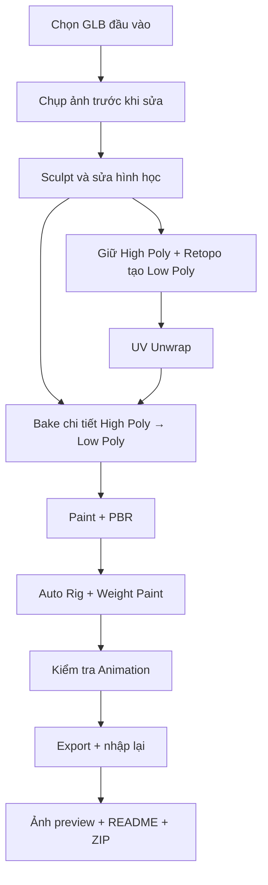

# Bài 07 — Dự án cuối khóa: AI 3D → Game-ready Character

> **Mục tiêu:** Áp dụng 6 bài học vào một asset hoàn chỉnh thay vì chỉ chạy theo bản xem trước đẹp. **Lưu ý:** đây là bài tập tổng hợp được biên soạn thêm, không phải phần riêng của bản chép lời.

## 1. Đề bài

Chọn một mô hình nhân vật phong cách stylized được sinh bằng AI (khủng long, robot thú, quái vật hay người). Bàn giao một asset có thể import lại vào Blender, có bản mesh tối ưu, hệ UV, texture, rig (nếu nhân vật cần chuyển động), và ít nhất một animation kiểm thử. Tất cả thông số công bố phải đo trên chính tệp bàn giao.

## 2. Sản phẩm bắt buộc

| Mã | Đầu ra | Cách kiểm chứng |
| --- | --- | --- |
| P1 | Ảnh trước/sau sửa hình học | Cùng góc nhìn, quan sát mắt, móng, khớp và silhouette |
| P2 | Bản high-poly backup, bản low-poly | Object tách biệt, đặt tên có nghĩa, không ghi đè nguồn |
| P3 | Ảnh topology/wireframe | Vòng cạnh rõ quanh khớp chuyển động và các chi tiết quan trọng |
| P4 | UV layout và file texture | UV không giãn nghiêm trọng, đường seam có chủ đích; ảnh lưu ngoài file `.blend` |
| P5 | Normal Map, Base Color và vật liệu | Hiện đủ chi tiết khi mở file Blender mới hoặc import lại |
| P6 | Rig + animation thử | Vai, hông, cổ, chân hoạt động; lỗi weight được sửa |
| P7 | Gói phát hành | `.blend`, ít nhất một định dạng trao đổi, texture, 3 ảnh preview và README kỹ thuật |

## 3. Quy trình thực hiện



### Mốc 1 — Hình học

1. Import mô hình nguồn và tạo collection `SOURCE_DO_NOT_EDIT`.
2. Ghi nhận các lỗi có thể nhìn thấy; chụp screenshot với góc camera cố định.
3. Dùng Sculpt để xử lý hình dạng, không cố giải quyết mọi lỗi bằng Smooth.
4. Lưu `01_sculpt_highpoly.blend`; giữ nguyên một bản High Poly phục vụ baking.

### Mốc 2 — Topology

1. Tạo Low Poly tự động hoặc thủ công; so sánh silhouette trước/sau.
2. Kiểm tra vùng vai, hông, khuỷu, đầu gối, cổ, mắt và ngón tay nếu có.
3. Dùng wireframe để phát hiện nơi thiếu mật độ hoặc lưới quá dày.
4. Lưu `02_lowpoly_retopo.blend`; ghi số mặt và tam giác **đo được**, không điền số ví dụ.

### Mốc 3 — UV và texture

1. Mark Seam, Unwrap, kiểm tra stretch, Pack Islands.
2. Tạo Normal Map và Base Color từ bản gốc khi có vật liệu tương ứng.
3. Sửa các vùng lỗi bằng Clone, Smear và Paint Mask.
4. Kiểm tra material với ánh sáng khác nhau và lưu ảnh texture ra đĩa.

### Mốc 4 — Rig và Animation

1. Chọn đường đi Mixamo hoặc AccuRig phù hợp cấu trúc nhân vật.
2. Điều chỉnh marker/bone, import về Blender, kiểm tra quan hệ xương–mesh.
3. Thử pose lớn tại vai/hông/cổ và sửa weight nếu vùng không liên quan bị kéo.
4. Tạo hoặc gắn một Action tên `Idle_Test` / `Walk_Test` và kiểm tra vòng lặp.

### Mốc 5 — Bàn giao

1. Xóa hoặc ẩn các object hậu trường không cần xuất, giữ bản dự phòng trong tệp khác.
2. Export GLB, FBX hay định dạng phù hợp; import vào một scene sạch để kiểm thử.
3. Kiểm tra hướng trục, tỷ lệ, material, texture, armature và animation sau import.
4. Render ít nhất 3 hình: chính diện 3/4, mặt sau/bên, wireframe hoặc UV.
5. Đóng gói file zip và viết README rõ nguồn AI, công cụ, số polygon và giới hạn đã biết.

## 4. Thang điểm tham khảo (100 điểm)

| Hạng mục | Điểm | Mức đạt |
| --- | ---: | --- |
| Chất lượng hình học | 20 | Silhouette, mắt, răng, móng và đường chuyển tiếp không lỗi lớn |
| Retopology | 20 | Mật độ hợp lý, vòng cạnh đúng ở nơi biến dạng |
| UV và Bake | 20 | Layout dùng được, map không lỗi rõ rệt |
| Texture và PBR | 15 | Màu rõ, vật liệu đúng, không mất texture |
| Rig và Animation | 15 | Xương chính hoạt động, weight được kiểm tra |
| Đóng gói và tài liệu | 10 | Import lại được, file có tên, metadata trung thực |
| **Tổng** | **100** | **Đề xuất đạt từ 75 điểm** |

## 5. Cấu trúc gói asset mẫu

```text
Dino_GameReady/
├── Source/
│   └── dino_highpoly.blend
├── Models/
│   ├── dino_game_ready.blend
│   ├── dino_game_ready.glb
│   └── dino_game_ready.fbx
├── Textures/
│   ├── dino_basecolor.png
│   ├── dino_normal.png
│   └── dino_roughness.png
├── Preview/
│   ├── beauty_01.png
│   ├── side_back_02.png
│   └── wireframe_03.png
└── README.md
```

> Chỉ đóng gói những file thực sự có. Ví dụ có `roughness.png` không đồng nghĩa bắt buộc mọi model phải có map riêng, nếu roughness dùng giá trị trong shader thì mô tả đúng điều đó.

## 6. Checklist tự đánh giá

- [ ] Tôi đã giữ nguyên bản gốc hoặc bản backup trước khi sculpt.
- [ ] Tôi biết điểm nào đã được sửa bằng tay và điểm nào vẫn còn lỗi.
- [ ] Tôi có thể giải thích lựa chọn mật độ topology quanh hai vùng biến dạng.
- [ ] UV không đè nhau ngoài chủ ý và được đóng gói hợp lý.
- [ ] Texture được lưu ra các ảnh bên ngoài `.blend`.
- [ ] Tôi đã thử animation trong Blender và định dạng xuất nhập lại.
- [ ] Gói asset có phần ghi công cụ AI, các hạn chế và quyền sử dụng một cách trung thực.

## 7. Câu hỏi phản biện

1. Nếu silhouette tốt nhưng đầu gối bị rách khi đi bộ, nên sửa ở bước nào?
2. Khi texture có rãnh đẹp ở bản High Poly nhưng mất ở Low Poly, bước nào cần kiểm tra?
3. Vì sao cần mở file export trong scene sạch thay vì tin vào viewport ban đầu?
4. Khi nhân vật có ba ngón tay, auto-rig có thể mắc lỗi gì với marker ngón cái?
5. Sản phẩm `Rigged` khác `Animated` ở thông tin cần công bố ra sao?

**Gợi ý:** lần lượt xem lại Bài 02 và 05, Bài 03, Bài 06, Bài 05, Bài 06.
