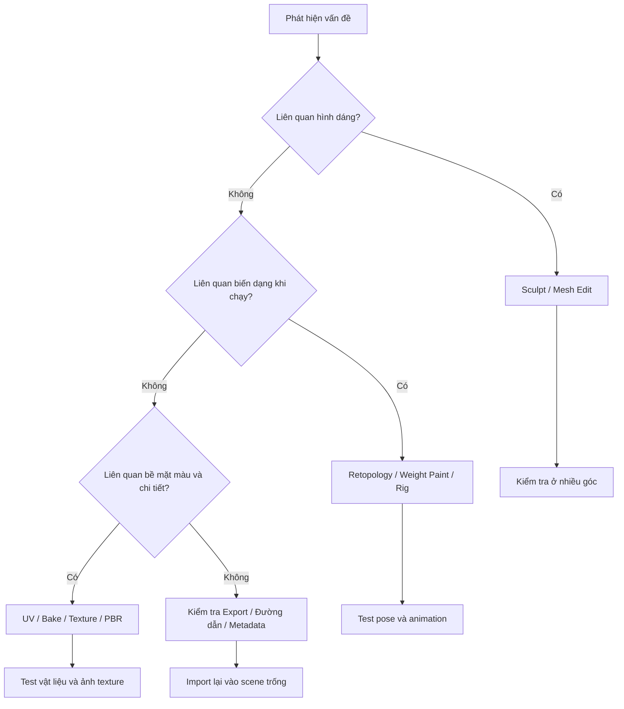

# Bài 08 — Sổ tay thao tác nhanh và khắc phục lỗi

> **Vai trò:** Tài liệu tham khảo trong lúc thực hành các bài 01–06. Phím tắt có thể khác khi đổi keymap, add-on hoặc phiên bản Blender.

## 1. Phím tắt thường gặp

| Thao tác | Phím / thao tác thông dụng | Ghi chú |
| --- | --- | --- |
| Xoay nhìn (Orbit) | Giữ nút chuột giữa + kéo | 3D Viewport |
| Lia nhìn (Pan) | `Shift` + nút chuột giữa | 3D Viewport |
| Zoom | Cuộn chuột | Có thể dùng Numpad `.` để Frame Selected |
| Chuyển Object ↔ Edit Mode | `Tab` | Khi con trỏ ở viewport |
| Chọn tất cả | `A` | Tùy mode |
| Dịch chuyển / xoay / scale | `G` / `R` / `S` | Khóa trục bằng `X/Y/Z` |
| Undo | `Ctrl + Z` | Sử dụng trước khi tiếp tục thao tác phá hủy |
| Đặt kích thước cọ Sculpt | `F` | Di chuột và xác nhận |
| Làm mượt tạm trong Sculpt | Giữ `Shift` | Tùy công cụ và phiên bản |
| Đảo tác dụng cọ | Thường giữ `Ctrl` | Phụ thuộc cọ |
| Box Select | `B` | Dùng thêm X-Ray khi chọn xuyên mesh |
| Extrude | `E` | Edit Mode |
| Loop Cut | `Ctrl + R` | Topology phù hợp mới tạo vòng liên tục |
| Knife | `K` | Nhấn `Enter` để kết thúc đường cắt |
| Join objects | `Ctrl + J` | Object Mode, nên kiểm tra UV/material trước |
| Chọn thành phần vertex / edge / face | `1` / `2` / `3` (hàng số) | Edit Mode, **không phải** numpad |
| Camera view | Numpad `0` | Render kiểm tra |
| Render Image | `F12` | Kiểm tra ánh sáng / preview |

**Lưu ý:** Transcript có vài chỗ dịch tên và phím tắt thiếu ngữ cảnh (ví dụ nút chọn edge, mask paint, phiên bản add-on). Khi giao diện hiện tại khác ví dụ, tìm thao tác theo **tên tính năng** trong Blender (`F3`) thay vì lặp phím máy móc.

## 2. Chẩn đoán lỗi theo triệu chứng

| Triệu chứng | Nguyên nhân thường gặp | Hướng kiểm tra |
| --- | --- | --- |
| Sculpt bị lag | Voxel quá nhỏ, quá nhiều đỉnh, Dyntopo chạy liên tục | Tăng Voxel Size, tắt Dyntopo khi không cần, ẩn đối tượng nặng |
| Sculpt lệch hai bên | Chưa bật symmetry; origin sai; model chưa cân trục | Kiểm tra trục X symmetry, mirror plane, origin và hình dạng đầu vào |
| Khe hở giữa hai nửa nhân vật | Mirror chưa Merge/Clipping; đỉnh giữa không ở mặt phẳng | Bật Merge/Clipping, kiểm tra các đỉnh trung tâm; áp dụng đúng sau khi kiểm tra |
| Quads đẹp nhưng animation méo | Không có edge loop theo hướng gập hoặc mật độ vùng khớp chưa đủ | Retopo vùng khớp; thử pose trước khi bake final |
| UV khó tô, đường nối lộ | Seam đặt ở mặt trước, island quá vụn, stretch lớn | Đặt lại seam ở nơi khuất; Unwrap lại; xem distortion/checker |
| Bake ra màu đen | Chọn sai object, material node chưa active, loại bake sai | Soát high→low selection, UV active, image node active, engine/cài đặt bake |
| Normal Map hiển thị sai | Đọc map dạng sRGB; kết nối thẳng vào shader | `Non-Color` → `Normal Map` → `Principled BSDF.Normal` |
| Texture biến mất sau mở lại | Ảnh chưa Save As/Pack; đường dẫn tuyệt đối lỗi | Save ảnh từng map; Pack Resources nếu cần; mở tệp trên máy/thư mục khác để thử |
| Vẽ tràn lên gai / mắt | Không dùng Paint Mask; island UV đè nhau | Bật mask chọn mặt; sửa UV island nếu cần |
| Rig kéo cả bụng theo tay | Weight vai tràn xuống bụng hoặc topology không phù hợp | Giảm weight ở vùng sai; smooth weight; kiểm tra deform groups |
| Animation import nhưng model đứng yên | Action chưa gắn, rig khác cấu trúc, NLA chưa kích hoạt | Kiểm tra Action Editor, armature active, tên xương và NLA |
| GLB/FBX import lại sai size | Export scale/orientation, apply transforms thiếu kiểm soát | So sánh kích thước thật, export options, kiểm tra ở scene mới |
| Marketplace báo thông tin sai | Thông số polygon và định dạng không khớp asset | Lấy statistics từ file xuất cuối, ghi đúng rig/animation và các map thật |

## 3. Cây quyết định sửa model AI

## 4. Quy tắc lưu file an toàn

- Luôn tạo bản sao tệp nguồn; trước thao tác phá hủy hãy `Save As` sang tên mới.
- Đặt tên nhất quán `body_low`, `body_high`, `eye_L`, `eye_R`, `rig_main`, `MAT_Body`, `TEX_BaseColor`.
- Lưu ảnh vẽ texture ra file ngoài, không chỉ lưu `.blend`.
- Ghi phiên bản Blender và add-on nếu asset dựa vào tính năng riêng của chúng.
- Không Apply modifier/transform lên Armature đã rig khi chưa thử tác động lên animation.

## 5. Checklist 2 phút trước khi xuất

- [ ] Không có đối tượng thừa trong tập object được export.
- [ ] Mesh hiển thị đúng từ mặt trước, bên và mặt dưới.
- [ ] Không có texture node bị mất ảnh.
- [ ] Hệ xương di chuyển đúng nếu asset ghi `Rigged`.
- [ ] Animation có Action thực, không chỉ screenshot demo.
- [ ] Gói có tên file và thông số chính xác.
- [ ] Có thể import lại vào một Blender scene mới.
