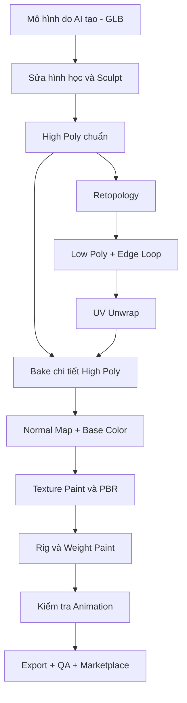

# Khóa học: Hoàn thiện mô hình 3D do AI tạo bằng Blender

> **Trình độ:** Người mới làm quen Blender đến thực hành sản xuất asset 3D  
> **Định hướng:** Nhân vật phong cách stylized dùng cho game, hoạt hình và marketplace  
> **Công cụ:** Blender; Quad Remesher và RetopoFlow (tùy chọn); Mixamo hoặc AccuRig  
> **Sản phẩm xuyên suốt:** Một nhân vật khủng long 3D do AI tạo, được sửa lưới, tối ưu, tạo texture, rig và xuất bản.

## 1. Giới thiệu

Mô hình 3D tạo bằng AI thường gây ấn tượng ngay ở hình ảnh đầu tiên, nhưng vẻ ngoài đẹp chưa đồng nghĩa với **sẵn sàng đưa vào sản xuất**. Lưới có thể quá nặng, mắt và móng vuốt bị biến dạng, topology không phù hợp với khớp, texture không thể sửa thuận tiện hoặc hệ xương hoạt động sai. Khóa học này hướng dẫn giải quyết lần lượt những vấn đề đó bằng quy trình có thể kiểm tra được ở mỗi giai đoạn.

Đích đến không chỉ là một hình render đẹp. Người học cần có **bản High Poly giữ chi tiết**, **bản Low Poly có topology hợp lý**, **UV và texture đã lưu**, **nhân vật đã rig và kiểm thử cử động**, cùng **gói tệp có thể bàn giao**.

## 2. Lộ trình

| Bài | Nội dung | Đầu ra chính |
| --- | --- | --- |
| [01 — Sculpting và sửa lưới](01-sculpting-va-sua-luoi.md) | Import GLB, Sculpt Mode, Remesh, Mirror, sửa mắt–răng–sọc–móng | `01_sculpt_highpoly.blend` |
| [02 — Retopology](02-retopology-va-toi-uu-luoi.md) | Quad Remesher, RetopoFlow, Edge Loop cho vùng biến dạng | `02_lowpoly_retopo.blend` |
| [03 — UV Mapping và Baking](03-uv-mapping-va-texture-baking.md) | Seam, Unwrap, Pack Islands, bake Normal và Base Color | `03_uv_bake.blend` + ảnh texture |
| [04 — Texture Painting và PBR](04-texture-painting-va-pbr.md) | Paint, Clone, Smear, Roughness, Stencil Projection | `04_painted_character.blend` + texture |
| [05 — Rigging và Animation](05-rigging-va-animation.md) | Mixamo / AccuRig, Weight Paint, Action Editor, thử hoạt ảnh | `05_rigged_character.blend` |
| [06 — Export và Marketplace](06-export-va-marketplace.md) | Kiểm tra asset, render giới thiệu, đóng gói, đăng bán | Gói asset `.zip` và nội dung listing |

## 3. Sơ đồ quy trình



**Giải thích:** Bản High Poly được giữ lại để bảo toàn chi tiết gốc; bản Low Poly cần được UV trước khi nhận kết quả bake. Hai bản phải đặt đúng vị trí tương quan khi bake. Texture hoàn thiện được gắn vào nhân vật đã rig, sau đó kiểm tra xuất nhập định dạng.

## 4. Quy ước làm bài

- Giữ nguyên mô hình AI nhập ban đầu trong một collection dự phòng. Không chỉnh trực tiếp bản duy nhất.
- Sau mỗi bài, lưu một tệp `.blend` mới và kiểm tra kết quả trước khi học bài tiếp.
- Nếu không có khủng long, có thể dùng nhân vật khác; những bước đặc thù như gai, đuôi và ba ngón tay được điều chỉnh theo hình học thực tế.
- Tập trung vào kết quả quan sát được hơn là sao chép máy móc các giá trị tham số ví dụ. Tỷ lệ đối tượng, số đa giác và phiên bản Blender có thể khác nhau.
- Bài học có câu hỏi trắc nghiệm kèm đáp án và giải thích để tự ôn tập.

## 5. Tài liệu bổ trợ

- [07 — Dự án cuối khóa và rubric chấm điểm](07-du-an-cuoi-khoa.md): bài tập tích hợp theo từng mốc và tiêu chuẩn nghiệm thu rõ ràng.
- [08 — Phím tắt, checklist kiểm thử và sửa lỗi](08-phim-tat-va-khac-phuc-loi.md): tờ tham khảo nhanh khi mở Blender.
- [09 — Thuật ngữ và đối chiếu nguồn](09-thuat-ngu-va-nguon.md): từ vựng Việt–Anh và mốc thời gian của 6 bản chép lời.

**Khuyến nghị học:** học tuần tự từ Bài 01 đến Bài 06; sau mỗi bài nộp một file `.blend` và 2–3 ảnh chứng minh kết quả. Bài 07 có thể làm song song để theo dõi tiến độ. Đọc README này trước, mở bài tương ứng, làm checklist cuối bài rồi mới chuyển tiếp.

## 6. Tiêu chí hoàn thành khóa học

- [ ] Mô hình không còn các lỗi hình học chính gây khó chịu khi nhìn từ nhiều góc.
- [ ] Low Poly giữ được silhouette và có luồng cạnh phù hợp tại khớp.
- [ ] UV không kéo giãn nghiêm trọng; các đảo được đóng gói hợp lý.
- [ ] Normal Map và Base Color bake đúng vật thể, được lưu ra ảnh.
- [ ] Texture không còn lỗi rõ rệt tại các vùng đã chỉnh sửa.
- [ ] Rig có thể xoay các khớp chính mà không làm méo các vùng không liên quan.
- [ ] File bàn giao có tên rõ ràng, có ảnh xem trước, và nội dung mô tả phản ánh đúng asset thực tế.

> **Ghi chú kỹ thuật:** Giao diện, tính năng add-on, định dạng hỗ trợ và quy định của marketplace có thể khác theo phiên bản hoặc thời điểm. Các giá trị như Voxel Size `0.002`, khoảng `4.000 quads` hay texture `4K` trong bài là **thiết lập của ví dụ thực hành**, không phải tiêu chuẩn bắt buộc với mọi mô hình.

## 7. Cấu trúc thư mục

```text
Khoa_hoc_Hoan_thien_Model_3D_AI_Blender_Game_Ready/
├── README.md
├── 01-sculpting-va-sua-luoi.md
├── 02-retopology-va-toi-uu-luoi.md
├── 03-uv-mapping-va-texture-baking.md
├── 04-texture-painting-va-pbr.md
├── 05-rigging-va-animation.md
├── 06-export-va-marketplace.md
├── 07-du-an-cuoi-khoa.md
├── 08-phim-tat-va-khac-phuc-loi.md
└── 09-thuat-ngu-va-nguon.md
```

**Nguồn:** 6 bản chép lời đính kèm ngày 25/10/2026. Các bài đã loại bỏ câu dẫn video, lời kêu gọi tương tác và lỗi dịch máy rõ ràng để tập trung vào thao tác. Các số liệu trong ví dụ chỉ có tính tham khảo và không đảm bảo phù hợp mọi model hoặc mọi phiên bản phần mềm.
