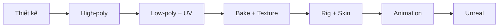

# Bài 01 — Tổng quan và chuẩn bị dự án

> **Mục tiêu:** giải thích tại sao cần nhiều công đoạn thay vì tải thẳng một mesh AI vào game; thiết lập kho dữ liệu có thể phục hồi. **Thời lượng tự học gợi ý:** 30–45 phút.

## 1. Vì sao không chỉ dùng một lần sinh 3D?

Video xây dựng nhân vật cơ khí nhiều bộ phận. Công đoạn sinh mesh AI chỉ giúp có **hình dáng chi tiết**; nó không thay thế việc kiểm tra số đa giác, mặt quad, UV, texture, trọng số xương hay animation. Việc sinh các bộ phận riêng giúp người tạo kiểm soát chất lượng, bố trí lại tỉ lệ và tối ưu theo loại chuyển động.

| Đối tượng | Vai trò | Dấu hiệu cần đạt |
|---|---|---|
| Concept 2D | Khóa thiết kế hình dáng | Full body, nền đơn giản, chi tiết thấy rõ |
| High-poly | Nguồn chi tiết hình học | Không mất đặc trưng cơ khí |
| Low-poly | Mesh đưa vào engine | Đủ nhẹ theo mục tiêu dự án |
| UV | Hệ tọa độ trải texture | Không chồng ngoài ý muốn |
| Normal/PBR | Tái tạo cảm giác bề mặt | Vật liệu và shading nhất quán |
| Rig & skin | Cấu trúc chuyển động | Xương chuyển động không kéo sai mesh |
| Unreal assets | Đầu ra triển khai | Có thể import và xem animation |

## 2. Quy trình và điểm kiểm soát

Mỗi chặng chỉ chuyển tiếp khi kết quả trước có thể mở lại. Ví dụ: nếu normal map xuất lỗi thì nên sửa tại bước bake, không cố bù bằng rigging.

## 3. Thiết lập dự án

1. Tạo thư mục như `README.md` đã mô tả.
2. Đặt chuẩn tên: `Dino_Head_HP.fbx`, `Dino_Head_LP.fbx`, `Dino_Head_Normal_2K.png`.
3. Lưu `Dino_v01_concept.png`; khi upscale, không ghi đè ảnh gốc.
4. Viết `reports/asset_log.md` với cột: *bộ phận / công cụ / phiên bản / trạng thái / lỗi / đường dẫn*.
5. Kiểm tra chính sách sử dụng và quyền đối với hình ảnh đầu vào, mô hình và animation trước khi đưa vào sản phẩm thương mại.

## 4. Checklist hoàn thành

- [ ] Biết điểm khác nhau giữa high-poly và low-poly.
- [ ] Có thư mục riêng cho texture, rig và Unreal.
- [ ] Có bảng theo dõi tên file/phiên bản để tránh ghép sai bộ phận.
- [ ] Hiểu rằng **chưa có hoạt hình** khi mới có mesh từ AI.

## 5. Tự kiểm tra

1. Vì sao high-poly vẫn cần giữ sau khi có low-poly?
2. Nếu import FBX vào engine được nhưng không chuyển động, thiếu những bước nào?
3. Khi nào nên tách đầu, thân, tay, chân, đuôi thành các file khác nhau?

**Sản phẩm nộp:** sơ đồ pipeline và cấu trúc thư mục đã tạo.
