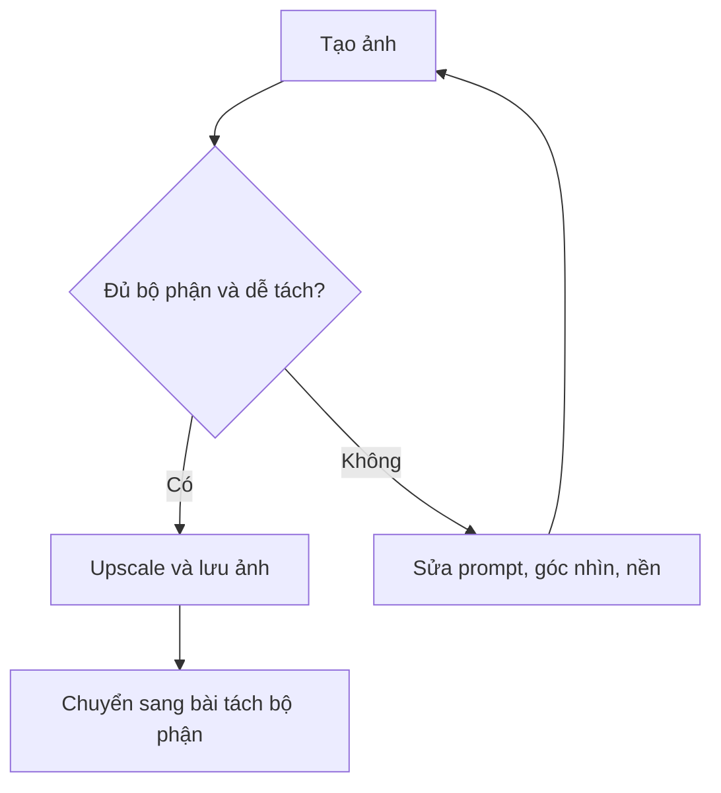

# Bài 02 — Tạo ảnh concept với ComfyUI

> **Mục tiêu:** tạo ảnh nhân vật rõ toàn thân có đủ chi tiết để tiếp tục tách bộ phận. **Nguồn:** 00:59–03:05.

## 1. Ý tưởng từ video

Tác giả dùng **ComfyUI** bản cloud cùng mô hình tạo ảnh được gọi là **Qwen Image 2512**. Từ khóa chính trong lời giảng gồm nhân vật **khủng long steampunk**, thiết kế **cơ khí chi tiết**, **móng vuốt máy**, thể hiện toàn thân và **nền trơn**. Sau khi chạy workflow, ảnh được upscale để có độ phân giải tốt hơn trước khi tách bộ phận.

Nền sạch không chỉ để đẹp: nền phức tạp dễ bị hệ thống image-to-3D hiểu nhầm thành một phần hình học nhân vật.

## 2. Quy trình thực hành

1. Mở ComfyUI cloud hoặc một workflow local tương đương, xác định model image được sử dụng thực tế.
2. Nhập prompt mô tả nhất quán cả hình dáng và chất liệu; đảm bảo thấy toàn thân, không cắt đuôi hoặc chân.
3. Chạy workflow một lần, đánh giá đầu, khớp tay/chân, đuôi và tỉ lệ.
4. Nếu ảnh nhòe, thêm bước **upscale** như tác giả thực hiện (video không cung cấp tên model upscale chính xác).
5. Xuất một ảnh concept gốc và một ảnh upscale; ghi lại prompt, seed và thiết lập nếu giao diện hỗ trợ.

### Prompt tham khảo (do giáo trình soạn, không phải prompt nguyên văn trong video)

```text
Full-body steampunk mechanical dinosaur character, detailed articulated
metal joints, mechanical claws, segmented tail, symmetrical character
design, readable silhouette, neutral standing pose, high-quality 3D
character concept, plain studio background, centered composition,
all limbs and the entire tail visible, no props, no text.
```

Điều chỉnh thêm hướng nhìn 3/4 hoặc góc camera thích hợp nếu muốn đọc tốt hình khối. Video mô tả hình ảnh có cảm giác 3D và sử dụng nó làm nguồn tách bộ phận, **không nói bắt buộc T-pose** trong ví dụ này.

## 3. Tự đánh giá ảnh

| Kiểm tra | Đạt | Chưa đạt |
|---|---|---|
| Toàn thân | Đủ đầu/thân/tay/chân/đuôi | Bộ phận ra ngoài khung |
| Nền | Ít chi tiết phụ | Có đạo cụ dính vào nhân vật |
| Cơ khí | Khớp/ốp kim loại đọc rõ | Nhiều chi tiết bị hòa lẫn |
| Tỉ lệ | Các khối tương đối hợp lý | Đầu hoặc chi lệch quá lớn |

## 4. Sơ đồ quyết định



## 5. Lỗi thường gặp

- **Ảnh thiếu chân/đuôi:** yêu cầu `full-body`, `entire tail visible`, bố cục căn giữa.
- **Chi tiết nhỏ dính nền:** chuyển nền một màu và giảm đạo cụ.
- **Concept thiếu tính đối xứng:** dùng mô tả khớp và cấu trúc cân đối; vẫn cần kiểm tra sau sinh 3D.
- **Ảnh upscale khác thiết kế gốc:** lưu cả hai, so sánh, chọn ảnh giữ hình khối tốt nhất.

## 6. Bài tập

Tạo 2 biến thể nhân vật khủng long cơ khí; chọn một phiên bản theo bốn tiêu chí trên. Nộp `Dino_Concept_v01.png`, `Dino_Concept_upscaled.png` và prompt sử dụng.
