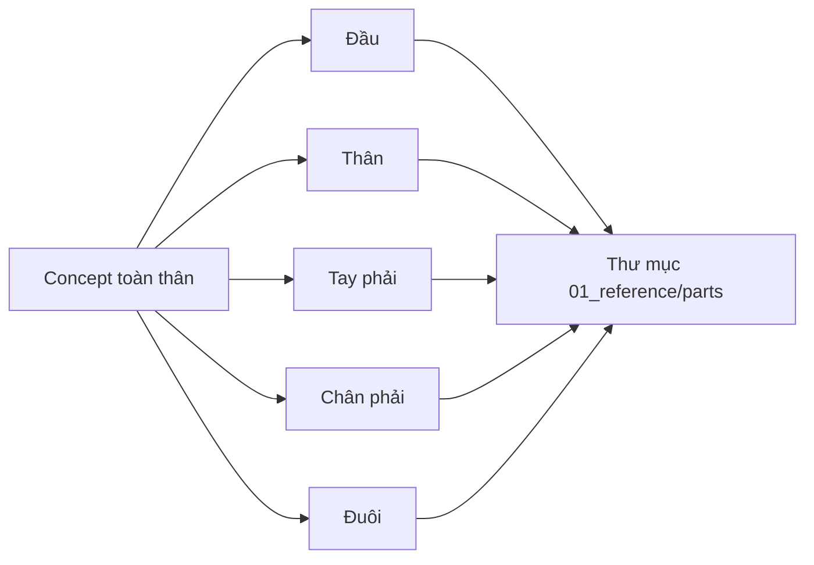

# Bài 03 — Tách ảnh thành các bộ phận bằng AI

> **Mục tiêu:** tạo bộ ảnh tham chiếu từng phần cho bước image-to-3D. **Nguồn:** 03:06–04:33.

## 1. Lý do tách bộ phận

Video khuyến khích tách ảnh trước khi sinh 3D vì mỗi bộ phận được **lấp đầy khung hình**, cho phép công cụ 3D tập trung vào hình khối cục bộ. Điều này giúp chỉnh tỉ lệ, đối xứng và chuẩn bị retopology từng thành phần dễ hơn.

Các nhóm được nhắc đến: **đầu, thân, tay, chân, đuôi**; trong ví dụ tác giả chỉ chuẩn bị tay/chân một bên để có thể mirror ở Blender về sau.

## 2. Các bước với Nano Banana Pro

1. Tải ảnh concept đã upscale lên môi trường chỉnh sửa ảnh (video dùng Nano Banana Pro qua một dịch vụ cloud).
2. Lần lượt gửi yêu cầu **chỉ hiển thị một bộ phận** như chân, tay, thân, đầu hoặc đuôi.
3. Yêu cầu giữ màu, hoa văn, tỉ lệ tương đối và góc nhìn theo ảnh concept.
4. Đặt ảnh tạo ra ở mức **2K** theo ví dụ trong video, sau đó lưu riêng cho từng bộ phận.
5. Kiểm tra hình ảnh cô lập: không còn phần chi khác, ít mất nét và không thay đổi thiết kế.

### Prompt mẫu (được biên soạn thêm)

```text
Using the uploaded character concept, isolate only the right mechanical leg.
Preserve the original design, materials, proportions and joint structure.
Show the complete isolated leg, centered and large in the frame, with a
plain background. Do not include the body, other limbs, text, or props.
```

Thay `right mechanical leg` bằng `head`, `torso`, `right arm`, `tail`. Trong video tác giả có yêu cầu phóng lớn khoảng 20% khi thao tác với tay; đây là một ví dụ thay vì một ngưỡng bắt buộc.

## 3. Sơ đồ kiểm ảnh



## 4. Tình huống hỏng và cách xử lý

| Vấn đề | Cách xử lý |
|---|---|
| Phần tay bị AI vẽ lại kiểu dáng | Khóa nguyên tắc *preserve original design* và so với concept |
| Không thấy khớp nối vào thân | Yêu cầu bao gồm đầy đủ đầu nối, không crop sát |
| Nhiều bộ phận dính chung | Tạo lại bằng prompt hẹp hơn, chỉ một bộ phận |
| Hình quá nhỏ trong khung | Đề nghị `fills most of frame` nhưng không cắt mất đầu mút |

## 5. Bài tập và checklist

- [ ] Có đủ 5 ảnh tách bộ phận.
- [ ] Mọi ảnh cùng một phong cách vật liệu.
- [ ] Phần nối giữa các chi có hình dạng đủ rõ để lắp lại.
- [ ] File đặt tên ví dụ `part_head.png`, `part_right_leg.png`.

**Câu hỏi:** Vì sao ảnh từng bộ phận 2K có thể hữu ích hơn chỉ một ảnh 2K toàn thân khi sinh 3D?
