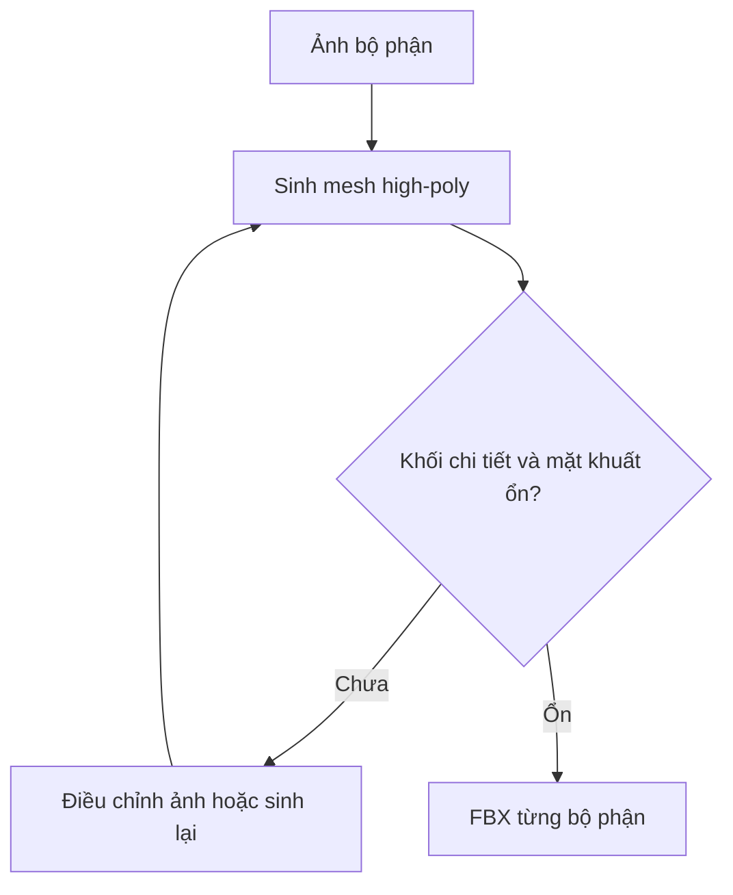

# Bài 04 — Sinh 3D high-poly từ ảnh từng bộ phận

> **Mục tiêu:** biến năm ảnh cô lập thành các mesh high-poly độc lập để lắp ráp trong Blender. **Nguồn:** 04:34–06:16.

## 1. High-poly dùng để làm gì?

High-poly giữ những gờ, khe, ốc, mấu cơ khí mà mesh game tối ưu khó giữ nguyên bằng hình học. Video cố ý **chưa cần texture ở giai đoạn này**, bởi texture sẽ được xử lý sau bằng workflow chuyên biệt. Đây là bước tạo *nguồn chi tiết hình học*.

Trong lời thoại, tác giả nhắc **Hunyuan3D** và **Trellis 2** như các lựa chọn; tên chính xác của **dịch vụ tác giả đang thao tác ở 04:51** không thể xác định chắc từ bản phiên âm, vì vậy thực hành dựa trên **chức năng** image-to-3D, không gán nhầm cho một nhà cung cấp.

## 2. Thao tác trong công cụ image-to-3D

1. Chọn ảnh một bộ phận, ví dụ `part_head.png`.
2. Tìm mức sinh hình học cao nhất có sẵn; video minh họa **Ultra** cho chất lượng mesh.
3. Bỏ hoặc trì hoãn bước sinh texture nếu dịch vụ hỗ trợ.
4. Video chọn mesh **triangles** và thiết lập **auto** cho bản high-poly (tam giác ở giai đoạn này không mâu thuẫn mục tiêu low-poly quad về sau).
5. Chạy sinh 3D, quay 360° để xem mặt khuất và phần khớp.
6. Xuất **FBX** với thiết lập tương thích **Blender** nếu dịch vụ cho chọn, rồi lặp lại cho các bộ phận khác.

**Lưu ý:** video nhắc tùy chọn độ phân giải texture 4K nhưng cũng nói chưa cần ở thời điểm xuất high-poly. Không dành ngân sách xuất map texture chỉ vì mesh high-poly có nhiều polygon.

## 3. Quy tắc đặt tên

```text
02_highpoly/
├── Dino_Head_HP.fbx
├── Dino_Torso_HP.fbx
├── Dino_RightArm_HP.fbx
├── Dino_RightLeg_HP.fbx
└── Dino_Tail_HP.fbx
```

## 4. Kiểm tra chất lượng đầu ra

- **Mặt nhìn chính:** giống ảnh tham chiếu, có đủ chi tiết cơ khí.
- **Mặt sau / phần khuất:** không có lõm, bướu hoặc vật liệu hình học phi lý làm cản chuyển động.
- **Vùng nối:** có vị trí chồng hợp lý khi ghép đầu–thân, thân–chân, thân–đuôi.
- **Khả năng import:** file mở được trong Blender, đúng trục và tỉ lệ có thể chỉnh được.



## 5. Bài tập

Sinh ít nhất **đầu, thân, chân** và tự mở từng FBX trong Blender. Ghi nhận lỗi thường gặp và ảnh chụp góc 3/4 + góc sau. Nếu công cụ giới hạn lượt sinh, có thể thử trước với ba bộ phận rồi hoàn thiện sau.
