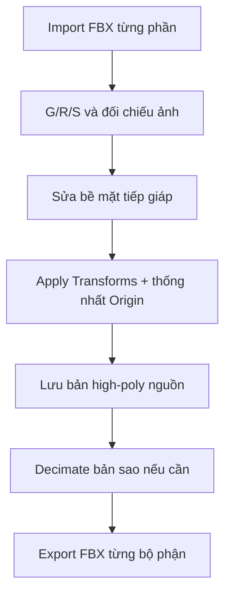

# Bài 05 — Lắp ráp mô hình high-poly trong Blender

> **Mục tiêu:** đặt đúng vị trí các bộ phận, sửa khe hở, chuẩn hóa transform và quản lý bản high-poly. **Nguồn:** 06:17–11:13.

## 1. Import và sắp xếp

1. Giải nén file export nếu nhận ZIP; vào **File → Import → FBX** và chọn từng bộ phận.
2. Đổi tên object ngay sau import: `HP_Head`, `HP_Torso`, `HP_RightArm`, `HP_RightLeg`, `HP_Tail`.
3. Đặt concept cạnh scene làm ảnh tham chiếu; lắp **thân trước**, sau đó đầu, tay, chân và đuôi.
4. Sử dụng phím tắt Blender: **G** di chuyển, **R** xoay, **S** thay đổi kích thước.
5. Chỉnh tỉ lệ, nhất là đầu và chỗ nối để có tổng thể dễ nhìn.

## 2. Sửa khoảng hở ở vùng lắp ráp

Video sử dụng **Sculpt Mode** và một brush có hiệu ứng kéo/chỉnh hình bề mặt (bản chép lời phiên âm tên brush thiếu rõ ràng). Ý nghĩa của bước này là làm các biên tiếp giáp giữa đầu–cổ, hông–chân, đuôi–thân ăn khớp hơn.

**Lưu ý kỹ thuật:** điêu khắc cho hai bề mặt khớp hình **không đồng nghĩa** đã tạo mesh kín (watertight) hay hàn đỉnh. Nếu dự án cần khối liền thật, phải kiểm tra ranh giới và xử lý topo riêng.

## 3. Quy tắc đối xứng và origin

Video chỉ thao tác với **tay phải, chân phải**, dự định dùng **Mirror Modifier** sau khi retopology.

- Trước khi xuất mesh vào công cụ retopo, dùng **Ctrl + A → Apply All Transforms** sau khi đã hoàn tất vị trí/tỉ lệ.
- Đặt **3D Cursor** ở tâm thế giới nếu muốn dùng **Object → Set Origin → Origin to 3D Cursor** như video.
- **Origin ở x=0** có ý nghĩa đặc biệt cho mirror qua trục X; việc đặt mọi origin về tâm thế giới chỉ phù hợp nếu hệ tọa độ giữa các bộ phận được quản lý nhất quán.
- Đặt chân ở độ cao hợp lý so với mặt đất.

## 4. Giảm tải trước khi retopo

Video thêm **Decimate Modifier** cho mesh quá nặng; mức **ratio ~0.1** chỉ là ví dụ. Sau decimate cần xoay kiểm tra để chắc khe, răng, gờ quan trọng không mất; nếu có, tăng ratio hoặc giữ bản high-poly nguồn riêng. Không coi decimate là retopology quad.

## 5. Quy trình xuất sang công cụ retopo

1. Tổ chức Collection `HIGH_POLY_SOURCE` và sao lưu `.blend`.
2. Với **mỗi object riêng**, chọn **File → Export → FBX**, bật **Selected Objects**.
3. Đặt tên `HP_Head_for_retopo.fbx`, `HP_Leg_for_retopo.fbx`.
4. Nếu công cụ retopo giữ tọa độ thế giới khi nhập/xuất, không tự ý move các low-poly mới nhập trở lại; giữ high/low trùng khớp cho bake.

## 6. Kiểm tra

- [ ] Đầu/thân/chi/đuôi khớp nhau từ ít nhất 3 góc nhìn.
- [ ] Tên object và Collections rõ ràng.
- [ ] Đã lưu bản high-poly gốc trước khi decimate.
- [ ] Scale / Rotation đã chuẩn hóa theo mục tiêu xuất.
- [ ] Đã xuất mỗi bộ phận riêng, bật Selected Objects.

**Bài tập:** chụp hai ảnh trước/sau lắp ráp; giải thích điểm cần sửa bằng sculpt hoặc biến đổi cơ bản.
