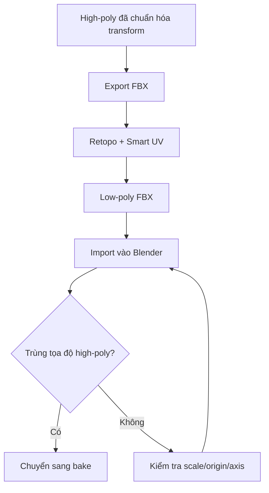

# Bài 06 — Retopology low-poly và UV mapping

> **Mục tiêu:** tạo bản low-poly dễ quản lý và UV có thể dùng để bake texture. **Nguồn:** 11:14–15:11.

## 1. High-poly, Decimate, Retopology khác gì?

| Kỹ thuật | Tác động | Mục đích |
|---|---|---|
| High-poly | Nhiều tam giác/chi tiết | Làm nguồn chi tiết |
| Decimate | Giảm số mặt tự động | Giảm tải nhanh |
| Retopology | Xây dựng bố cục lưới mới, ưu tiên quad | Phù hợp deformation, UV, bake |
| UV unwrap | Gán tọa độ 2D cho mặt 3D | Đưa texture lên mesh |

Video sử dụng **một công cụ 3D Studio/retopology dạng web**; bản phiên âm về địa chỉ dịch vụ không đủ chắc chắn để xác nhận tên miền. Chọn công cụ có chức năng nhập mesh, retopology quad và **Smart UV Unwrap** tương ứng.

## 2. Thực hành theo video

1. Import FBX của một bộ phận từ Blender.
2. Chọn mục tạo **low topology / low poly** từ **local model**.
3. Chọn mức mật độ thấp/vừa/cao theo vai trò nhân vật: video chọn **High** vì đây là nhân vật chính, không phải đạo cụ xa camera hay lặp rất nhiều lần.
4. Chọn kết quả dạng **quads**; chạy retopology.
5. Mở **wireframe** để quan sát vòng cạnh và mật độ mặt.
6. Sang tab **UV**, dùng **Smart UV Unwrap** (theo ví dụ video).
7. Xuất **FBX** và lặp cho các bộ phận.
8. Import FBX low-poly về Blender, đặt tên `LP_Head`, `LP_Torso`, v.v.; giữ nguyên transform để trùng với high-poly.

## 3. Tiêu chí chấp nhận

- Quad tương đối đều, không có mảng tam giác kỳ lạ ở vùng khớp cần biến dạng.
- Silhouette đủ gần high-poly ở camera dự định sử dụng.
- UV islands không vượt ngoài vùng map mục tiêu; khoảng trống đủ cho padding và mipmaps.
- Không có nhiều UV đảo chiều hoặc chồng không chủ ý.
- Low-poly nằm **đúng vị trí tương đối** so với high-poly.

Video mô tả ví dụ một mesh có xấp xỉ **13 nghìn mặt**; các con số đỉnh/mặt trong bản chép lời không hoàn toàn nhất quán nên chỉ mang tính minh họa, không dùng làm ngân sách polygon chuẩn.

## 4. Tại sao vị trí high/low quan trọng?

Nếu sai trục hoặc scale giữa hai mesh, normal map có thể bị bake từ sai vùng hình học.

## 5. Bài tập

Retopo hai bộ phận (ví dụ đầu và chân), chụp: (1) wireframe high-poly, (2) wireframe low-poly, (3) bố cục UV. Ghi tổng số mặt và đỉnh thực tế tại file Blender thay vì chép số ví dụ trong video.
