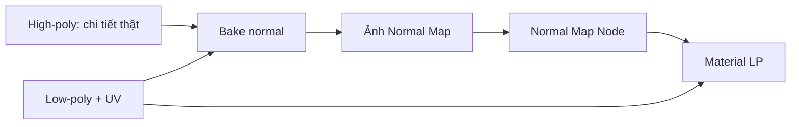

# Bài 07 — Chuyển chi tiết high-poly sang normal map

> **Mục tiêu:** đưa cảm giác gờ và rãnh từ hình học high-poly lên mesh low-poly qua normal map. **Nguồn:** 15:12–20:10.

## 1. Khái niệm cốt lõi

Normal map lưu thông tin **hướng pháp tuyến bề mặt** phục vụ chiếu sáng, **không tạo ra độ dày hình học thực**. Nhờ đó lưới game ít polygon vẫn có thể nhìn chi tiết như bản điêu khắc.



## 2. Chuẩn bị trong Blender

1. Tạo material cho mesh low-poly, vào **Shader Editor**.
2. Thêm **Image Texture** và tạo ảnh mới `Dino_Head_Normal`.
3. Chọn độ phân giải **2K hoặc 4K** như video minh họa, theo hiệu năng mục tiêu.
4. Đặt **Color Space = Non-Color** cho normal map.
5. Trước khi Bake, **chọn đúng Image Texture node** là nơi nhận ảnh bake.
6. Chuyển **Render Engine = Cycles**; CPU/GPU phụ thuộc hỗ trợ và tình trạng máy.

## 3. Nhánh thao tác trong video: Shrinkwrap + Multires

Video mô tả một cách dựa vào **Shrinkwrap Modifier** đưa low-poly bám bề mặt high-poly, tiếp theo là **Multiresolution**, tăng mức subdivide rồi dùng **Bake from Multires** để đưa chi tiết về ảnh. Cách này có thể phụ thuộc phiên bản Blender và thứ tự modifier; cần làm trên **bản sao** low-poly để không phá mesh gốc.

Thứ tự học:

1. Đối chiếu high-poly và low-poly của cùng bộ phận tại cùng vị trí.
2. Gắn Shrinkwrap lên bản sao low-poly, nhắm đúng high-poly.
3. Thêm Multires, tăng subdivisions vừa đủ để mô phỏng chi tiết high-poly.
4. Tùy phiên bản Blender và cấu hình bake, chọn phương thức `Bake from Multires` nếu có, đích là ảnh normal vừa tạo.
5. Hạ mức viewport về low level và kiểm tra model vẫn có độ chi tiết khi bật normal map.

**Lưu ý quan trọng:** lời thoại mô tả nhanh UI, nhưng chưa cung cấp một bộ thiết lập bake đầy đủ cho mọi phiên bản. **Không mặc định** rằng chỉ thêm Shrinkwrap và Multires là chắc chắn bake đúng. Kiểm tra bản xem trước sau mỗi bước.

## 4. Cách kiểm thử trong Shader Editor

Kết nối thông dụng:

```text
Image Texture [Non-Color] Color
          ↓
     Normal Map [Color]
          ↓
  Principled BSDF [Normal]
          ↓
    Material Output
```

Không cắm màu normal map thẳng vào Base Color để đánh giá độ nổi. Trong video có đoạn bật ảnh xem thử, nhưng kiểm thử shading thực sự phải dùng **Normal Map node → Principled BSDF / Normal**.

## 5. Triệu chứng lỗi và hướng kiểm tra

| Lỗi | Kiểm tra đầu tiên |
|---|---|
| Ảnh bake trống | Image Texture node có được active? UV tồn tại? |
| Shading bị lõm ngược | Hướng pháp tuyến/tangent và chuẩn normal map |
| Chi tiết nằm lệch | Transform high/low, shrinkwrap target, cage/bake settings |
| Nét bị vỡ ở UV seams | UV padding, hướng normal, độ phân giải texture |
| Normal quá nặng | 4K không cần thiết? Thử 2K và so sánh |

## 6. Thực hành mở rộng (không phải bước video khẳng định)

Nếu Multires không phù hợp, có thể nghiên cứu workflow **Selected to Active bake** trong Blender để bake từ high-poly sang low-poly sử dụng cage hoặc ray distance. Không áp dụng hai cách cùng lúc mà không xác định đầu vào/đầu ra.

## 7. Bài tập

Bake normal cho **đầu** và **đuôi**. Chụp low-poly trong hai trạng thái bật/tắt normal; xuất ảnh normal map, ghi ảnh thuộc UV set và bộ phận nào.
