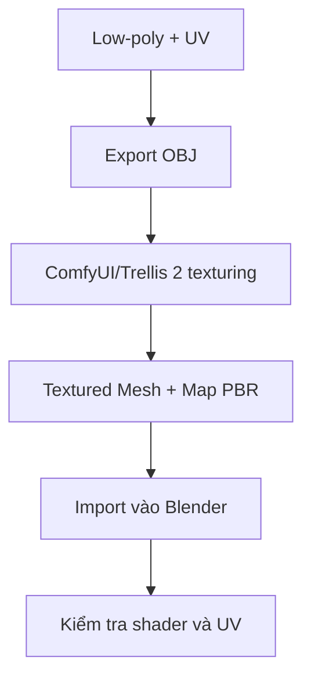

# Bài 08 — Tạo texture PBR với Trellis 2

> **Mục tiêu:** sinh bộ texture cho low-poly, tách đúng bản đồ màu, roughness, metallic. **Nguồn:** 20:11–22:40.

## 1. Vai trò của texture trong dự án

Normal map từ Bài 07 xử lý **chi tiết hình học**. Giai đoạn này bổ sung **thông tin bề mặt**: màu cơ bản (base color), độ nhám (roughness) và tính kim loại (metallic). Video dùng **ComfyUI + Trellis 2** cho quá trình tạo texture theo mesh, và nói có thể chọn một dịch vụ AI texture thay thế.

## 2. Chuẩn bị mesh

1. Giữ bản low-poly có UV đã hoàn thành.
2. Theo video, xuất một bản **OBJ** vì node texture trong workflow được tác giả sử dụng **không đọc FBX** ở chặng này. Đây là hạn chế của **workflow được minh họa**, không phải kết luận chung về tất cả Trellis 2.
3. Lưu một OBJ cho từng bộ phận (ví dụ `Dino_Tail_LP.obj`).
4. Mở ComfyUI với workflow texture bằng Trellis 2 đã cấu hình sẵn (video không đính kèm file workflow trong bản chép lời).
5. Nhập đúng đường dẫn OBJ vào node nạp mesh; chú ý cú pháp đường dẫn mà node yêu cầu.

## 3. Chạy workflow và kiểm tra xuất

- Chọn lưu **base color**, **roughness** và **metallic** nếu workflow tạo được.
- Chạy tạo texture, kiểm tra preview và thư mục output.
- Video nói kết quả gồm một **textured mesh** trong thư mục đầu ra; bản chép lời không đủ để khẳng định mọi map xuất ở dạng file rời hay packed cho mọi trường hợp.
- Lặp lại cho đầu, thân, tay/chân và đuôi.
- Khi import Blender, đối chiếu kích thước, origin, UV và tên material với low-poly trước khi copy map.

## 4. Các bản đồ PBR

| Map | Ý nghĩa | Color space khi đọc trong Blender |
|---|---|---|
| Base Color | Màu sắc không chiếu sáng | Thường sRGB |
| Roughness | Độ nhám bề mặt | Non-Color |
| Metallic | Phần bề mặt thể hiện như kim loại | Non-Color |
| Normal | Hướng pháp tuyến giả lập | Non-Color (qua Normal Map node) |

## 5. Lỗi cần tránh

- **Texture bị trượt:** low-poly và mesh texturing không cùng UV hoặc cùng object coordinates.
- **Màu quá sáng/tối:** kiểm tra Color Space, ánh sáng và base color.
- **Kim loại quá bóng:** roughness không chính xác hoặc metallic bị đọc sai kênh.
- **OBJ xuất sai bộ phận:** node đang đọc file cũ hoặc đường dẫn chưa cập nhật.

## 6. Bài tập

Tạo texture cho ít nhất một chân và một phần thân. Lưu toàn bộ output gốc, ảnh preview và danh sách những map được xuất thực tế. Viết 4–5 dòng phân biệt mục đích của normal và roughness.
