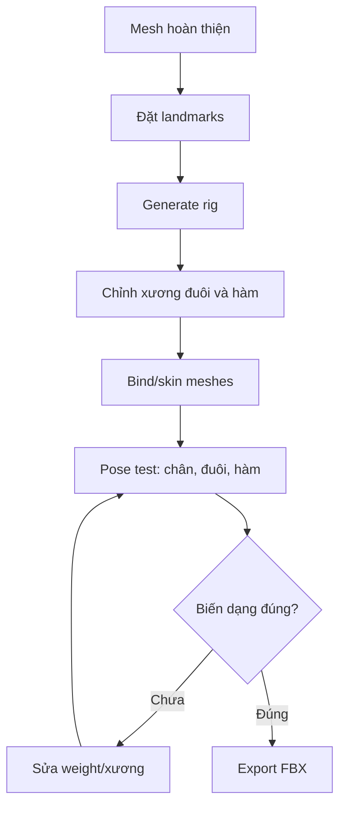

# Bài 10 — Tạo rig cho nhân vật khủng long máy

> **Mục tiêu:** tạo xương chính, đuôi, hàm; skin và kiểm tra pose trước khi xuất FBX. **Nguồn:** 24:35–32:52.

## 1. Tác giả dùng công cụ gì?

Video sử dụng **Auto-Rig Pro**, một add-on Blender được tác giả mô tả là **trả phí**, và một cách thiết lập tự động gợi ý vị trí xương. Công cụ này giúp giảm thao tác rig thủ công, nhưng **không loại bỏ yêu cầu kiểm tra vị trí khớp và weight**.

Một phương án khác được nhắc đến là chuyển trực tiếp tới **Mixamo**, tuy nhiên ví dụ chính vẫn rig và skin trong Blender trước.

## 2. Chuẩn bị

- Đảm bảo mesh đã có hai chân/tay, đầu, thân, đuôi, hàm cần chuyển động.
- Lưu bản checkpoint `Dino_preRig.blend`.
- Kiểm tra scale/rotation và các modifier cần áp dụng/giữ theo yêu cầu xuất.
- Trong góc nhìn trước, chọn các mesh chính; video chọn thiết lập body rig mà không bật đầy đủ facial rig.

## 3. Sinh xương và điều chỉnh dấu mốc

1. Mở Auto-Rig Pro, vào chế độ thiết lập thông minh mà phiên bản của bạn cung cấp.
2. Đánh dấu nhân vật **đối xứng** nếu phù hợp; dùng chức năng tự dự đoán landmarks nếu có.
3. **Sửa thủ công các landmarks** bị đặt sai, đặc biệt ở tay, chân và khớp lệch.
4. Tạo rig và quan sát xương trong góc trước, bên.
5. Tinh chỉnh vị trí các khớp chân; video đề cập có thể thêm **twist bones/segment** tùy nhu cầu.
6. Đuôi: thêm một chuỗi xương; tác giả cân nhắc 6 rồi 4, 8 đốt ở các đoạn khác nhau. Hãy chọn số đốt vừa đủ độ uốn của **mẫu thực tế**, không xem đây là con số cố định.
7. Hàm: thêm nhóm xương điều khiển miệng dưới và phần trên cần thiết, giữ hệ facial tối giản cho nhân vật cơ khí.

## 4. Từ skeleton tới skinning

Video chọn một phương pháp skinning được phiên âm là **voxelize**, bật bảo toàn thể tích và chạy bind. Tên menu/các tùy chọn có thể khác theo phiên bản; hãy nhìn trực tiếp giao diện Auto-Rig Pro thay vì giả định chính xác theo bản chép lời.

## 5. Test pose tối thiểu

- **Chân:** nhấc và gập từng chân; mắt cá/khớp gối không kéo méo thân.
- **Đuôi:** uốn đoạn đầu và đuôi cuối; bề mặt không rách hay bị vặn xoắn đột ngột.
- **Hàm:** mở/đóng miệng, phần hàm còn neo hợp lý.
- **Thân:** kiểm tra vùng vai/hông khi xoay thân hoặc chân.

## 6. Xuất FBX

Theo video, vào tùy chọn export FBX của Auto-Rig Pro, chọn profile **Humanoid** và **Unreal Engine** thích hợp; tác giả có một lần **quên bật Unreal Engine** rồi làm lại. Khi export, không chỉ kiểm tra file sinh ra mà còn **nhập thử** để xác nhận hierarchy xương mong muốn và độ tương thích.

**Cảnh báo:** tùy chọn Humanoid không bảo đảm mọi rig khủng long có đuôi/hàm sẽ được ánh xạ đầy đủ khi retarget. Những xương phụ có thể cần giữ hoặc cấu hình riêng.

## 7. Bài tập

Nộp `Dino_Rigged.blend`, `Dino_Rigged_Unreal.fbx` và 3 ảnh pose (chân, đuôi, hàm), cộng ghi chú các vùng đã weight-paint lại.
