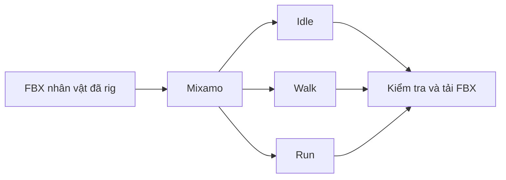

# Bài 11 — Tạo các animation Idle, Walk, Run

> **Mục tiêu:** chuẩn bị bộ animation cơ bản và kiểm tra tính tương thích với nhân vật. **Nguồn:** 32:53–34:03.

## 1. Mục tiêu chuyển động

Video dùng **Mixamo** để tìm các chuyển động có sẵn và xem trước trực tiếp trên nhân vật. Ba animation được nhắc đến:

| Animation | Mục đích | Cần kiểm tra |
|---|---|---|
| Idle | Đứng chờ | Chân không trôi vị trí |
| Walk | Di chuyển chậm | Chu kỳ bước đều |
| Run | Di chuyển nhanh | Chân không xuyên sàn, thân không lắc quá mức |

## 2. Các bước

1. Upload nhân vật đã rig/xuất tương thích vào Mixamo theo định dạng mà phiên bản dịch vụ chấp nhận.
2. Tìm `walking`, chọn và xem nhân vật có chuyển động đúng không.
3. Điều chỉnh các tham số hoạt hình có sẵn nếu cần.
4. Download dưới dạng **FBX**, ví dụ video sử dụng **With Skin**, **30 FPS**.
5. Lặp cho `running` và `idle`; đặt tên file rõ để không nhầm clip.
6. Lưu cả rig gốc Blender và các file animation do Mixamo xuất.

**Giới hạn cần biết:** Mixamo chủ yếu sử dụng hệ skeleton humanoid. Video biểu diễn nhân vật khủng long cơ khí trong một rig phù hợp; **không bảo đảm** đuôi/hàm tùy biến cũng sẽ tự animate. Những xương phụ có thể cần animation riêng trong Blender/Unreal.

## 3. Tiêu chí đạt

- Không bị đảo hướng nhân vật khi chạy animation.
- Không bị kéo giãn chân/tay bất thường.
- Với clip đi/chạy, hiểu clip có **root motion** hay **in-place** để cấu hình di chuyển trong game cho đúng.
- Tên ba tệp không trùng nhau và dễ liên kết với nhân vật.

## 4. Bài tập

Lưu ba clip `Dino_Idle.fbx`, `Dino_Walk.fbx`, `Dino_Run.fbx` ở thư mục `07_rig_animation`; ghi chú một lỗi chuyển động và cách khắc phục thử nghiệm. Trả lời: vì sao không thể mặc định nhân vật sẽ có animation đuôi chỉ vì file FBX có xương đuôi?
